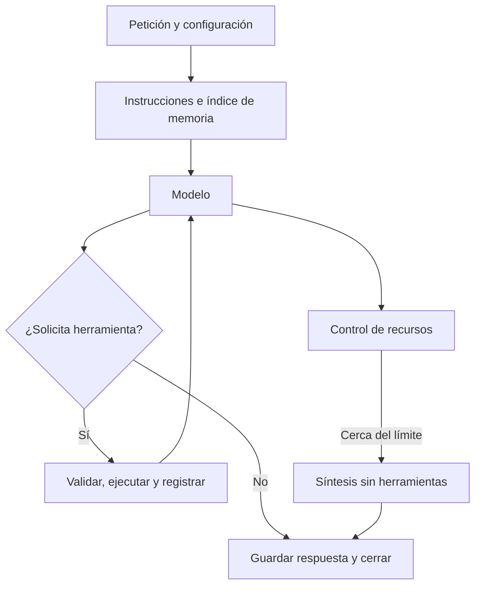

# Arquitectura implementada

> Estado: contraste estático con el código del proyecto externo. Revisión: 2026-10-16.
> Autoridad: `src/research_agent/`, schemas registrados y biblioteca compartida instalada.

## Frontera y estructura

```text
research_agent/
  pyproject.toml          distribución y comando research-agent
  src/research_agent/    ciclo, archivos, registro e integraciones
    prompts/             instrucciones Markdown instalables
    integrations/        funciones de Findata, Tavily, archivos y cálculo
  scenarios/             estímulos y checks de experimentos
  tests/                 verificación controlada y frontera de imports
  docs/                  referencias de arquitectura, investigación y desarrollo
  artifacts/             datos locales ignorados, separados del código
```

El núcleo no importa `finmate`, `engine` o `api`; la prueba en subprocess bloquea
su carga durante ejecución de A y Audit. No utiliza el backend del producto. Las
bibliotecas compartidas se instalan desde wheel; sus fuentes siguen en FinMate.
El [mapa de dependencias](dependencies.md) explica instalación y configuración.

## Componentes y contratos

| Componente | Responsabilidad y autoridad |
|---|---|
| [AgentA](../src/research_agent/agent.py) | Conversación, ciclo, presupuestos e historial del proveedor |
| [ToolRegistry](../src/research_agent/tools.py) | Catálogo, schema de argumentos, ejecución y resultados |
| [Workspace](../src/research_agent/workspace.py) | Acceso acotado a archivos del agente |
| [RunRecorder](../src/research_agent/recording.py) | Manifest, eventos, transcript y artefactos recuperables |
| [FindataTools](../src/research_agent/integrations/findata_tools.py) | Adaptación financiera con sesiones breves de solo lectura |
| [build_agent](../src/research_agent/bootstrap.py) | Componer modelo, herramientas, workspace y captura de configuración |
| [capture_traces](../src/research_agent/tracing.py) | Captura local de logs y payloads de los adaptadores compartidos |

[AgentRequest](../src/research_agent/contracts.py) contiene mensaje, identidad del workspace,
conversación, instrucciones y metadatos. `AgentLimits` controla recursos.
`AgentResult` devuelve identidad, respuesta opcional, estado operativo, motivo de
cierre, contadores, error seguro y referencias. Ninguno es una entidad financiera.

`ConversationClient` y los mensajes proceden de `runtime_contracts`. Se conserva el
replay, incluidos elementos opacos del proveedor; no se aplana a simples textos.

## Flujo de una intervención



El modelo elige investigación y terminación; no hay planificador o crítico separados.
Cada respuesta puede solicitar una herramienta, conforme al contrato actual del cliente.
Se añade su resultado al historial y se vuelve a llamar. Errores de herramienta se
devuelven de forma segura cuando es posible; una dependencia fallida no cuenta como
evidencia obtenida. Fallos operativos, timeout y cancelación conservan resultados parciales.

`completed` significa que se obtuvo una respuesta, aunque sea limitada por presupuesto.
No significa suficiencia financiera. Otros estados son `interrupted`, `failed` y
`cancelled`; el motivo de terminación se conserva separado. No hay publicación de tesis.

## Herramientas y validaciones

| Grupo | Herramientas |
|---|---|
| Findata | `search_companies`, `read_company`, `read_financials`, `read_metric_trend` |
| Tavily | `search_web`, `read_document` |
| Workspace | `list_files`, `read_file`, `search_files`, `write_markdown` |
| Evidencia y cálculo | `read_artifact`, `calculate` |

Findata conserva metadatos y ausencias; exige PostgreSQL, transacción de solo lectura
y timeout por sentencia. No ingiere ni escribe. Buscar fuentes no equivale a leerlas:
Tavily conserva contenido extraído, fragmentos y procedencia, posiblemente parciales.

La calculadora ejecuta aritmética y registra entradas, fórmula y referencias.
No valida que la referencia respalde los números ni que sean comparables. La existencia
de citas, una llamada exitosa o un resultado numérico no certifica la inferencia económica.
No hay SQL libre, shell, Python arbitrario o DCF.

Las escrituras solo admiten Markdown dentro del workspace. Se rechazan escapes,
streams de Windows, enlaces y junctions. Workspace, archivo de ejecuciones e instrucciones
deben estar separados. Estos controles no son un sandbox contra procesos externos
que modifiquen simultáneamente el sistema de archivos.

## Tres clases de estado

1. **Historial de conversación:** en memoria de la instancia de A; incorpora llamadas,
   resultados y continuaciones. Una instancia pertenece a una conversación.
2. **Memoria persistente:** archivos Markdown del workspace, editables por el agente.
   Se carga automáticamente solo `memory/index.md`; el resto se consulta bajo demanda.
3. **Archivo experimental:** evidencia del sistema fuera del workspace; el agente puede
   consultar artefactos por referencia, pero no editar los registros con sus herramientas.

La CLI crea una instancia por invocación. Repetir `--conversation` no restaura un chat
de otro proceso: la continuidad entre procesos procede de los Markdown. Audit conserva
la instancia entre mensajes de un escenario; otros escenarios tienen workspaces aislados.
No existe un gestor autónomo de recuerdos, embeddings o compactación.

El archivo incluye `manifest.json`, `transcript.json`, `events.jsonl`, `result.json`,
respuesta Markdown si existe, resultados y snapshots inicial/final. Los artefactos se
identifican por hash y se verifican al leer. Los de ejecuciones anteriores pueden
recuperarse desde el mismo archivo si coincide el fingerprint del workspace. Este
fingerprint depende de su ruta absoluta: mover memorias y archivos históricos requiere
revisar esa recuperación, aunque los Markdown sigan siendo legibles.

## Recursos y trazabilidad

Defaults en `AgentLimits`, por intervención y no por campaña:

| Recurso | Límite |
|---|---|
| Llamadas lógicas al cliente | 18 |
| Herramientas | 30 |
| Tiempo | 300 segundos |
| Reserva para cierre | Una llamada y ventana de 45 segundos |
| Contexto serializado | 256 KiB; no es una medida en tokens |
| Índice de memoria automático | 8 KiB, con continuación explícita si falta contenido |
| Lectura de archivo o artefacto | Hasta 32 KiB, offsets en bytes |

Los resultados grandes de herramientas se guardan completos y se leen por páginas.
Al acercarse al presupuesto se pide una síntesis con herramientas deshabilitadas.
Si el contexto ya excede el límite, puede registrarse interrupción sin llamar otra vez.
No se oculta ese límite mediante recortes silenciosos. Las políticas de red del cliente
son compartidas; un reintento de transporte no es una nueva decisión del agente.

Se correlacionan conversación, intervención, ejecución y llamada lógica. Los eventos
`engine.llm`, `engine.llm_call` y `engine.llm_attempt` conservan su nombre histórico;
no implican importar Engine. `lab.*` registra acciones del agente. OpenTelemetry sigue
instalado, pero el laboratorio no configura exportadores. La captura usa configuración
global temporal: las campañas se ejecutan secuencialmente dentro de un proceso.

## Especialización y límites actuales

La [CLI](../src/research_agent/cli.py) y Audit añaden
[guía financiera básica](../src/research_agent/prompts/financial_research.md) al
[prompt general](../src/research_agent/prompts/agent_a.md). `--instructions` añade texto;
no sustituye esos prompts. `AGENTS.md` guía al desarrollador y no se carga automáticamente
como prompt del agente. La matriz A0–A3 requiere cambios experimentales aún no implementados.

No hay expediente con schema obligatorio, grafo argumentativo, estados de postura,
valoración DCF, cartera, aprendizaje persistente o vigilancia proactiva. La disposición
`cases/<empresa>/` es una [propuesta de experimento](experiments.md), no un contrato vigente.
