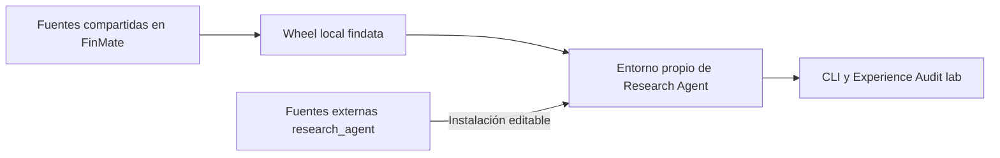

# Dependencias de FinMate

> Estado: organización e instalación contrastadas el 2026-10-16.

## Una distribución puede contener varios paquetes

Una carpeta importable de Python y una distribución instalable no son lo mismo.
Hoy existen dos distribuciones relevantes:

| Distribución | Declaración | Paquetes que aporta |
|---|---|---|
| `research-agent==0.1.0` | [pyproject local](../pyproject.toml) | `research_agent` |
| `findata==0.1.0` | [pyproject de FinMate](../../FinMate/pyproject.toml) | `findata`, `infra`, `runtime_contracts`, `experience_audit`, módulos de observabilidad y otros paquetes del producto |

Por tanto, no instalamos tres distribuciones independientes llamadas Findata,
Infra y Experience Audit. Se instalan juntas desde la distribución compartida cuyo
nombre actual es `findata`. Que el wheel incluya código del producto no autoriza
a cargarlo: los tests de frontera rechazan `finmate`, `engine` y `api`.



## Qué se reutiliza

| Biblioteca | Uso en A | Frontera |
|---|---|---|
| Findata | Empresas, observaciones y tendencias v2 | PostgreSQL de solo lectura; sin ingesta o creación de tablas |
| Infra | `LLMFactory`, perfil, clientes, replay, reintentos, búsqueda y extracción Tavily | Sin fallback entre modelos añadido por el laboratorio |
| runtime_contracts | Mensajes, herramientas, continuaciones, errores, documentos y contexto técnico | Sin entidades, ORM o SDKs del producto |
| Observabilidad | Correlación y captura local de logs/payloads | Nombres históricos `engine.llm*`; sin exportador configurado aquí |
| Experience Audit | Escenarios `lab-v1`, ejecución, Archive, consulta e informes | Importa Research Agent para ejecutarlo; Research Agent no importa Audit |

Engine mantiene reexportaciones de contratos por compatibilidad con sus consumidores.
El agente importa las definiciones canónicas de `runtime_contracts`; no necesita cargar
Engine. Véase la [decisión compartida](../../FinMate/docs/architecture/decisions/0004-shared-runtime-contracts.md).

## Editable frente a wheel

Ambos modos requieren un proyecto instalable. Editable enlaza los imports con las
fuentes de ese proyecto: un cambio local de código se ve en la siguiente ejecución.
Una instalación normal copia el contenido construido al entorno; editar las fuentes
de FinMate no modifica esa copia. Cambiar metadatos o dependencias del proyecto editable
puede requerir reinstalarlo.

El entorno actual usa Research Agent editable y el wheel compartido no editable.
Así se desarrolla A sin seguir automáticamente cada cambio de FinMate. Esto congela
código instalado, no datos de PostgreSQL, resultados web, modelos remotos ni configuración.
Tampoco aísla modificaciones manuales del entorno.

## Recrear el entorno

Desde la raíz del proyecto, con Python >=3.11; el corte anterior se verificó con 3.12:

```powershell
py -3.12 -m venv .venv
# Primero obtener el wheel local construido desde las fuentes de FinMate.
.\.venv\Scripts\python.exe -m pip install -c constraints.txt "RUTA_LOCAL\findata-0.1.0-py3-none-any.whl"
.\.venv\Scripts\python.exe -m pip install -c constraints.txt -e .
.\.venv\Scripts\python.exe -m pip install -c constraints.txt pytest mypy types-PyYAML types-jsonschema
.\.venv\Scripts\python.exe -m pip check
Copy-Item .env.example .env
```

El último paso solo corresponde a una instalación nueva sin `.env`; completar sus
valores localmente. No sobrescribir una configuración existente. No buscar un paquete
homónimo en un índice público como sustituto del wheel de este repositorio.

`constraints.txt` conserva versiones del corte de extracción: limita la resolución,
no instala todo su contenido ni es un lock con hashes. El wheel inicial quedó en
`../FinMate/artifacts/experience-audit-validation/relocation-2026-10-16/wheels/`;
es evidencia local ignorada y puede no existir en otra máquina. Para trasladar el proyecto,
conservar también el wheel aprobado o reconstruirlo desde la revisión correspondiente.

## Configuración y servicios

La [plantilla](../.env.example) declara las variables mínimas. La composición usa
la configuración compartida del planificador (`LLM_PLANNER_PROVIDER`,
`LLM_PLANNER_MODEL` y ajustes asociados) con un perfil explícito llamado `lab`.
Las claves de proveedor y `TAVILY_API_KEY` se mantienen fuera de Git.

`DATABASE_URL` debe apuntar a PostgreSQL con datos ya disponibles. El esquema de URL
elige el controlador: `postgresql+psycopg` necesita psycopg 3; `postgresql` utiliza
normalmente psycopg2 con SQLAlchemy. SQLite no sustituye las lecturas v2. Usar además
credenciales de lectura cuando estén disponibles; A abre transacciones de solo lectura.

Se conserva OpenTelemetry por compatibilidad de dependencias. No es necesario configurar
un exportador para producir los registros locales. La instalación amplia del wheel puede
incluir dependencias del producto, pero las campañas `lab` no necesitan sus servicios,
usuarios, navegador ni instalar binarios de Playwright.

Las rutas de workspace y archivo son explícitas. Los prompts incluidos son recursos
del paquete; no se localizan buscando el checkout padre. Para ejecutar desde otra
carpeta, proporcionar configuración disponible allí o variables de entorno: no asumir
que se descubrirá automáticamente el `.env` de este proyecto.

## Evolucionar una biblioteca compartida

1. Determinar el contrato y los consumidores afectados en FinMate. Cambiar allí la
   biblioteca, con sus pruebas; no editar `site-packages` o copiarla al agente.
2. Construir un wheel nuevo y conservar revisión de origen y SHA-256.
3. Actualizar deliberadamente el entorno del agente y ejecutar sus verificaciones.
4. Registrar la actualización y cualquier cambio experimental; conservar el wheel anterior.

Ejemplo desde Research Agent, con las dependencias de construcción instaladas:

```powershell
.\.venv\Scripts\python.exe -m pip wheel ..\FinMate --no-deps --no-build-isolation --wheel-dir artifacts/wheels
Get-FileHash artifacts/wheels/findata-0.1.0-py3-none-any.whl -Algorithm SHA256
.\.venv\Scripts\python.exe -m pip install --force-reinstall --no-deps artifacts/wheels/findata-0.1.0-py3-none-any.whl
.\.venv\Scripts\python.exe -m pip check
```

`--no-deps` presupone un entorno compatible; si cambian los requisitos, resolverlos
explícitamente antes de aceptar la actualización. El mismo número `0.1.0` puede ocultar
código distinto: registrar hash del wheel y revisión, no solo la versión. No reinstalar
silenciosamente durante una comparación experimental.

Extraer Findata o Audit como distribuciones independientes sigue siendo una decisión
futura. Puede hacerse si su evolución lo justifica; no es requisito del agente actual.
Las referencias documentales entre carpetas hermanas no son dependencias de ejecución.
