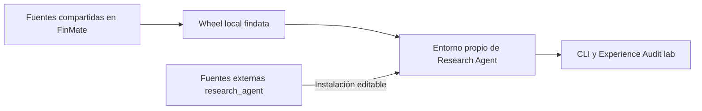

# Desarrollo y operación

> Operación y dependencias del proyecto externo. Revisión: 2026-10-18.
> Los detalles del wheel corresponden al corte del 2026-10-16; verificar el entorno efectivo.

## Dependencias y frontera de instalación

Una distribución instalable puede aportar varios paquetes importables:

| Distribución | Declaración | Paquetes que aporta |
|---|---|---|
| `research-agent==0.1.0` | [pyproject local](../pyproject.toml) | `research_agent` |
| `findata==0.1.0` | [pyproject de FinMate](../../FinMate/pyproject.toml) | `findata`, `infra`, `runtime_contracts`, `experience_audit`, módulos de observabilidad y otros paquetes del producto |

Findata, Infra y Experience Audit se instalan juntas desde el wheel local `findata`.
Que incluya código del producto no autoriza a cargarlo: los tests de frontera rechazan
`finmate`, `engine` y `api`.



### Bibliotecas reutilizadas

| Biblioteca | Uso en A | Frontera |
|---|---|---|
| Findata | Empresas, observaciones y tendencias v2 | PostgreSQL de solo lectura; sin ingesta o creación de tablas |
| Infra | `LLMFactory`, perfil, clientes, replay, reintentos, búsqueda y extracción Tavily | Sin fallback entre modelos añadido por el laboratorio |
| runtime_contracts | Mensajes, herramientas, continuaciones, errores, documentos y contexto técnico | Sin entidades, ORM o SDKs del producto |
| Observabilidad | Correlación y captura local de logs/payloads | Nombres históricos `engine.llm*`; sin exportador configurado aquí |
| Experience Audit | Escenarios `lab-v1`, ejecución, Archive, consulta e informes | Importa Research Agent para ejecutarlo; Research Agent no importa Audit |

Engine mantiene reexportaciones de contratos por compatibilidad con sus consumidores.
El agente importa las definiciones canónicas de `runtime_contracts`; no necesita cargar
Engine. Véase la [decisión compartida](../../FinMate/docs/architecture/decisions/0004-shared-runtime-contracts.md).

### Editable frente a wheel

En el corte de extracción, Research Agent se instaló editable: los imports siguen
sus fuentes y los cambios de código se ven en la siguiente ejecución. Cambiar sus
metadatos o dependencias puede requerir reinstalarlo. El wheel compartido se instaló
como copia: editar FinMate no cambia esa instalación. Esto fija código, no datos,
web, modelos remotos o configuración; verificar el entorno antes de comparar.

## Instalación

Desde la raíz del proyecto, con Python >=3.11; el corte anterior se verificó con 3.12:

```powershell
py -3.12 -m venv .venv
# Primero obtener el wheel local construido desde las fuentes de FinMate.
.\.venv\Scripts\python.exe -m pip install -c constraints.txt "RUTA_LOCAL\findata-0.1.0-py3-none-any.whl"
.\.venv\Scripts\python.exe -m pip install -c constraints.txt -e .
.\.venv\Scripts\python.exe -m pip install -c constraints.txt pytest mypy types-PyYAML types-jsonschema
.\.venv\Scripts\python.exe -m pip check
```

Crear `.env` con la configuración indicada abajo solo si no existe. No sobrescribir
una configuración existente ni sustituir el wheel por un homónimo de un índice público.

`constraints.txt` conserva versiones del corte de extracción: limita la resolución,
no instala todo su contenido ni es un lock con hashes. El wheel inicial quedó en
`../FinMate/artifacts/experience-audit-validation/relocation-2026-10-16/wheels/`;
es evidencia local ignorada y puede no existir en otra máquina. Para trasladar el proyecto,
conservar también el wheel aprobado o reconstruirlo desde la revisión correspondiente.

## Configuración y servicios

La composición usa la configuración compartida del planificador (`LLM_PLANNER_PROVIDER`,
`LLM_PLANNER_MODEL` y ajustes asociados) con un perfil explícito llamado `lab`.
Las claves de proveedor y `TAVILY_API_KEY` se mantienen fuera de Git.

`LLM_PLANNER_MAX_OUTPUT_TOKENS` limita la salida por llamada, incluidos los argumentos
de escritura. La configuración local se amplió de 4000 a 16000 el 2026-10-21 tras un
`LLMTruncated` en ASML S1-04; se verificó el perfil efectivo sin llamar al proveedor.
Se ajusta en `.env` y se aplica al iniciar procesos nuevos. El máximo del archivo de
estado sigue siendo 128 KiB; no era el límite que provocó ese fallo.

`DATABASE_URL` debe apuntar a PostgreSQL con datos ya disponibles. El esquema de URL
elige el controlador: `postgresql+psycopg` necesita psycopg 3; `postgresql` utiliza
normalmente psycopg2 con SQLAlchemy. SQLite no sustituye las lecturas v2. Usar además
credenciales de lectura cuando estén disponibles; A abre transacciones de solo lectura.

Se conserva OpenTelemetry por compatibilidad de dependencias. No es necesario configurar
un exportador para producir los registros locales. La instalación amplia del wheel puede
incluir dependencias del producto, pero las campañas `lab` no necesitan sus servicios,
usuarios, navegador ni instalar binarios de Playwright.

La CLI deriva las rutas de estado y ejecuciones de `--experiment`; la interfaz
básica usada por Audit recibe workspace y archivo explícitamente. Los prompts incluidos son recursos
del paquete; no se localizan buscando el checkout padre. Para ejecutar desde otra
carpeta, proporcionar configuración disponible allí o variables de entorno: no asumir
que se descubrirá automáticamente el `.env` de este proyecto.

## Actualizar una biblioteca compartida

1. Determinar el contrato y los consumidores afectados en FinMate. Cambiar allí la
   biblioteca, con sus pruebas; no editar `site-packages` o copiarla al agente.
2. Construir un wheel nuevo y conservar revisión de origen y SHA-256.
3. Actualizar deliberadamente el entorno del agente y ejecutar sus verificaciones.
4. Registrar la actualización y cualquier cambio experimental; conservar el wheel anterior.

Ejemplo desde Research Agent, con las dependencias de construcción instaladas:

```powershell
.\.venv\Scripts\python.exe -m pip wheel ..\FinMate --no-deps --no-build-isolation --wheel-dir artifacts/wheels
Get-FileHash artifacts/wheels/findata-0.1.0-py3-none-any.whl -Algorithm SHA256
.\.venv\Scripts\python.exe -m pip install --force-reinstall --no-deps artifacts/wheels/findata-0.1.0-py3-none-any.whl
.\.venv\Scripts\python.exe -m pip check
```

`--no-deps` presupone un entorno compatible; si cambian los requisitos, resolverlos
explícitamente antes de aceptar la actualización. El mismo número `0.1.0` puede ocultar
código distinto: registrar hash del wheel y revisión, no solo la versión. No reinstalar
silenciosamente durante una comparación experimental.

Extraer Findata o Audit como distribuciones independientes sigue siendo una decisión
futura. Puede hacerse si su evolución lo justifica; no es requisito del agente actual.
Las referencias documentales entre carpetas hermanas no son dependencias de ejecución.

## Ejecutar A: nuevo experimento o continuación

La CLI exige una operación explícita y un nombre humano:

```powershell
.\.venv\Scripts\python.exe -m research_agent "Investiga NVIDIA" --experiment ./artifacts/nvidia-conservacion --new --run-name investigacion-inicial
.\.venv\Scripts\python.exe -m research_agent "Continúa desde lo conservado" --experiment ./artifacts/nvidia-conservacion --continue --run-name revision-documental
```

`--new` rechaza cualquier ruta existente. `--continue` exige `estado/`, `instrucciones/`
y `ejecuciones/`, preserva archivos y arranca otro proceso sin recuperar el chat anterior.
Otra ruta con `--new` inicia una prueba independiente. No hay copia de estados en esta versión.
Las colisiones de nombres de run reciben sufijo consecutivo. Solo un run por experimento
puede estar activo; no borrar `.run.lock` para resolver contención.

Las instrucciones iniciales se copian de los recursos instalados. `--instructions archivo.md`
puede repetirse únicamente con `--new`; luego editar explícitamente los Markdown de
`instrucciones/`. Los manifiestos registran el contenido efectivo de cada run, por lo que
cambiar instrucciones entre continuaciones es visible y altera la condición experimental.
La evolución M1 + M2 del 2026-10-21 está integrada en `prompts/agent_a.md`: se copia al crear
experimentos nuevos y se usa directamente en la interfaz básica. No sustituye las copias
de experimentos existentes. Para adoptarla en una continuación, actualizar explícitamente
su `instrucciones/agente.md` desde el prompt vigente, conservando las personalizaciones
que correspondan y la versión anterior en Git; no sobrescribir capturas históricas.
`--conversation` conserva correlación; no restaura memoria de proceso.
`--timeout-seconds` ajusta el límite temporal. Las demás reservas están en
[arquitectura](architecture.md#conservación-y-cierre-de-la-investigación).

La CLI imprime respuesta, `run_id` técnico y resumen `state`. Retorna 0 si hay respuesta
(`completed`), 1 para otros resultados operativos y 2 para entradas inválidas. Revisar
`resultado.json`, motivo de cierre y `state.capture_errors`, no solo el código de salida.
`respuesta.md` es la entrega; `estado/` contiene lo recuperable para continuar.
No se permite al agente editar materiales originales, instrucciones ni archivo de runs.

Los argumentos antiguos `--workspace`, `--runs`, `--knowledge-mode` y `--case-store`
se rechazan con la nueva sintaxis. No apuntar la CLI nueva a E001/E002 para convertirlos:
sus capturas y fuentes congeladas son históricas y permanecen intactas.

### Versionar el estado manualmente

El sistema no inicializa ni modifica Git. Opcionalmente, crear un repositorio propio
para el experimento; los comandos siguientes los ejecuta la persona cuando proceda:

```powershell
git -C ./artifacts/nvidia-conservacion init
git -C ./artifacts/nvidia-conservacion add estado instrucciones .gitignore
git -C ./artifacts/nvidia-conservacion commit -m "Conservar estado de la investigacion"
```

El `.gitignore` inicial excluye `ejecuciones/`, `.run.lock` y archivos `.env`.
Revisar los datos antes de añadirlos. Este repositorio de datos es distinto del Git
del código y no tiene remoto configurado por el sistema. Los runs registran commit y
cambios pendientes al inicio/final, sin atribuirse el repositorio padre. No tener Git
es válido. Git manual conserva solo versiones que se hayan registrado; los snapshots
del run conservan sus extremos, sin prometer todas las ediciones intermedias.

## Benchmark piloto

El catálogo piloto es histórico y ya no está en el árbol. Los ejemplos siguientes
utilizan `longitudinal-v1`, disponible con tres casos y 18 sesiones. Para el prototipo
controlado v2, seguir [preparación argumentativa](#preparación-argumentativa-experimental).

Desde la raíz del repositorio:

```powershell
.\.venv\Scripts\python.exe -m research_agent.benchmark validate benchmarks/longitudinal-v1
.\.venv\Scripts\python.exe -m research_agent.benchmark run benchmarks/longitudinal-v1 --output artifacts/benchmark
.\.venv\Scripts\python.exe -m research_agent.benchmark run benchmarks/longitudinal-v1 --case S2 --output artifacts/benchmark
```

`validate` no construye clientes ni consulta servicios. `run` llama al agente real y
requiere la configuración de proveedor, Findata y Tavily habitual; no realiza ingestas
ni migraciones. Ejecuta una sesión por subprocess, en secuencia, conservando archivos
sin restaurar el chat. Los límites son los actuales de A. No modifica prompts,
Experience Audit ni el wheel instalado. El [protocolo](experiments/benchmark-pilot-v1/protocol.md)
posee definiciones, rúbricas y límites de interpretación.

Cada invocación crea una carpeta de campaña nueva bajo `--output` e imprime su ruta.
`--case` elige un ID exacto; sin filtro, el orden es B1, E2, F3 y G2. No hay resume ni
reintentos automáticos de sesiones. Una sesión fallida o con captura incompleta bloquea
las siguientes de su caso; los otros casos continúan. Ctrl+C conserva lo disponible.
Retornos: 0 = todas las sesiones completadas con captura íntegra; 1 = fallo operativo,
interrupción o captura incompleta; 2 = argumentos/definiciones inválidos. No son notas
de calidad financiera.

Consultar primero `LEEME.md` y `resumen.json`, que incluye los metadatos de cada sesión
y apunta a `casos/ID/ejecuciones/`. Al cerrar la campaña se consolida la captura nativa,
sin cambiar el agente. Cada sesión completa contiene cinco archivos: `ejecucion.json`
(petición, configuración, resultado y hashes), `trayectoria.jsonl.gz`, `respuesta.md`
y los dos snapshots. Las instrucciones efectivas se congelan por hash bajo
`definiciones/instrucciones/`; fuentes y rúbricas también permanecen fuera del estado.
La revisión de calidad sigue siendo humana/Codex, con criterios y citas de evidencia;
el índice no inventa puntuaciones ni explicaciones de acciones.

La trayectoria reúne eventos, entradas/salidas del modelo y ejecuciones de herramientas.
Conserva separadamente el resultado original y el entregado al modelo, aunque pueda
reconstruir ambos desde un único contenido. Los snapshots conservan texto del conocimiento
y referencias verificadas a materiales. Las citas históricas de resultados siguen
disponibles mediante `read_artifact`; no apuntan necesariamente a archivos individuales.
No se guarda conversación, stdout correcto ni errores vacíos como copias adicionales.
Si hay captura incompleta, se retienen los originales nativos y diagnósticos.

Para exportar una campaña anterior a otra carpeta, conservando el origen intacto:

```powershell
.\.venv\Scripts\python.exe -m research_agent.benchmark compact artifacts/benchmark/ID --output artifacts/benchmark-compact/ID
```

El destino debe ser nuevo y separado del origen. La conversión verifica reconstrucción
de resultados de herramientas y snapshots antes de retirar copias en el destino. No
consulta proveedores. `recording_format` identifica cada sesión; capturas antiguas y
compactas son consultables por el mismo extractor.

Para regenerar la vista breve sin ejecutar el agente:

```powershell
.\.venv\Scripts\python.exe -m research_agent.benchmark extract RUTA_DE_CAMPAÑA
```

`pasos.jsonl` incluye caso, sesión, run, acción, identificadores disponibles, fragmentos
breves y referencias al original. No estima razonamiento privado ni puntúa respuestas.
En formato compacto una herramienta y su resultado comparten un registro `tool_execution`;
`line` identifica la secuencia descomprimida de `trayectoria.jsonl.gz`.
`extraccion.json` informa de capturas ausentes o dañadas al regenerar, sin modificar
los registros originales de sesión.
Los campos desconocidos permanecen nulos; los hashes detectan modificaciones de las
entradas publicadas. No hay Excel ni evaluación automática en esta versión.
`artifacts/` es local e ignorado; conservar el archivo completo para revisar o trasladar
evidencia, previa revisión de datos privados.

Para inspección detallada desde Python, las funciones públicas del módulo
`research_agent.benchmark_archive` son `records(run)`, `full_result(campaign, record)`,
`delivered_result(campaign, record)` y `restore_snapshot(campaign, snapshot)`.
Las dos últimas reconstruyen lo efectivamente entregado y el estado histórico, sin
inferencias. Las referencias a materiales e instrucciones comprueban sus hashes.

## Campañas nativas de Experience Audit

Usar `lab`, no el atajo del runner de recorridos del producto:

```powershell
$auditRoot = Join-Path $PWD.Path "artifacts/audit"
.\.venv\Scripts\python.exe -m experience_audit lab ./scenarios --output $auditRoot
```

El comando ejecuta todos los YAML/YML del directorio con IDs únicos. Para seleccionar
un subconjunto, preparar un directorio con esas definiciones y sus instrucciones.
Las intervenciones son secuenciales; no iniciar capturas concurrentes dentro del mismo
proceso. No se arranca frontend, backend, navegador ni sesión de usuario del producto.

El runner conserva `run.json` y archiva evidencia con `execution_kind=lab`, diferenciada
de las campañas históricas del producto. Los fallos y estados incompletos también son
evidencia. No asumir que el comando `resume` del producto restaura una conversación de A.

### Contrato del escenario

| Campo | Contenido |
|---|---|
| `schema_version` | `lab-v1` |
| `id`, `title` | Identidad única y descripción |
| `messages` | Una o varias intervenciones ordenadas |
| `instructions` | Rutas opcionales a Markdown dentro del directorio de escenarios |
| `memory` | Mapa opcional de rutas Markdown y contenido inicial |
| `requirements` | `llm`, `postgresql`, `tavily`; por defecto `llm` |
| `limits` | Ajustes de `AgentLimits` para esa condición |
| `checks` | Lista de comprobaciones deterministas |

Ejemplo mínimo que usa el modelo configurado, sin exigir datos financieros:

```yaml
schema_version: lab-v1
id: lab_revision_example
title: Revisión de una conclusión sintética
requirements: [llm]
memory:
  indice.md: "Caso ficticio; consulta notes/source.md."
  notes/source.md: "Beneficio 20, de los cuales 12 son extraordinarios."
messages:
  - Lee la nota y explica qué permite concluir sobre el beneficio recurrente.
checks:
  - {id: finished, kind: completed}
  - {id: source_read, kind: tool_used, value: read_file}
```

`requirements` declara preflight, no desactiva herramientas ni añade credenciales.
LLM/Tavily comprueban presencia de claves, no disponibilidad real del proveedor.
PostgreSQL comprueba una lectura mínima; no garantiza cobertura suficiente de datos.

Checks disponibles: `completed`, `answer_contains`, `tool_used`, `file_contains`.
`step` selecciona intervención desde 1. `file_contains` consulta el workspace final;
no acredita por sí solo el contenido histórico de un paso. Una cadena vacía comprueba
legibilidad del archivo, no calidad de memoria. Los checks de texto son literales;
una cita correcta, una revisión bien razonada o un análisis financiero necesitan otra revisión.

### Consultar y exportar

Reutilizar la ruta **absoluta** de salida en estos comandos. En la biblioteca actual,
algunos comandos de archivo resuelven rutas relativas desde la instalación de Audit,
mientras `lab` las resuelve desde el directorio de trabajo. Especificar solo la misma
cadena relativa puede abrir otro archivo.

```powershell
$auditRoot = Join-Path $PWD.Path "artifacts/audit"
.\.venv\Scripts\python.exe -m experience_audit history --output $auditRoot
.\.venv\Scripts\python.exe -m experience_audit show ID_DE_EJECUCION --full --output $auditRoot
.\.venv\Scripts\python.exe -m experience_audit export ID_DE_EJECUCION --format json --full --output $auditRoot --destination ./artifacts/export.json
.\.venv\Scripts\python.exe -m experience_audit report RUTA_AL_RUN_JSON
```

Sustituir los marcadores por el ID de una ejecución archivada y la ruta devuelta por
`lab`. El informe genera resumen y `dashboard.html`, que se abre localmente. El lanzador
`ui` de campañas del producto no es la entrada visual de este laboratorio.

Conservar el archivo completo, no solo el dashboard o una copia de la respuesta.
Las definiciones, snapshots, herramientas y payloads permiten investigar qué ocurrió.
La captura refleja interacciones observables; no proporciona todo el razonamiento
privado del modelo. Antes de exportar fuera de la máquina, revisar datos privados.
Los comandos de limpieza pueden eliminar detalle o ejecuciones: no son mantenimiento
necesario para investigar y no deben borrar tentativas incómodas de una comparación.

## Verificación proporcionada al cambio

### Preparación argumentativa experimental

Preparación actual: [v2.1 y recorrido corto](experiments/longitudinal-v2-1/protocol.md),
con comandos para ejecución manual. V2 se conserva como antecedente con campañas
locales. La prueba corta verifica operación; las nuevas A0/A1 comparan calidad bajo
la misma definición corregida. Un experimento nuevo copia el prompt A1 actualizado;
las instrucciones de experimentos y campañas anteriores no se reescriben.

El [prototipo](argumentative-prototype.md) es optativo. La CLI admite
`--knowledge-mode markdown|argumentative` y `--tool-profile live|closed-corpus`
al crear un experimento. Sin opciones mantiene Markdown/live; las continuaciones
heredan `experimento.json` y rechazan cambiarlo. Experimentos históricos sin ese
archivo siguen siendo Markdown/live. El modo argumentativo crea instrucciones
operativas adicionales y su base en `conocimiento/`, sin migrar estados antiguos.

Comprobación offline del nuevo catálogo (no llama al modelo):

```powershell
.\.venv\Scripts\python.exe -m research_agent.benchmark validate benchmarks/longitudinal-v2
```

Para una campaña futura, `benchmark run` admite `--condition A0|A1` y
`--profile RUTA_JSON`. V2 exige perfil explícito con `provider`, `model`,
`reasoning_effort` (o null) y `max_output_tokens`; no se elige uno en esta entrega.
El protocolo fija límites idénticos y herramientas de corpus cerrado. El runner
congela perfil, parámetros por sesión, fuentes, rúbricas y prompts efectivos.
La CLI recibe internamente `--runtime-config` con límites, perfil y cupo documental.
Estos archivos son configuración del controlador, fuera del estado del agente.

Una invocación ejecuta una condición por campaña, con memoria nueva por caso y
procesos independientes por sesión. Ejecutar A0 y A1 con idéntico JSON y definiciones;
comparar además manifiestos efectivos y wheel antes de atribuir una diferencia.
El [protocolo v2](experiments/longitudinal-v2/protocol.md) separa preparación,
calibración del baseline y comparación. No ejecutar campañas por validar documentación.

La captura compacta A1 incluye seis archivos adicionales: SQLite y JSON inicial/final
con sendos índices de hashes. `research_agent.knowledge.verify_capture(run)` valida
integridad y equivalencia; los lectores de campañas anteriores siguen disponibles.
Los snapshots de archivos conservan su formato: el expediente no se disfraza como
Markdown ni se carga automáticamente en el contexto.

### Comprobaciones locales

| Cambio | Verificación esperada |
|---|---|
| Solo documentación | Contrastar afirmaciones, enlaces, ejemplos y `git diff --check` |
| Ciclo, memoria o herramientas | Tests locales afectados y regresión de fronteras |
| Contrato compartido | Pruebas de sus consumidores en FinMate, wheel nuevo y regresión local |
| Proveedor o acceso a datos | Primero transportes controlados; después aceptación real autorizada y archivada |
| Hipótesis financiera | Campaña y revisión semántica con rúbrica previa, además de checks |

Comandos de comprobación local sin campaña real:

```powershell
.\.venv\Scripts\python.exe -m pytest -q tests
.\.venv\Scripts\python.exe -m mypy src/research_agent --follow-imports=silent
.\.venv\Scripts\python.exe -m pip check
git diff --check
```

La suite incluye subprocess que bloquea imports de `finmate`, `engine` y `api`.
El comprobador local de enlaces y anclas se ejecuta con
`.\.venv\Scripts\python.exe scripts/check_docs.py`; no necesita servicios remotos.
No utiliza el catálogo documental de FinMate. Si también cambia documentación de FinMate,
ejecutar allí su propio flujo documental; no copiar el catálogo al laboratorio.

Un cambio documental no necesita llamadas a modelos o PostgreSQL. Tampoco acredita
aceptación financiera. No confundir un resultado histórico enlazado con una prueba
repetida en el entorno actual. Registrar qué se comprobó y qué quedó fuera.

## Baseline y comparabilidad

El [baseline](baseline.md) identifica código, prompts y wheel de referencia. Un run
con `--new` reproduce el mecanismo, pero no congela web, datos ni configuración del
entorno. Comparar manifiestos y conservar entradas idénticas antes de atribuir una
mejora a un cambio. La guía del baseline separa checks locales y evidencia semántica.

## Entrega y continuidad

Actualizar la referencia propietaria y el índice cuando cambie el mapa. Las entregas
en `docs/deliveries/` indican fecha, base, cambio, verificaciones, límites y siguiente
paso, sin duplicar el diseño. Los [protocolos y hallazgos](experiments/README.md)
conservan lo aprendido; las [decisiones](decisions/README.md), las elecciones duraderas.
La prioridad vigente está en [estrategia](strategy.md).

No incorporar `.env`, payloads privados o estados reales al Git del código. El Git local del experimento es una elección humana con revisión de sus materiales. `artifacts/`
está ignorado; citar una ruta allí no hace portable la evidencia. Las guías pueden
describir el procedimiento, mientras las capturas completas se conservan localmente.
No realizar commit, push o despliegue sin autorización del usuario.
