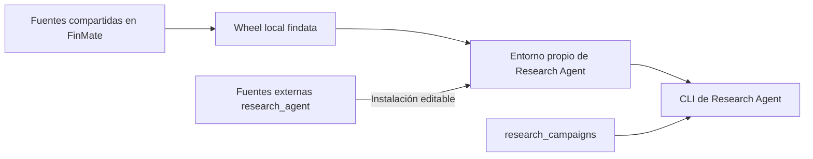

# Desarrollo y operación

> Operación y dependencias del proyecto externo. Consolidación documental: 2026-10-31.
> Los detalles del wheel corresponden al corte del 2026-10-16; verificar el entorno efectivo.

## Dependencias y frontera de instalación

Una distribución instalable puede aportar varios paquetes importables:

| Distribución | Declaración | Paquetes que aporta |
|---|---|---|
| `research-agent==0.1.0` | [pyproject local](../pyproject.toml) | `research_agent`, `research_campaigns` |
| `findata==0.1.0` | [pyproject de FinMate](../../FinMate/pyproject.toml) | `findata`, `infra`, `runtime_contracts`, `experience_audit`, módulos de observabilidad y otros paquetes del producto |

Findata, Infra y Experience Audit se instalan juntas desde el wheel local `findata`.
Que incluya código del producto no autoriza a cargarlo: los tests de frontera rechazan
`finmate`, `engine` y `api`. El núcleo tampoco importa `experience_audit` ni
`research_campaigns`; Audit puede permanecer instalado sin ser usado.



### Bibliotecas reutilizadas

| Biblioteca | Uso en A | Frontera |
|---|---|---|
| Findata | Empresas, observaciones y tendencias v2 | PostgreSQL de solo lectura; sin ingesta o creación de tablas |
| Infra | `LLMFactory`, perfil, clientes, replay, reintentos, búsqueda y extracción Tavily | Sin fallback entre modelos añadido por el laboratorio |
| runtime_contracts | Mensajes, herramientas, continuaciones, errores, documentos y contexto técnico | Sin entidades, ORM o SDKs del producto |
| Observabilidad | Correlación y captura local de logs/payloads | Nombres históricos `engine.llm*`; sin exportador configurado aquí |
| research_campaigns | Definiciones, ejecución y revisión de campañas | Depende de Research Agent; no se importa desde el núcleo |

Engine mantiene reexportaciones de contratos por compatibilidad con sus consumidores.
El agente importa las definiciones canónicas de `runtime_contracts`; no necesita cargar
Engine. Véase la [decisión compartida](../../FinMate/docs/architecture/decisions/0004-shared-runtime-contracts.md).

### Editable frente a wheel

En el corte de extracción, Research Agent se instaló editable: los imports siguen
sus fuentes y los cambios de código se ven en la siguiente ejecución. Cambiar sus
metadatos o dependencias puede requerir reinstalarlo. El wheel compartido se instaló
como copia: editar FinMate no cambia esa instalación. Esto fija código, no datos,
web, modelos remotos o configuración; verificar el entorno antes de comparar.

## B opcional con contexto preparado

La única modalidad activa de B es `--knowledge-agent prepared`; `off` conserva
escritura directa de A. Se utiliza E2 (`--continuous`), mandato explícito y
`--max-calls 100`: 30 llamadas protegidas para B, 70 para A y el controlador.
El encargo se registra antes de ejecutarse y B recibe vistas deterministas
hasta 64 KiB, con recuperación explícita de recortes. No se incluye un lanzador de campañas ni una variante sin precarga.
Las configuraciones históricas `on` y `protected` no se migran silenciosamente.
Crear un experimento nuevo para esta versión. Las continuaciones heredan el modo.

Verificación local sin proveedores:

```powershell
.\.venv\Scripts\python.exe -m pytest -q tests/test_durable_knowledge.py tests/test_e2.py
```

La [entrega actual](deliveries/2026-11-02-b-prepared-closing.md) describe alcance y límites.

## Instalación

### Python programable opcional

Instalar desde la raíz, conservando el wheel compartido ya instalado:

```powershell
.\.venv\Scripts\python.exe -m pip install -c constraints.txt -e ".[python]"
```

La POC verificada usa Python 3.12.6, NumPy 2.5.0, pandas 3.0.3, SciPy 1.18.1 y
numpy-financial 1.0.0 en Windows. El extra no es necesario para el agente por defecto.
Añadir `--python` a la CLI, también con `--continuous` o `--simulation`, activa las
herramientas durante investigación. Repetirlo explícitamente en las continuaciones;
la configuración efectiva queda registrada por run. Las dependencias se comprueban
antes de crear clientes externos o preparar un experimento nuevo. No se instalan
automáticamente y no hay sustitución silenciosa de entorno.

Es ejecución local con controles preventivos, no un sandbox; no usar código no
confiable como si estuviera aislado. La [arquitectura](architecture.md#operadores-python-opcionales)
detalla los límites y la captura. Las instrucciones nuevas explican la capacidad
solo cuando está disponible; las copias de experimentos anteriores no se actualizan.
La CLI conserva sus fuentes habituales: activar Python no congela web ni datos.

Verificación específica sin proveedores:

```powershell
.\.venv\Scripts\python.exe -m pytest -q tests/test_python_operators.py
```

Sin el extra, los casos científicos se omiten; los checks de ausencia de dependencias,
restricciones estáticas y ciclo de procesos siguen disponibles. El contraste real se
describe en el [protocolo](experiments/python-operators-v1/protocol.md), sin ejecutarlo.

### Instalación base

Desde la raíz del proyecto, con Python >=3.11; el corte anterior se verificó con 3.12:

```powershell
py -3.12 -m venv .venv
# Primero obtener el wheel local construido desde las fuentes de FinMate.
.\.venv\Scripts\python.exe -m pip install -c constraints.txt "RUTA_LOCAL\findata-0.1.0-py3-none-any.whl"
.\.venv\Scripts\python.exe -m pip install -c constraints.txt -e .
.\.venv\Scripts\python.exe -m pip install -c constraints.txt pytest mypy types-PyYAML types-jsonschema
.\.venv\Scripts\python.exe -m pip check
```

Crear `.env` con la configuración indicada abajo solo si no existe. No sobrescribir
una configuración existente ni sustituir el wheel por un homónimo de un índice público.

`constraints.txt` conserva versiones del corte de extracción: limita la resolución,
no instala todo su contenido ni es un lock con hashes. El wheel inicial quedó en
`../FinMate/artifacts/experience-audit-validation/relocation-2026-10-16/wheels/`;
es evidencia local ignorada y puede no existir en otra máquina. Para trasladar el proyecto,
conservar también el wheel aprobado o reconstruirlo desde la revisión correspondiente.

## Configuración y servicios

La composición usa la configuración compartida del planificador (`LLM_PLANNER_PROVIDER`,
`LLM_PLANNER_MODEL` y ajustes asociados) con un perfil explícito llamado `lab`.
Las claves de proveedor y `TAVILY_API_KEY` se mantienen fuera de Git.

`DATABASE_URL` debe apuntar a PostgreSQL con datos ya disponibles. El esquema de URL
elige el controlador: `postgresql+psycopg` necesita psycopg 3; `postgresql` utiliza
normalmente psycopg2 con SQLAlchemy. SQLite no sustituye las lecturas v2. Usar además
credenciales de lectura cuando estén disponibles; A abre transacciones de solo lectura.

Se conserva OpenTelemetry por compatibilidad de dependencias. No es necesario configurar
un exportador para producir los registros locales. La instalación amplia del wheel puede
incluir dependencias del producto, pero las campañas propias no necesitan sus servicios,
usuarios, navegador ni instalar binarios de Playwright.

La CLI deriva las rutas de estado y ejecuciones de `--experiment`; la composición
directa recibe workspace y archivo explícitamente. Los prompts incluidos son recursos
del paquete; no se localizan buscando el checkout padre. Para ejecutar desde otra
carpeta, proporcionar configuración disponible allí o variables de entorno: no asumir
que se descubrirá automáticamente el `.env` de este proyecto.

## Actualizar una biblioteca compartida

1. Determinar el contrato y los consumidores afectados en FinMate. Cambiar allí la
   biblioteca, con sus pruebas; no editar `site-packages` o copiarla al agente.
2. Construir un wheel nuevo y conservar revisión de origen y SHA-256.
3. Actualizar deliberadamente el entorno del agente y ejecutar sus verificaciones.
4. Registrar la actualización y cualquier cambio experimental; conservar el wheel anterior.

Ejemplo desde Research Agent, con las dependencias de construcción instaladas:

```powershell
.\.venv\Scripts\python.exe -m pip wheel ..\FinMate --no-deps --no-build-isolation --wheel-dir artifacts/wheels
Get-FileHash artifacts/wheels/findata-0.1.0-py3-none-any.whl -Algorithm SHA256
.\.venv\Scripts\python.exe -m pip install --force-reinstall --no-deps artifacts/wheels/findata-0.1.0-py3-none-any.whl
.\.venv\Scripts\python.exe -m pip check
```

`--no-deps` presupone un entorno compatible; si cambian los requisitos, resolverlos
explícitamente antes de aceptar la actualización. El mismo número `0.1.0` puede ocultar
código distinto: registrar hash del wheel y revisión, no solo la versión. No reinstalar
silenciosamente durante una comparación experimental.

Extraer Findata o Audit como distribuciones independientes sigue siendo una decisión
futura. Puede hacerse si su evolución lo justifica; no es requisito del agente actual.
Las referencias documentales entre carpetas hermanas no son dependencias de ejecución.

## Ejecutar A: nuevo experimento o continuación

La CLI exige una operación explícita y un nombre humano:

```powershell
.\.venv\Scripts\python.exe -m research_agent "Investiga NVIDIA" --experiment ./artifacts/nvidia-conservacion --new --run-name investigacion-inicial
.\.venv\Scripts\python.exe -m research_agent "Continúa desde lo conservado" --experiment ./artifacts/nvidia-conservacion --continue --run-name revision-documental
```

`--new` rechaza cualquier ruta existente. `--continue` exige `estado/`, `instrucciones/`
y `ejecuciones/`, preserva archivos y arranca otro proceso sin recuperar el chat anterior.
Otra ruta con `--new` inicia una prueba independiente. No hay copia de estados en esta versión.
Las colisiones de nombres de run reciben sufijo consecutivo. Solo un run por experimento
puede estar activo; no borrar `.run.lock` para resolver contención.

Las instrucciones iniciales se copian de los recursos instalados. `--instructions archivo.md`
puede repetirse únicamente con `--new`; luego editar explícitamente los Markdown de
`instrucciones/`. Los manifiestos registran el contenido efectivo de cada run, por lo que
cambiar instrucciones entre continuaciones es visible y altera la condición experimental.
La evolución M1 del 2026-10-21 está integrada en `prompts/agent_a.md`: se copia al crear
experimentos nuevos y se usa directamente en la interfaz básica. No sustituye las copias
de experimentos existentes. Para adoptarla en una continuación, actualizar explícitamente
su `instrucciones/agente.md` desde el prompt vigente, conservando las personalizaciones
que correspondan y la versión anterior en Git; no sobrescribir capturas históricas.
`--conversation` conserva correlación; no restaura memoria de proceso.
`--timeout-seconds` ajusta el límite temporal. Las demás reservas están en
[arquitectura](architecture.md#conservación-y-cierre-de-la-investigación).

La CLI imprime respuesta, `run_id` técnico y resumen `state`. Retorna 0 si hay respuesta
(`completed`), 1 para otros resultados operativos y 2 para entradas inválidas. Revisar
`resultado.json`, motivo de cierre y `state.capture_errors`, no solo el código de salida.
`respuesta.md` es la entrega; `estado/` contiene lo recuperable para continuar.
No se permite al agente editar materiales originales, instrucciones ni archivo de runs.

Los argumentos antiguos `--workspace`, `--runs`, `--knowledge-mode` y `--case-store`
se rechazan con la nueva sintaxis. No apuntar la CLI nueva a E001/E002 para convertirlos:
sus capturas y fuentes congeladas son históricas y permanecen intactas.

### Versionar el estado manualmente

El sistema no inicializa ni modifica Git. Opcionalmente, crear un repositorio propio
para el experimento; los comandos siguientes los ejecuta la persona cuando proceda:

```powershell
git -C ./artifacts/nvidia-conservacion init
git -C ./artifacts/nvidia-conservacion add estado instrucciones .gitignore
git -C ./artifacts/nvidia-conservacion commit -m "Conservar estado de la investigacion"
```

El `.gitignore` inicial excluye `ejecuciones/`, `.run.lock` y archivos `.env`.
Revisar los datos antes de añadirlos. Este repositorio de datos es distinto del Git
del código y no tiene remoto configurado por el sistema. Los runs registran commit y
cambios pendientes al inicio/final, sin atribuirse el repositorio padre. No tener Git
es válido. Git manual conserva solo versiones que se hayan registrado; los snapshots
del run conservan sus extremos, sin prometer todas las ediciones intermedias.

## Campañas

La [guía de campañas](campaigns.md) posee la interfaz, modalidades, estructura de
resultados y límites de recuperación. El paquete `research_campaigns` prepara y
lanza A; no se importa desde el núcleo.

```powershell
.\.venv\Scripts\python.exe -m research_campaigns validate RUTA_DEFINICION_SUITE
.\.venv\Scripts\python.exe -m research_campaigns run RUTA_DEFINICION_SUITE --case S2 --output artifacts/nueva-campana
.\.venv\Scripts\python.exe -m research_campaigns report artifacts/nueva-campana
```

`validate` no consulta proveedores ni bases. `run` sí ejecuta el agente real.
Cada destino es la carpeta exacta y debe ser nuevo. Revisar primero `README.md`.
No hay conversión compacta ni compatibilidad con los comandos y capturas retirados;
los artefactos anteriores permanecen intactos.

## Experience Audit histórico

La integración local, sus escenarios y sus pruebas se retiraron el 2026-10-24.
El wheel compartido no se modifica. Las campañas actuales usan la CLI propia y
`python -m research_campaigns`; los archivos históricos no se reescriben.

## Herramientas de estado

<a id="herramientas-de-estado-v5"></a>

La [ablación E1](experiments/e1-simplificacion/protocol.md) simplifica directamente
el agente: hay una sola composición y una única escritura, `record_research_advance`.
Se retiraron los selectores `--state-tools` y `--adopt-state-tools-v5`, también de
las APIs internas. La identidad `state-tools-e1` en `herramientas.json` describe
el contrato instalado; no selecciona una variante.

Los experimentos nuevos congelan `herramientas-estado.md` junto a sus otras
instrucciones. Las continuaciones requieren ese contrato y su guía. Los experimentos
anteriores, incluso sin configuración, se rechazan antes de construir clientes;
usar el código anterior o una migración expresamente autorizada. No se reescriben
instrucciones, estado ni capturas históricas.

Las consultas conservan propósito, selectores, versiones y cursores. El guardado
crea o edita de uno a cinco archivos con versiones y fragmentos exactos. Un target
vacío solo es único en un archivo vacío: permite inicializarlo sin reemplazo ciego.
En los demás casos se rechaza como ambiguo. Ante conflicto releer; ante
`applied=true` inspeccionar lo aplicado antes de reintentar.

Los [contratos de estado](../src/research_agent/state_contracts/state.md) y
[empresa](../src/research_agent/state_contracts/company.md) conservan ejemplos
recuperables con `describe_state_tools`. La publicación, diarios y recuperación
siguen siendo internos al runtime, fuera de la memoria editable.

Verificación local sin proveedores:
`python -m pytest -q tests/test_state_tools.py tests/test_v6.py tests/test_v7.py`.
Estos checks no acreditan calidad financiera ni elección autónoma de herramientas.

## Continuidad V6 y evaluación offline

La [V6 histórica](experiments/continuidad-v6/protocol.md) introdujo continuidad sobre V5;
el agente actual conserva esa continuidad con escritura única. Los nuevos experimentos deliberativos crean una agenda
con foco activo y copian los prompts actuales. Las continuaciones mantienen sus copias;
adoptar instrucciones nuevas exige editarlas explícitamente y conservar la versión
anterior. Los contratos efectivos se congelan por run; una campaña
preparada con otro runtime no puede reanudarse silenciosamente.

Las definiciones históricas se retiraron del checkout. Para una definición continua
existente y compatible, validación offline sin proveedores ni datos remotos:

```powershell
.\.venv\Scripts\python.exe -m research_campaigns validate RUTA_DEFINICION_CONTINUA
.\.venv\Scripts\python.exe -m pytest -q tests/test_v6.py
```

Tras una ejecución autorizada, generar observaciones sin llamar al modelo:

```powershell
.\.venv\Scripts\python.exe -m research_campaigns progress RUTA_DEL_RUN
.\.venv\Scripts\python.exe -m research_campaigns progress RUTA_DEL_RUN --checks COMPROBACIONES.json --output RUTA_DEL_RUN/progreso-con-cifras.json
```

`RUTA_DEL_RUN` contiene manifiesto, eventos y snapshots. El informe JSON debe ser
un archivo nuevo directamente dentro del run; no sobrescribe evidencia. Los estados
intermedios están en `continuidad/indice.json`, separados del workspace editable.
Campañas anteriores sin checkpoints siguen siendo observables en sus trazas, pero el
informe no inventa estados intermedios. Regenerar el README de campaña con `report`
enlaza el índice y el informe por defecto cuando existan.

El [contrato numérico ilustrativo](experiments/continuidad-v6/numerical-checks-example.json)
requiere adaptar cita exacta, operandos por JSON pointer en materiales del snapshot
final, unidades, escala y tolerancia. Las comprobaciones no descubren todas las cifras
ni certifican unidades declaradas. Usar la rúbrica para progreso/calidad/utilidad y
recuperación: el informe no atribuye éxito semántico a recuentos mecánicos.

Las nuevas protecciones de expediente también se aplican a los aliases de escritura
en composición V5; no vaciar IDs poblados para mover argumentos bajo otro encabezado.
Las vistas parciales devuelven cómo recuperar contenido; una escritura válida no
garantiza coherencia económica. No hay nuevos agentes, grafo o dependencia externa.

## Verificación proporcionada al cambio

| Cambio | Verificación esperada |
|---|---|
| Solo documentación | Contrastar afirmaciones, enlaces, ejemplos y `git diff --check` |
| Ciclo, memoria o herramientas | Tests locales afectados y regresión de fronteras |
| Contrato compartido | Pruebas de sus consumidores en FinMate, wheel nuevo y regresión local |
| Proveedor o acceso a datos | Primero transportes controlados; después aceptación real autorizada y archivada |
| Hipótesis financiera | Campaña y revisión semántica con rúbrica previa, además de checks |

Comandos de comprobación local sin campaña real:

```powershell
.\.venv\Scripts\python.exe -m pytest -q tests
.\.venv\Scripts\python.exe -m mypy src/research_agent src/research_campaigns --follow-imports=silent
.\.venv\Scripts\python.exe -m pip check
git diff --check
```

La suite incluye subprocess que bloquea imports de `finmate`, `engine` y `api`. El núcleo tampoco importa `experience_audit` ni
`research_campaigns`; Audit puede permanecer instalado sin ser usado.
El comprobador histórico de enlaces y anclas (`scripts/check_docs.py`) se retiró
en `3c1d481`; no es un comando disponible del checkout. Puede consultarse mediante
`git show d2600fb:scripts/check_docs.py` y ejecutarse temporalmente apuntando a la raíz
actual, sin restaurarlo. Comprobar enlaces y anclas internos; informar aparte las
referencias externas a FinMate y la disponibilidad de capturas locales. No consultar
servicios ni ocultar errores internos con exclusiones generales. Si también cambia documentación de FinMate,
ejecutar allí su propio flujo documental; no copiar el catálogo al laboratorio.

Un cambio documental no necesita llamadas a modelos o PostgreSQL. Tampoco acredita
aceptación financiera. No confundir un resultado histórico enlazado con una prueba
repetida en el entorno actual. Registrar qué se comprobó y qué quedó fuera.

## Ejecutar el modo continuo experimental

El continuo usa E2: un bucle ReAct con checkpoints, `report_work`, evaluación
por eventos y reconstrucción con intercambios completos. Requiere `--mandate` y
`--continuous`. `--max-calls` incluye investigación, checkpoints, evaluación y B.
`--max-total-calls` conserva compatibilidad como techo adicional (se usa el menor).
`--context-bytes` limita el contexto; `--renewal-bytes` fija el umbral de renovación.
`--consolidation-bytes` sigue siendo un alias de renovación. `--max-tools` y
`--continuous-timeout-seconds` limitan herramientas y tiempo global.

B es opcional. `--knowledge-agent prepared` exige 100 llamadas totales, protege
30 para B y prepara sus vistas iniciales. Cada intento exige reserva completa de
15 llamadas, 24 herramientas y 181 segundos disponibles; dispone de hasta 180
segundos respetando el plazo global. Las últimas cuatro llamadas y herramientas
se reservan para verificar, publicar y declarar; los últimos 60 segundos quedan
fuera del trabajo ordinario y los últimos 15 solo permiten la declaración final.
La última llamada o herramienta también se limita a `finish_integration`.
El aviso de tiempo de cierre no concede llamadas extra.
No se transfieren las llamadas no utilizadas de B a A. Encargos y resultados viven
en `control-integracion`, fuera de conocimiento editable y de la conversación.
Los pendientes no son conocimiento integrado ni certifican calidad financiera.

Las versiones históricas del controlador por fases y de B sin contexto preparado
no son modalidades ejecutables de esta entrega. Los experimentos congelados
conservan sus evidencias, sin migración silenciosa a este controlador.

## Baseline y comparabilidad

El [baseline](baseline.md) identifica código, prompts y wheel de referencia. Un run
con `--new` reproduce el mecanismo, pero no congela web, datos ni configuración del
entorno. Comparar manifiestos y conservar entradas idénticas antes de atribuir una
mejora a un cambio. La guía del baseline separa checks locales y evidencia semántica.

## Entrega y continuidad

Actualizar la referencia propietaria y el índice cuando cambie el mapa. Las entregas
en `docs/deliveries/` indican fecha, base, cambio, verificaciones, límites y siguiente
paso, sin duplicar el diseño. Los [protocolos y hallazgos](experiments/README.md)
conservan lo aprendido; las [decisiones](decisions/README.md), las elecciones duraderas.
La prioridad vigente está en [estrategia](strategy.md).

No incorporar `.env`, payloads privados o estados reales al Git del código. El Git local del experimento es una elección humana con revisión de sus materiales. `artifacts/`
está ignorado; citar una ruta allí no hace portable la evidencia. Las guías pueden
describir el procedimiento, mientras las capturas completas se conservan localmente.
No realizar commit, push o despliegue sin autorización del usuario.

## Laboratorio longitudinal

La [guía experimental histórica](experiments/colaboracion-historica-v1/protocol.md)
conserva condiciones y comandos de su corte. La interfaz vigente es
`research_campaigns validate|run|resume|report`, descrita en [campañas](campaigns.md).
No existe un subcomando público `preflight`: usar `validate --data` para datos locales;
`run` histórico sin `--data` puede exportar Findata y requiere autorización de ejecución.
Las definiciones y utilidades de `scripts/` se retiraron del checkout; las capturas
anteriores se conservan sin compatibilidad automática de comandos o formatos.

### Intención persistente opcional

El [piloto de seis activaciones](experiments/intencion-persistente-v1/protocol.md)
conserva comandos históricos para comprobar perfil/dataset y ejecutar dos campañas
independientes con `--condition baseline` y `--condition deliberative`. La condición ampliada sí se ejecutó: véanse sus [hallazgos](experiments/intencion-persistente-v1/findings-amplio.md). Usar `validate --data` para comprobar un dataset local sin consultar Findata.

En CLI manual, `--mandate PATH` activa la condición y debe suministrarse en cada
continuación. El archivo UTF-8 auténtico lo mantiene la persona fuera de `estado/` y
`ejecuciones/`; no se resume ni se copia automáticamente desde una petición breve.
Con `--new` se copian instrucciones deliberativas y se crea la agenda compacta V6. Con
`--continue` se exigen esos archivos, sin actualizar instrucciones anteriores.

```powershell
.\.venv\Scripts\python.exe -m research_agent "Comienza la investigación" --experiment artifacts/intencion-manual --new --run-name inicial --mandate C:/ruta/mandato.md
.\.venv\Scripts\python.exe -m research_agent "Continúa" --experiment artifacts/intencion-manual --continue --run-name continuacion --mandate C:/ruta/mandato.md
```

Estos dos comandos llaman al proveedor. Reemplazar la ruta del mandato por el archivo
real; no almacenar secretos en él. Mandato no vacío hasta 16 KiB, agenda hasta 8 KiB;
los errores se diagnostican antes de construir clientes desde la CLI. No apuntar el
mandato a memoria generada por A: la ruta externa delimita acceso, no autentica autoría.
El control longitudinal genera el archivo desde los mensajes congelados por fecha.

## Metodología financiera longitudinal

Los experimentos nuevos copian la metodología financiera y la convención Markdown
vigentes. Los existentes conservan sus instrucciones; no se migran automáticamente.
El [contraste específico](experiments/analisis-financiero-v1/protocol.md) conserva el control
histórico y comandos de aquel corte. El uso de estas instrucciones en campañas posteriores
no acredita ejecución de esa comparación controlada.

`research_campaigns run DEFINICION --instructions-dir DIRECTORIO` sustituye las plantillas por un
conjunto completo de instrucciones al crear una campaña. Para `--condition deliberative`
exige exactamente `agente.md`, `deliberacion.md` e `investigacion-financiera.md`; para
baseline, los dos archivos no deliberativos. Todos deben ser archivos UTF-8 no vacíos,
sin entradas extra. No equivale a la opción aditiva `--instructions` de la CLI manual.
`resume` solo usa las copias congeladas y rechaza alteraciones. La CLI manual mantiene
su interfaz actual; `prepare_experiment` ofrece el parámetro a composiciones locales.

La verificación de implementación usa clientes controlados sin proveedores ni bases
remotas. Los casos y rúbrica semánticos quedan preparados sin ejecutar: su futura
aplicación requiere corpus por etapas y captura, según el protocolo. Los tests prescritos
no demuestran elección autónoma de acciones ni razonamiento financiero superior.

## Operación V7

La evolución V7 se aplica al continuo existente, sin nueva opción de CLI ni perfil.
El revisor usa el mismo perfil y llamadas adicionales contabilizadas como
`external_review`. No ejecutar campañas para verificarlo: usar clientes simulados en
`tests/test_v7.py` y la suite local. Los informes viven en `revision-externa/` de cada
run; el informe final es distinto de la última respuesta intermedia del investigador.

Los diarios de `ejecuciones/transacciones/` pertenecen al runtime y deben conservarse
junto al estado para recuperación tras interrupción. No editarlos ni borrarlos para
sortear conflictos: el diagnóstico de recuperación identifica el archivo que exige
revisión. No existe aislamiento frente a editores externos durante una escritura conjunta.
Las copias de instrucciones antiguas no se actualizan automáticamente. La nueva política
continua sí queda registrada junto a contratos y fingerprints efectivos.

## Operación V8

El objetivo admite opcionalmente `assessment_path`, por ejemplo
`empresas/MSFT/evaluacion.md`. Es una ruta Markdown editable, relativa y sin escapes;
el runtime muestra el juicio activo sin crearlo. Para estos objetivos el evaluador
debe devolver también `decision_review` y la semilla requiere 16 KiB de margen bajo
el umbral de consolidación. Las definiciones e informes V8 anteriores siguen siendo
legibles. La pregunta no se genera automáticamente ni se modifica durante el run.
Una revisión parcial puede conservar impedimentos y servir de antecedente, pero no
publica distancia global. El paquete evaluador puede incluir hasta 16 KiB de la
evaluación activa, sin ampliar el máximo de 64 KiB ni su vista de contexto de 4 KiB.

`agenda.md` rechaza escrituras mayores de 8192 bytes antes de publicar. El error
permite compactar o mover detalle usando las herramientas, sin pérdida silenciosa;
no se migran agendas antiguas excesivas. Véase el [protocolo decisorio](experiments/evaluacion-msft-v1/protocol.md).

`--objective PATH` requiere `--continuous` y su mandato. El JSON UTF-8 de hasta 16 KiB
vive fuera de `estado/` y `ejecuciones/`; se valida antes de crear clientes. Ejemplo
de definición general (criterios y especialización pertenecen al caso):

```json
{
  "id": "modelo-negocio",
  "description": "Explicar el modelo de negocio de la empresa estudiada",
  "criteria": {
    "productos": "Explicar productos y servicios principales",
    "ingresos": "Explicar fuentes de ingresos y sus fundamentos"
  }
}
```

Ejemplo de ejecución real, **no necesario para verificar la implementación**:

```powershell
.\.venv\Scripts\python.exe -m research_agent "Investiga el objetivo" --experiment artifacts/objetivo-v8 --new --run-name inicial --mandate C:/ruta/mandato.md --continuous --objective C:/ruta/objective.json --max-calls 60 --max-tools 100 --continuous-timeout-seconds 1800
```

Repetir explícitamente `--objective` al continuar, usando `--continue` y otro nombre
de run. La definición y hash quedan en manifiesto; solo el mismo objetivo/workspace
recupera cobertura histórica. Otro objetivo inicia una serie sin comparación con
criterios distintos. Omitir la opción conserva el continuo V7.

Las llamadas `objective_evaluation` son adicionales al máximo ordinario; comparten
deadline. Capturas en `evaluacion-objetivo/`, separadas de `respuesta.md` y del estado.
`final.json` puede reutilizar una evaluación previa cuando no cambió el contenido;
una evaluación final no concede presupuesto extra al investigador para redactar cierre.
No interpretar evaluación parcial, fallo o ausencia de métrica como distancia uno.

Verificación local sin servicios: `python -m pytest -q tests/test_v8.py`, seguida de
los checks de [verificación](#verificación-proporcionada-al-cambio). El
[protocolo V8](experiments/objetivos-v8/protocol.md) explica política y contraste pendiente.
