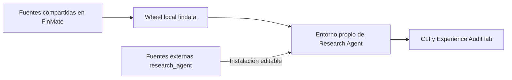

# Desarrollo y operación

> Operación y dependencias del proyecto externo. Reorganización: 2026-10-17.
> Los detalles del wheel corresponden al corte del 2026-10-16; verificar el entorno efectivo.

## Dependencias y frontera de instalación

Una distribución instalable puede aportar varios paquetes importables:

| Distribución | Declaración | Paquetes que aporta |
|---|---|---|
| `research-agent==0.1.0` | [pyproject local](../pyproject.toml) | `research_agent` |
| `findata==0.1.0` | [pyproject de FinMate](../../FinMate/pyproject.toml) | `findata`, `infra`, `runtime_contracts`, `experience_audit`, módulos de observabilidad y otros paquetes del producto |

Findata, Infra y Experience Audit se instalan juntas desde el wheel local `findata`.
Que incluya código del producto no autoriza a cargarlo: los tests de frontera rechazan
`finmate`, `engine` y `api`.



### Bibliotecas reutilizadas

| Biblioteca | Uso en A | Frontera |
|---|---|---|
| Findata | Empresas, observaciones y tendencias v2 | PostgreSQL de solo lectura; sin ingesta o creación de tablas |
| Infra | `LLMFactory`, perfil, clientes, replay, reintentos, búsqueda y extracción Tavily | Sin fallback entre modelos añadido por el laboratorio |
| runtime_contracts | Mensajes, herramientas, continuaciones, errores, documentos y contexto técnico | Sin entidades, ORM o SDKs del producto |
| Observabilidad | Correlación y captura local de logs/payloads | Nombres históricos `engine.llm*`; sin exportador configurado aquí |
| Experience Audit | Escenarios `lab-v1`, ejecución, Archive, consulta e informes | Importa Research Agent para ejecutarlo; Research Agent no importa Audit |

Engine mantiene reexportaciones de contratos por compatibilidad con sus consumidores.
El agente importa las definiciones canónicas de `runtime_contracts`; no necesita cargar
Engine. Véase la [decisión compartida](../../FinMate/docs/architecture/decisions/0004-shared-runtime-contracts.md).

### Editable frente a wheel

En el corte de extracción, Research Agent se instaló editable: los imports siguen
sus fuentes y los cambios de código se ven en la siguiente ejecución. Cambiar sus
metadatos o dependencias puede requerir reinstalarlo. El wheel compartido se instaló
como copia: editar FinMate no cambia esa instalación. Esto fija código, no datos,
web, modelos remotos o configuración; verificar el entorno antes de comparar.

## Instalación

Desde la raíz del proyecto, con Python >=3.11; el corte anterior se verificó con 3.12:

```powershell
py -3.12 -m venv .venv
# Primero obtener el wheel local construido desde las fuentes de FinMate.
.\.venv\Scripts\python.exe -m pip install -c constraints.txt "RUTA_LOCAL\findata-0.1.0-py3-none-any.whl"
.\.venv\Scripts\python.exe -m pip install -c constraints.txt -e .
.\.venv\Scripts\python.exe -m pip install -c constraints.txt pytest mypy types-PyYAML types-jsonschema
.\.venv\Scripts\python.exe -m pip check
```

Crear `.env` con la configuración indicada abajo solo si no existe. No sobrescribir
una configuración existente ni sustituir el wheel por un homónimo de un índice público.

`constraints.txt` conserva versiones del corte de extracción: limita la resolución,
no instala todo su contenido ni es un lock con hashes. El wheel inicial quedó en
`../FinMate/artifacts/experience-audit-validation/relocation-2026-10-16/wheels/`;
es evidencia local ignorada y puede no existir en otra máquina. Para trasladar el proyecto,
conservar también el wheel aprobado o reconstruirlo desde la revisión correspondiente.

## Configuración y servicios

La composición usa la configuración compartida del planificador (`LLM_PLANNER_PROVIDER`,
`LLM_PLANNER_MODEL` y ajustes asociados) con un perfil explícito llamado `lab`.
Las claves de proveedor y `TAVILY_API_KEY` se mantienen fuera de Git.

`DATABASE_URL` debe apuntar a PostgreSQL con datos ya disponibles. El esquema de URL
elige el controlador: `postgresql+psycopg` necesita psycopg 3; `postgresql` utiliza
normalmente psycopg2 con SQLAlchemy. SQLite no sustituye las lecturas v2. Usar además
credenciales de lectura cuando estén disponibles; A abre transacciones de solo lectura.

Se conserva OpenTelemetry por compatibilidad de dependencias. No es necesario configurar
un exportador para producir los registros locales. La instalación amplia del wheel puede
incluir dependencias del producto, pero las campañas `lab` no necesitan sus servicios,
usuarios, navegador ni instalar binarios de Playwright.

Las rutas de workspace y archivo son explícitas. Los prompts incluidos son recursos
del paquete; no se localizan buscando el checkout padre. Para ejecutar desde otra
carpeta, proporcionar configuración disponible allí o variables de entorno: no asumir
que se descubrirá automáticamente el `.env` de este proyecto.

## Actualizar una biblioteca compartida

1. Determinar el contrato y los consumidores afectados en FinMate. Cambiar allí la
   biblioteca, con sus pruebas; no editar `site-packages` o copiarla al agente.
2. Construir un wheel nuevo y conservar revisión de origen y SHA-256.
3. Actualizar deliberadamente el entorno del agente y ejecutar sus verificaciones.
4. Registrar la actualización y cualquier cambio experimental; conservar el wheel anterior.

Ejemplo desde Research Agent, con las dependencias de construcción instaladas:

```powershell
.\.venv\Scripts\python.exe -m pip wheel ..\FinMate --no-deps --no-build-isolation --wheel-dir artifacts/wheels
Get-FileHash artifacts/wheels/findata-0.1.0-py3-none-any.whl -Algorithm SHA256
.\.venv\Scripts\python.exe -m pip install --force-reinstall --no-deps artifacts/wheels/findata-0.1.0-py3-none-any.whl
.\.venv\Scripts\python.exe -m pip check
```

`--no-deps` presupone un entorno compatible; si cambian los requisitos, resolverlos
explícitamente antes de aceptar la actualización. El mismo número `0.1.0` puede ocultar
código distinto: registrar hash del wheel y revisión, no solo la versión. No reinstalar
silenciosamente durante una comparación experimental.

Extraer Findata o Audit como distribuciones independientes sigue siendo una decisión
futura. Puede hacerse si su evolución lo justifica; no es requisito del agente actual.
Las referencias documentales entre carpetas hermanas no son dependencias de ejecución.

## Ejecutar A

Desde la raíz de Research Agent, con su `.venv` y configuración local. No modificar
fuentes de FinMate ni ejecutar migraciones para arrancar A.

```powershell
.\.venv\Scripts\python.exe -m research_agent "Investiga NVIDIA: fundamentos, riesgos y límites de los datos, sin DCF" --workspace ./artifacts/workspace --runs ./artifacts/runs
```

La CLI imprime la respuesta y `run_id`; devuelve 0 cuando el estado es `completed`,
1 para otros estados operativos y 2 ante determinados errores de entrada.
Revisar `result.json` y el motivo de cierre, no solo el código de salida.
`--timeout-seconds` cambia el presupuesto temporal. `--instructions archivo.md` puede
repetirse y añade instrucciones a las incluidas. No sirve para seleccionar el futuro A0.

### Modo experimental de expedientes

`--knowledge-mode` admite `vanilla` (predeterminado) o `cases`. Este último exige
`--case-store`; proporcionar almacén en vanilla es un error. Ejemplo desde la raíz:

```powershell
.\.venv\Scripts\python.exe -m research_agent "Investiga NVIDIA" --knowledge-mode cases --case-store ./artifacts/example/cases --workspace ./artifacts/example/workspace --runs ./artifacts/example/runs
```

Otro proceso con las mismas tres rutas recupera memoria y expedientes, sin restaurar
el chat. El prompt de expedientes se añade automáticamente; no pasar manualmente una
copia por `--instructions`. El almacén debe ser disjunto de workspace, runs, código e
instrucciones; queda ligado a las rutas originales y no se comparte entre workspaces.
No borrar `.lock` para resolver contención: el bloqueo real lo mantiene el sistema
operativo y se libera al terminar el proceso. Un conflicto exige releer la revisión.
Los snapshots de estado identifican restos de escrituras no publicadas; conservarlos
para diagnóstico. No borrar o promover automáticamente esos archivos.

El esquema y límites están en [arquitectura](architecture.md#modo-experimental-de-expedientes).
La investigación y continuación acordadas tienen el [protocolo E001](experiments/E001-nvidia-casefile/protocol.md).
Se usa la CLI en procesos separados, porque Audit mantiene una instancia por escenario
y su configuración actual no selecciona este modo ni garantiza un reinicio entre pasos.
La dependencia directa Pydantic se declara en el proyecto. Mypy comprueba el código local
y omite los imports sin marcadores de tipado del wheel compartido, mediante overrides
explícitos; no implica comprobar internamente las bibliotecas compartidas.

En la revisión E002, cases reserva hasta dos llamadas para consolidación y una para
respuesta; requiere al menos cuatro llamadas al modelo y dos herramientas de presupuesto.
El catálogo y despacho se restringen durante consolidación. Los defaults siguen siendo
18 llamadas, 30 herramientas y 300 segundos, y el máximo de salida depende del perfil
compartido, que esta revisión no modifica. La CLI añade una línea `persistence=...` con
publicaciones confirmadas por disco y entrega de respuesta. El código de salida continúa
reflejando estado operativo: comprobar persistencia por separado. `drafts/` conserva
textos tempranos que no llegaron a ser respuesta final. Véanse [contrato de cierre](architecture.md#conservación-y-cierre-de-la-investigación)
y [protocolo E002](experiments/E002-persistent-research/protocol.md).

Workspace y archivo de ejecuciones deben ser disjuntos y estar fuera del código/prompts.
La memoria Markdown persiste; el historial del proceso CLI no. Actualizar el índice
permite descubrir las notas en la siguiente intervención; no carga automáticamente
todos los informes. Véanse las tres clases de estado en [arquitectura](architecture.md).

## Campañas nativas de Experience Audit

Usar `lab`, no el atajo del runner de recorridos del producto:

```powershell
$auditRoot = Join-Path $PWD.Path "artifacts/audit"
.\.venv\Scripts\python.exe -m experience_audit lab ./scenarios --output $auditRoot
```

El comando ejecuta todos los YAML/YML del directorio con IDs únicos. Para seleccionar
un subconjunto, preparar un directorio con esas definiciones y sus instrucciones.
Las intervenciones son secuenciales; no iniciar capturas concurrentes dentro del mismo
proceso. No se arranca frontend, backend, navegador ni sesión de usuario del producto.

El runner conserva `run.json` y archiva evidencia con `execution_kind=lab`, diferenciada
de las campañas históricas del producto. Los fallos y estados incompletos también son
evidencia. No asumir que el comando `resume` del producto restaura una conversación de A.

### Contrato del escenario

| Campo | Contenido |
|---|---|
| `schema_version` | `lab-v1` |
| `id`, `title` | Identidad única y descripción |
| `messages` | Una o varias intervenciones ordenadas |
| `instructions` | Rutas opcionales a Markdown dentro del directorio de escenarios |
| `memory` | Mapa opcional de rutas Markdown y contenido inicial |
| `requirements` | `llm`, `postgresql`, `tavily`; por defecto `llm` |
| `limits` | Ajustes de `AgentLimits` para esa condición |
| `checks` | Lista de comprobaciones deterministas |

Ejemplo mínimo que usa el modelo configurado, sin exigir datos financieros:

```yaml
schema_version: lab-v1
id: lab_revision_example
title: Revisión de una conclusión sintética
requirements: [llm]
memory:
  memory/index.md: "Caso ficticio; consulta notes/source.md."
  notes/source.md: "Beneficio 20, de los cuales 12 son extraordinarios."
messages:
  - Lee la nota y explica qué permite concluir sobre el beneficio recurrente.
checks:
  - {id: finished, kind: completed}
  - {id: source_read, kind: tool_used, value: read_file}
```

`requirements` declara preflight, no desactiva herramientas ni añade credenciales.
LLM/Tavily comprueban presencia de claves, no disponibilidad real del proveedor.
PostgreSQL comprueba una lectura mínima; no garantiza cobertura suficiente de datos.

Checks disponibles: `completed`, `answer_contains`, `tool_used`, `file_contains`.
`step` selecciona intervención desde 1. `file_contains` consulta el workspace final;
no acredita por sí solo el contenido histórico de un paso. Una cadena vacía comprueba
legibilidad del archivo, no calidad de memoria. Los checks de texto son literales;
una cita correcta, una revisión bien razonada o un análisis financiero necesitan otra revisión.

### Consultar y exportar

Reutilizar la ruta **absoluta** de salida en estos comandos. En la biblioteca actual,
algunos comandos de archivo resuelven rutas relativas desde la instalación de Audit,
mientras `lab` las resuelve desde el directorio de trabajo. Especificar solo la misma
cadena relativa puede abrir otro archivo.

```powershell
$auditRoot = Join-Path $PWD.Path "artifacts/audit"
.\.venv\Scripts\python.exe -m experience_audit history --output $auditRoot
.\.venv\Scripts\python.exe -m experience_audit show ID_DE_EJECUCION --full --output $auditRoot
.\.venv\Scripts\python.exe -m experience_audit export ID_DE_EJECUCION --format json --full --output $auditRoot --destination ./artifacts/export.json
.\.venv\Scripts\python.exe -m experience_audit report RUTA_AL_RUN_JSON
```

Sustituir los marcadores por el ID de una ejecución archivada y la ruta devuelta por
`lab`. El informe genera resumen y `dashboard.html`, que se abre localmente. El lanzador
`ui` de campañas del producto no es la entrada visual de este laboratorio.

Conservar el archivo completo, no solo el dashboard o una copia de la respuesta.
Las definiciones, snapshots, herramientas y payloads permiten investigar qué ocurrió.
La captura refleja interacciones observables; no proporciona todo el razonamiento
privado del modelo. Antes de exportar fuera de la máquina, revisar datos privados.
Los comandos de limpieza pueden eliminar detalle o ejecuciones: no son mantenimiento
necesario para investigar y no deben borrar tentativas incómodas de una comparación.

## Verificación proporcionada al cambio

| Cambio | Verificación esperada |
|---|---|
| Solo documentación | Contrastar afirmaciones, enlaces, ejemplos y `git diff --check` |
| Ciclo, memoria o herramientas | Tests locales afectados y regresión de fronteras |
| Contrato compartido | Pruebas de sus consumidores en FinMate, wheel nuevo y regresión local |
| Proveedor o acceso a datos | Primero transportes controlados; después aceptación real autorizada y archivada |
| Hipótesis financiera | Campaña y revisión semántica con rúbrica previa, además de checks |

Comandos de comprobación local sin campaña real:

```powershell
.\.venv\Scripts\python.exe -m pytest -q tests
.\.venv\Scripts\python.exe -m mypy src/research_agent --follow-imports=silent
.\.venv\Scripts\python.exe -m pip check
git diff --check
```

La suite incluye subprocess que bloquea imports de `finmate`, `engine` y `api`.
El proyecto no tiene el comprobador documental ni catálogo de FinMate: comprobar
enlaces de README, AGENTS y `docs/` aquí. Si también cambia documentación de FinMate,
ejecutar allí su propio flujo documental; no copiar el catálogo al laboratorio.

Un cambio documental no necesita llamadas a modelos o PostgreSQL. Tampoco acredita
aceptación financiera. No confundir un resultado histórico enlazado con una prueba
repetida en el entorno actual. Registrar qué se comprobó y qué quedó fuera.

## Entrega y continuidad

Actualizar la referencia propietaria y el índice cuando cambie el mapa. Las entregas
en `docs/deliveries/` indican fecha, base, cambio, verificaciones, límites y siguiente
paso, sin duplicar el diseño. Los [protocolos y hallazgos](experiments/README.md)
conservan lo aprendido; las [decisiones](decisions/README.md), las elecciones duraderas.
La prioridad vigente está en [estrategia](strategy.md).

No versionar `.env`, payloads privados, bases locales ni workspaces reales. `artifacts/`
está ignorado; citar una ruta allí no hace portable la evidencia. Las guías pueden
describir el procedimiento, mientras las capturas completas se conservan localmente.
No realizar commit, push o despliegue sin autorización del usuario.
