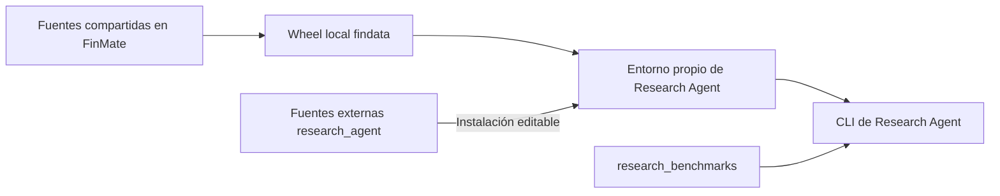

# Desarrollo y operación

> Operación y dependencias del proyecto externo. Revisión: 2026-10-24.
> Los detalles del wheel corresponden al corte del 2026-10-16; verificar el entorno efectivo.

## Dependencias y frontera de instalación

Una distribución instalable puede aportar varios paquetes importables:

| Distribución | Declaración | Paquetes que aporta |
|---|---|---|
| `research-agent==0.1.0` | [pyproject local](../pyproject.toml) | `research_agent`, `research_benchmarks` |
| `findata==0.1.0` | [pyproject de FinMate](../../FinMate/pyproject.toml) | `findata`, `infra`, `runtime_contracts`, `experience_audit`, módulos de observabilidad y otros paquetes del producto |

Findata, Infra y Experience Audit se instalan juntas desde el wheel local `findata`.
Que incluya código del producto no autoriza a cargarlo: los tests de frontera rechazan
`finmate`, `engine` y `api`. El núcleo tampoco importa `experience_audit` ni
`research_benchmarks`; Audit puede permanecer instalado sin ser usado.



### Bibliotecas reutilizadas

| Biblioteca | Uso en A | Frontera |
|---|---|---|
| Findata | Empresas, observaciones y tendencias v2 | PostgreSQL de solo lectura; sin ingesta o creación de tablas |
| Infra | `LLMFactory`, perfil, clientes, replay, reintentos, búsqueda y extracción Tavily | Sin fallback entre modelos añadido por el laboratorio |
| runtime_contracts | Mensajes, herramientas, continuaciones, errores, documentos y contexto técnico | Sin entidades, ORM o SDKs del producto |
| Observabilidad | Correlación y captura local de logs/payloads | Nombres históricos `engine.llm*`; sin exportador configurado aquí |
| research_benchmarks | Catálogo, campañas, extracción y compactación | Depende de Research Agent; no se importa desde el núcleo |

Engine mantiene reexportaciones de contratos por compatibilidad con sus consumidores.
El agente importa las definiciones canónicas de `runtime_contracts`; no necesita cargar
Engine. Véase la [decisión compartida](../../FinMate/docs/architecture/decisions/0004-shared-runtime-contracts.md).

### Editable frente a wheel

En el corte de extracción, Research Agent se instaló editable: los imports siguen
sus fuentes y los cambios de código se ven en la siguiente ejecución. Cambiar sus
metadatos o dependencias puede requerir reinstalarlo. El wheel compartido se instaló
como copia: editar FinMate no cambia esa instalación. Esto fija código, no datos,
web, modelos remotos o configuración; verificar el entorno antes de comparar.

## Instalación

Desde la raíz del proyecto, con Python >=3.11; el corte anterior se verificó con 3.12:

```powershell
py -3.12 -m venv .venv
# Primero obtener el wheel local construido desde las fuentes de FinMate.
.\.venv\Scripts\python.exe -m pip install -c constraints.txt "RUTA_LOCAL\findata-0.1.0-py3-none-any.whl"
.\.venv\Scripts\python.exe -m pip install -c constraints.txt -e .
.\.venv\Scripts\python.exe -m pip install -c constraints.txt pytest mypy types-PyYAML types-jsonschema
.\.venv\Scripts\python.exe -m pip check
```

Crear `.env` con la configuración indicada abajo solo si no existe. No sobrescribir
una configuración existente ni sustituir el wheel por un homónimo de un índice público.

`constraints.txt` conserva versiones del corte de extracción: limita la resolución,
no instala todo su contenido ni es un lock con hashes. El wheel inicial quedó en
`../FinMate/artifacts/experience-audit-validation/relocation-2026-10-16/wheels/`;
es evidencia local ignorada y puede no existir en otra máquina. Para trasladar el proyecto,
conservar también el wheel aprobado o reconstruirlo desde la revisión correspondiente.

## Configuración y servicios

La composición usa la configuración compartida del planificador (`LLM_PLANNER_PROVIDER`,
`LLM_PLANNER_MODEL` y ajustes asociados) con un perfil explícito llamado `lab`.
Las claves de proveedor y `TAVILY_API_KEY` se mantienen fuera de Git.

`DATABASE_URL` debe apuntar a PostgreSQL con datos ya disponibles. El esquema de URL
elige el controlador: `postgresql+psycopg` necesita psycopg 3; `postgresql` utiliza
normalmente psycopg2 con SQLAlchemy. SQLite no sustituye las lecturas v2. Usar además
credenciales de lectura cuando estén disponibles; A abre transacciones de solo lectura.

Se conserva OpenTelemetry por compatibilidad de dependencias. No es necesario configurar
un exportador para producir los registros locales. La instalación amplia del wheel puede
incluir dependencias del producto, pero las campañas propias no necesitan sus servicios,
usuarios, navegador ni instalar binarios de Playwright.

La CLI deriva las rutas de estado y ejecuciones de `--experiment`; la composición
directa recibe workspace y archivo explícitamente. Los prompts incluidos son recursos
del paquete; no se localizan buscando el checkout padre. Para ejecutar desde otra
carpeta, proporcionar configuración disponible allí o variables de entorno: no asumir
que se descubrirá automáticamente el `.env` de este proyecto.

## Actualizar una biblioteca compartida

1. Determinar el contrato y los consumidores afectados en FinMate. Cambiar allí la
   biblioteca, con sus pruebas; no editar `site-packages` o copiarla al agente.
2. Construir un wheel nuevo y conservar revisión de origen y SHA-256.
3. Actualizar deliberadamente el entorno del agente y ejecutar sus verificaciones.
4. Registrar la actualización y cualquier cambio experimental; conservar el wheel anterior.

Ejemplo desde Research Agent, con las dependencias de construcción instaladas:

```powershell
.\.venv\Scripts\python.exe -m pip wheel ..\FinMate --no-deps --no-build-isolation --wheel-dir artifacts/wheels
Get-FileHash artifacts/wheels/findata-0.1.0-py3-none-any.whl -Algorithm SHA256
.\.venv\Scripts\python.exe -m pip install --force-reinstall --no-deps artifacts/wheels/findata-0.1.0-py3-none-any.whl
.\.venv\Scripts\python.exe -m pip check
```

`--no-deps` presupone un entorno compatible; si cambian los requisitos, resolverlos
explícitamente antes de aceptar la actualización. El mismo número `0.1.0` puede ocultar
código distinto: registrar hash del wheel y revisión, no solo la versión. No reinstalar
silenciosamente durante una comparación experimental.

Extraer Findata o Audit como distribuciones independientes sigue siendo una decisión
futura. Puede hacerse si su evolución lo justifica; no es requisito del agente actual.
Las referencias documentales entre carpetas hermanas no son dependencias de ejecución.

## Ejecutar A: nuevo experimento o continuación

La CLI exige una operación explícita y un nombre humano:

```powershell
.\.venv\Scripts\python.exe -m research_agent "Investiga NVIDIA" --experiment ./artifacts/nvidia-conservacion --new --run-name investigacion-inicial
.\.venv\Scripts\python.exe -m research_agent "Continúa desde lo conservado" --experiment ./artifacts/nvidia-conservacion --continue --run-name revision-documental
```

`--new` rechaza cualquier ruta existente. `--continue` exige `estado/`, `instrucciones/`
y `ejecuciones/`, preserva archivos y arranca otro proceso sin recuperar el chat anterior.
Otra ruta con `--new` inicia una prueba independiente. No hay copia de estados en esta versión.
Las colisiones de nombres de run reciben sufijo consecutivo. Solo un run por experimento
puede estar activo; no borrar `.run.lock` para resolver contención.

Las instrucciones iniciales se copian de los recursos instalados. `--instructions archivo.md`
puede repetirse únicamente con `--new`; luego editar explícitamente los Markdown de
`instrucciones/`. Los manifiestos registran el contenido efectivo de cada run, por lo que
cambiar instrucciones entre continuaciones es visible y altera la condición experimental.
La evolución M1 del 2026-10-21 está integrada en `prompts/agent_a.md`: se copia al crear
experimentos nuevos y se usa directamente en la interfaz básica. No sustituye las copias
de experimentos existentes. Para adoptarla en una continuación, actualizar explícitamente
su `instrucciones/agente.md` desde el prompt vigente, conservando las personalizaciones
que correspondan y la versión anterior en Git; no sobrescribir capturas históricas.
`--conversation` conserva correlación; no restaura memoria de proceso.
`--timeout-seconds` ajusta el límite temporal. Las demás reservas están en
[arquitectura](architecture.md#conservación-y-cierre-de-la-investigación).

La CLI imprime respuesta, `run_id` técnico y resumen `state`. Retorna 0 si hay respuesta
(`completed`), 1 para otros resultados operativos y 2 para entradas inválidas. Revisar
`resultado.json`, motivo de cierre y `state.capture_errors`, no solo el código de salida.
`respuesta.md` es la entrega; `estado/` contiene lo recuperable para continuar.
No se permite al agente editar materiales originales, instrucciones ni archivo de runs.

Los argumentos antiguos `--workspace`, `--runs`, `--knowledge-mode` y `--case-store`
se rechazan con la nueva sintaxis. No apuntar la CLI nueva a E001/E002 para convertirlos:
sus capturas y fuentes congeladas son históricas y permanecen intactas.

### Versionar el estado manualmente

El sistema no inicializa ni modifica Git. Opcionalmente, crear un repositorio propio
para el experimento; los comandos siguientes los ejecuta la persona cuando proceda:

```powershell
git -C ./artifacts/nvidia-conservacion init
git -C ./artifacts/nvidia-conservacion add estado instrucciones .gitignore
git -C ./artifacts/nvidia-conservacion commit -m "Conservar estado de la investigacion"
```

El `.gitignore` inicial excluye `ejecuciones/`, `.run.lock` y archivos `.env`.
Revisar los datos antes de añadirlos. Este repositorio de datos es distinto del Git
del código y no tiene remoto configurado por el sistema. Los runs registran commit y
cambios pendientes al inicio/final, sin atribuirse el repositorio padre. No tener Git
es válido. Git manual conserva solo versiones que se hayan registrado; los snapshots
del run conservan sus extremos, sin prometer todas las ediciones intermedias.

## Benchmark piloto

Desde la raíz del repositorio:

```powershell
.\.venv\Scripts\python.exe -m research_benchmarks validate benchmarks/longitudinal-v1
.\.venv\Scripts\python.exe -m research_benchmarks run benchmarks/longitudinal-v1 --output artifacts/benchmark
.\.venv\Scripts\python.exe -m research_benchmarks run benchmarks/longitudinal-v1 --case S2 --output artifacts/benchmark
```

`validate` no construye clientes ni consulta servicios. `run` llama al agente real y
requiere la configuración de proveedor, Findata y Tavily habitual; no realiza ingestas
ni migraciones. Ejecuta una sesión por subprocess, en secuencia, conservando archivos
sin restaurar el chat. Los límites son los actuales de A. No modifica prompts ni
el wheel instalado. El [protocolo](experiments/longitudinal-v1/protocol.md)
posee definiciones, rúbricas y límites de interpretación.

Cada invocación crea una carpeta de campaña nueva bajo `--output` e imprime su ruta.
`--case` elige un ID exacto; sin filtro, el orden es S1, S2 y S3. No hay resume ni
reintentos automáticos de sesiones. Una sesión fallida o con captura incompleta bloquea
las siguientes de su caso; los otros casos continúan. Ctrl+C conserva lo disponible.
Retornos: 0 = todas las sesiones completadas con captura íntegra; 1 = fallo operativo,
interrupción o captura incompleta; 2 = argumentos/definiciones inválidos. No son notas
de calidad financiera.

Consultar primero `LEEME.md` y `resumen.json`, que incluye los metadatos de cada sesión
y apunta a `casos/ID/ejecuciones/`. Al cerrar la campaña se consolida la captura nativa,
sin cambiar el agente. Cada sesión completa contiene cinco archivos: `ejecucion.json`
(petición, configuración, resultado y hashes), `trayectoria.jsonl.gz`, `respuesta.md`
y los dos snapshots. Las instrucciones efectivas se congelan por hash bajo
`definiciones/instrucciones/`; fuentes y rúbricas también permanecen fuera del estado.
La revisión de calidad sigue siendo humana/Codex, con criterios y citas de evidencia;
el índice no inventa puntuaciones ni explicaciones de acciones.

La trayectoria reúne eventos, entradas/salidas del modelo y ejecuciones de herramientas.
Conserva separadamente el resultado original y el entregado al modelo, aunque pueda
reconstruir ambos desde un único contenido. Los snapshots conservan texto del conocimiento
y referencias verificadas a materiales. Las citas históricas de resultados siguen
disponibles mediante `read_artifact`; no apuntan necesariamente a archivos individuales.
No se guarda conversación, stdout correcto ni errores vacíos como copias adicionales.
Si hay captura incompleta, se retienen los originales nativos y diagnósticos.

Para exportar una campaña anterior a otra carpeta, conservando el origen intacto:

```powershell
.\.venv\Scripts\python.exe -m research_benchmarks compact artifacts/benchmark/ID --output artifacts/benchmark-compact/ID
```

El destino debe ser nuevo y separado del origen. La conversión verifica reconstrucción
de resultados de herramientas y snapshots antes de retirar copias en el destino. No
consulta proveedores. `recording_format` identifica cada sesión; capturas antiguas y
compactas son consultables por el mismo extractor.

Para regenerar la vista breve sin ejecutar el agente:

```powershell
.\.venv\Scripts\python.exe -m research_benchmarks extract RUTA_DE_CAMPAÑA
```

`pasos.jsonl` incluye caso, sesión, run, acción, identificadores disponibles, fragmentos
breves y referencias al original. No estima razonamiento privado ni puntúa respuestas.
En formato compacto una herramienta y su resultado comparten un registro `tool_execution`;
`line` identifica la secuencia descomprimida de `trayectoria.jsonl.gz`.
`extraccion.json` informa de capturas ausentes o dañadas al regenerar, sin modificar
los registros originales de sesión.
Los campos desconocidos permanecen nulos; los hashes detectan modificaciones de las
entradas publicadas. No hay Excel ni evaluación automática en esta versión.
`artifacts/` es local e ignorado; conservar el archivo completo para revisar o trasladar
evidencia, previa revisión de datos privados.

Para inspección detallada desde Python, las funciones públicas del módulo
`research_agent.archive` son `records(run)`, `full_result(campaign, record)`,
`delivered_result(campaign, record)` y `restore_snapshot(campaign, snapshot)`.
Las dos últimas reconstruyen lo efectivamente entregado y el estado histórico, sin
inferencias. Las referencias a materiales e instrucciones comprueban sus hashes.

## Experience Audit histórico

La integración local, sus escenarios y sus pruebas se retiraron el 2026-10-24.
El wheel compartido no se modifica. Las campañas actuales usan la CLI propia y
`python -m research_benchmarks`; los archivos históricos no se reescriben.

## Verificación proporcionada al cambio

| Cambio | Verificación esperada |
|---|---|
| Solo documentación | Contrastar afirmaciones, enlaces, ejemplos y `git diff --check` |
| Ciclo, memoria o herramientas | Tests locales afectados y regresión de fronteras |
| Contrato compartido | Pruebas de sus consumidores en FinMate, wheel nuevo y regresión local |
| Proveedor o acceso a datos | Primero transportes controlados; después aceptación real autorizada y archivada |
| Hipótesis financiera | Campaña y revisión semántica con rúbrica previa, además de checks |

Comandos de comprobación local sin campaña real:

```powershell
.\.venv\Scripts\python.exe -m pytest -q tests
.\.venv\Scripts\python.exe -m mypy src/research_agent src/research_benchmarks --follow-imports=silent
.\.venv\Scripts\python.exe -m pip check
git diff --check
```

La suite incluye subprocess que bloquea imports de `finmate`, `engine` y `api`. El núcleo tampoco importa `experience_audit` ni
`research_benchmarks`; Audit puede permanecer instalado sin ser usado.
El comprobador local de enlaces y anclas se ejecuta con
`.\.venv\Scripts\python.exe scripts/check_docs.py`; no necesita servicios remotos.
No utiliza el catálogo documental de FinMate. Si también cambia documentación de FinMate,
ejecutar allí su propio flujo documental; no copiar el catálogo al laboratorio.

Un cambio documental no necesita llamadas a modelos o PostgreSQL. Tampoco acredita
aceptación financiera. No confundir un resultado histórico enlazado con una prueba
repetida en el entorno actual. Registrar qué se comprobó y qué quedó fuera.

## Ejecutar el modo continuo experimental

El [protocolo](experiments/contexto-continuo-v1/protocol.md) define alcance y aceptación.
Actualizar la instalación editable desde el pyproject vigente. El presupuesto continuo
usa bytes UTF-8 sin tokenizer ni dependencias nuevas; no cambia el wheel compartido.

Ejemplo de operación para una ejecución futura autorizada, no un check documental:

```powershell
.\.venv\Scripts\python.exe -m research_agent "Continúa investigando el mandato" --experiment ./artifacts/continuo --new --run-name inicial --continuous --mandate ./mandato.md --max-calls 60 --continuous-timeout-seconds 1200
.\.venv\Scripts\python.exe -m research_agent "Retoma desde lo conservado" --experiment ./artifacts/continuo --continue --run-name reanudacion --continuous --mandate ./mandato.md --max-calls 60
```

`--context-bytes` (524288) y `--consolidation-bytes` (262144) controlan la ventana;
`--max-calls`, `--max-tools` y `--continuous-timeout-seconds` son límites globales
opcionales por ejecución. Sin ellos continúa hasta interrupción o error. `--timeout-seconds`
conserva un timeout finito por operación (300 segundos por defecto). No se admite
`--limits` junto con `--continuous`, ni opciones continuas en modo acotado.
La API directa recibe `AgentRequest(..., continuous=ContinuousConfig(...))` y necesita
provider, model y max_output_tokens efectivos en la configuración de A.

Con `--simulation PATH`, usar un simulador previamente preparado y separado del estado:
se conserva su fecha, no se ejecuta el calendario longitudinal y las órdenes no avanzan
por renovar contexto. Sin simulador, siguen disponibles las herramientas habituales;
eso no constituye un escenario histórico congelado.

El modo requiere un mandato externo y una salida máxima positiva en el perfil. No
sustituye el modelo configurado: `gpt-6-luna` ya no está bloqueado por un mapping de
tokenizer. El presupuesto incluye entrada serializada, margen del 10 % y una reserva
heurística de ocho bytes por token máximo de salida; no acredita tokens reales ni
capacidad remota. No se aceptan las antiguas opciones `--context-tokens` y
`--consolidation-tokens`, para evitar reinterpretar unidades silenciosamente.

El [protocolo del piloto](experiments/contexto-continuo-v1/protocol.md#preparación-y-ejecución-manual)
contiene el comando de preparación offline, comprobación y ejecución manual. La preparación
crea un estado nuevo con las instrucciones vigentes; por eso el primer comando generado
usa `--continue`. La comprobación rechaza entradas/runtime cambiados o un destino ya usado.

La CLI indica `continuous=interrupted: call_limit|tool_limit|time_limit` en pausas
controladas y retorna 0; otros fallos retornan 1, argumentos inválidos 2. Una pausa
no es `completed`. Para reanudar, usar `--continue`: conserva archivos y estado económico,
abre otro archivo de ejecución y no repite herramientas previas. No hay reinicio automático.
`conversacion-completa.jsonl` es el historial entre ventanas; el JSON habitual contiene
la última ventana. Consultar también eventos, resultados originales y trazas de consumo.

## Baseline y comparabilidad

El [baseline](baseline.md) identifica código, prompts y wheel de referencia. Un run
con `--new` reproduce el mecanismo, pero no congela web, datos ni configuración del
entorno. Comparar manifiestos y conservar entradas idénticas antes de atribuir una
mejora a un cambio. La guía del baseline separa checks locales y evidencia semántica.

## Entrega y continuidad

Actualizar la referencia propietaria y el índice cuando cambie el mapa. Las entregas
en `docs/deliveries/` indican fecha, base, cambio, verificaciones, límites y siguiente
paso, sin duplicar el diseño. Los [protocolos y hallazgos](experiments/README.md)
conservan lo aprendido; las [decisiones](decisions/README.md), las elecciones duraderas.
La prioridad vigente está en [estrategia](strategy.md).

No incorporar `.env`, payloads privados o estados reales al Git del código. El Git local del experimento es una elección humana con revisión de sus materiales. `artifacts/`
está ignorado; citar una ruta allí no hace portable la evidencia. Las guías pueden
describir el procedimiento, mientras las capturas completas se conservan localmente.
No realizar commit, push o despliegue sin autorización del usuario.

## Laboratorio longitudinal

La [guía del experimento](experiments/colaboracion-historica-v1/protocol.md) documenta
`longitudinal validate`, `preflight`, `run` y `resume`, y separa prueba sintética y
campaña histórica. Requiere el wheel experimental de la
[entrega](deliveries/2026-10-24-longitudinal.md). No reutilizar el wheel anterior para
este modo ni editar `site-packages`. Las campañas existentes conservan su CLI.

### Intención persistente opcional

El [piloto de seis activaciones](experiments/intencion-persistente-v1/protocol.md)
incluye comandos para comprobar perfil/dataset sin red y ejecutar después dos campañas
independientes con `--condition baseline` y `--condition deliberative`. Está preparado,
sin ejecutar. No usar `longitudinal preflight` para un check documental: exporta Findata.

En CLI manual, `--mandate PATH` activa la condición y debe suministrarse en cada
continuación. El archivo UTF-8 auténtico lo mantiene la persona fuera de `estado/` y
`ejecuciones/`; no se resume ni se copia automáticamente desde una petición breve.
Con `--new` se copian instrucciones deliberativas y se crea una agenda vacía. Con
`--continue` se exigen esos archivos, sin actualizar instrucciones anteriores.

```powershell
.\.venv\Scripts\python.exe -m research_agent "Comienza la investigación" --experiment artifacts/intencion-manual --new --run-name inicial --mandate C:/ruta/mandato.md
.\.venv\Scripts\python.exe -m research_agent "Continúa" --experiment artifacts/intencion-manual --continue --run-name continuacion --mandate C:/ruta/mandato.md
```

Estos dos comandos llaman al proveedor. Reemplazar la ruta del mandato por el archivo
real; no almacenar secretos en él. Mandato no vacío hasta 16 KiB, agenda hasta 8 KiB;
los errores se diagnostican antes de construir clientes desde la CLI. No apuntar el
mandato a memoria generada por A: la ruta externa delimita acceso, no autentica autoría.
El control longitudinal genera el archivo desde los mensajes congelados por fecha.

## Metodología financiera longitudinal

Los experimentos nuevos copian la metodología financiera y la convención Markdown
vigentes. Los existentes conservan sus instrucciones; no se migran automáticamente.
El [nuevo contraste](experiments/analisis-financiero-v1/protocol.md) conserva el control
histórico y documenta los comandos preparados, sin campaña ejecutada.

`longitudinal run --instructions-dir DIRECTORIO` sustituye las plantillas por un
conjunto completo de instrucciones al crear una campaña. Para `--condition deliberative`
exige exactamente `agente.md`, `deliberacion.md` e `investigacion-financiera.md`; para
baseline, los dos archivos no deliberativos. Todos deben ser archivos UTF-8 no vacíos,
sin entradas extra. No equivale a la opción aditiva `--instructions` de la CLI manual.
`resume` solo usa las copias congeladas y rechaza alteraciones. La CLI manual mantiene
su interfaz actual; `prepare_experiment` ofrece el parámetro a composiciones locales.

La verificación de implementación usa clientes controlados sin proveedores ni bases
remotas. Los casos y rúbrica semánticos quedan preparados sin ejecutar: su futura
aplicación requiere corpus por etapas y captura, según el protocolo. Los tests prescritos
no demuestran elección autónoma de acciones ni razonamiento financiero superior.
