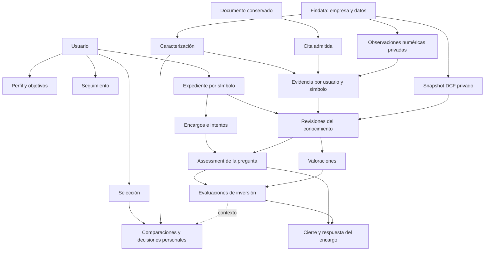
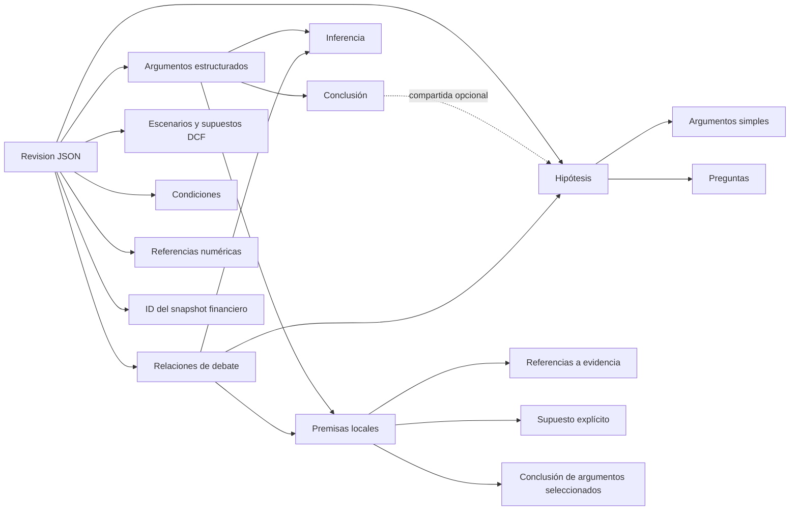
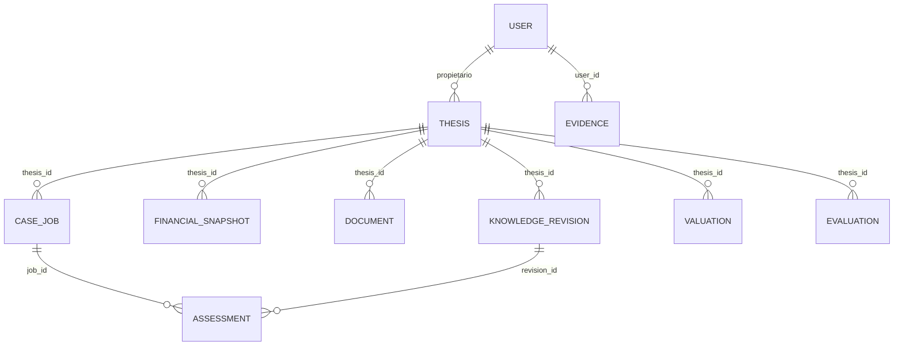
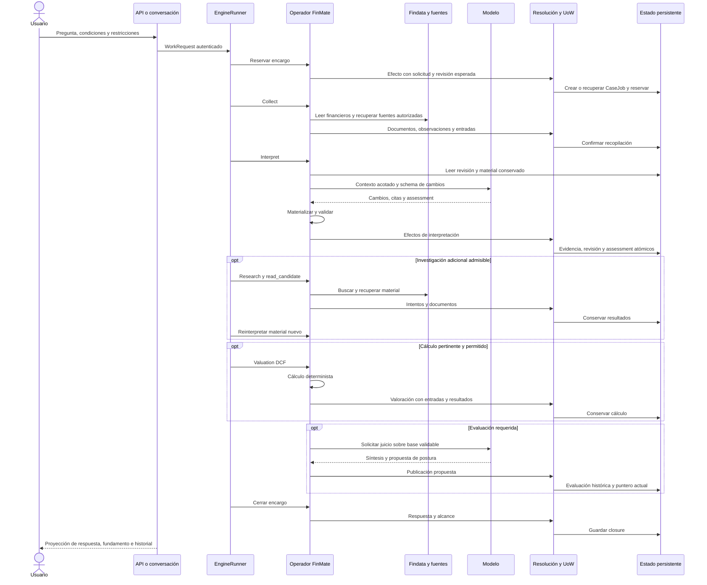

# Arqueología del conocimiento de FinMate

> Estado: investigación del checkout; reconstrucción conceptual y física, sin rediseño implementado.
> Última revisión: 2026-10-17. Autoridad: código, contratos, migraciones y pruebas referenciados.
> Base Git: `651686c23921ee002f7b38be5f23101cc81a6d25`, rama `feature/tesis`, con cambios locales preexistentes.
> Alcance: FinMate actual. «Research Lab» nombra el destino experimental indicado por el usuario; no se presupone su implementación.

## Cómo leer este documento

Este informe responde al primer paso del documento «FinMate — Rediseño del modelo de conocimiento y reconstrucción experimental de la arquitectura», de 17 de octubre de 2026: comprender qué representa FinMate hoy, cómo lo conserva, cómo cambia y qué consumen sus interfaces. No selecciona un modelo alternativo ni autoriza una migración.

Los tres entregables solicitados en aquella propuesta se reúnen aquí:

| Entregable | Contenido de este informe |
|---|---|
| A. Modelo conceptual actual | Secciones 1–12: conceptos, significados, fronteras y operaciones |
| B. Relaciones y ciclos de vida | Secciones 13–18: diagramas, recorrido completo, historia y ejemplos |
| C. Diagnóstico crítico | Secciones 19–24: observaciones, hipótesis y preguntas para el siguiente experimento |

El [anexo de estructuras](estructuras-y-campos.md) permite descender a los campos de modelos SQLAlchemy y contratos de datos. El [manifiesto de fuentes](fuentes.json) identifica mediante SHA-256 los archivos inventariados. La [entrega](delivery.md) registra comprobaciones y límites. El anexo describe declaraciones de código; no es un volcado de una base de datos.

Para navegar por el informe:

| Lectura | Entrada |
|---|---|
| Entender el mapa y sus límites | [Resultado principal](#1-resultado-principal-cuál-es-el-modelo-actual) |
| Usuario y mundo financiero | [Usuario y objetivos](#4-usuario-objetivos-seguimiento-y-posiciones) |
| Núcleo epistemológico | [Expediente y revisión](#7-expediente-y-revisión-del-conocimiento) |
| Procedencia y cifras | [Fuente documental y evidencia](#9-fuente-documental-observación-y-evidencia-numérica) |
| Qué significa una conclusión | [Análisis, valoración y evaluación](#10-análisis-hallazgos-valoración-evaluación-y-respuesta) |
| Intención y memoria durable de investigación | [Encargo y estado del agente](#11-intención-encargo-investigación-y-estado-del-agente) |
| Diagramas y almacenamiento | [Relaciones](#13-relaciones-conceptuales-y-jerarquías) |
| Seguir el recorrido completo | [Ciclo del conocimiento](#15-ciclo-completo-de-intención-a-conocimiento-persistente) |
| Ver la conexión con la experiencia | [Presentación y conversación](#19-presentación-conversación-y-recuperación-del-conocimiento) |
| Preparar el siguiente experimento | [Diagnóstico crítico](#21-diagnóstico-crítico-observaciones-verificadas) |

Se usan cuatro etiquetas de evidencia:

- **Verificado en código:** lectura de una declaración, productor, consumidor o validación identificables.
- **Comprobado con prueba local:** resultado de las suites especificadas en la entrega; datos y proveedores controlados.
- **Inferencia arquitectónica:** consecuencia razonada de estructuras observadas, sin medición suficiente de su impacto.
- **Hipótesis experimental:** cuestión a contrastar; no defecto demostrado ni decisión de eliminación.

Los ejemplos `AAA`, Alpha, renovaciones, precios y costes proceden de fixtures del repositorio. Son ejemplos reales de representación y comportamiento de pruebas, no evidencia real sobre una compañía cotizada. No se han consultado expedientes privados, bases compartidas ni proveedores externos. Tampoco se han reejecutado campañas financieras con modelos reales.

## 1. Resultado principal: cuál es el modelo actual

FinMate no contiene una base de conocimiento única que reúna en una ontología homogénea todo lo que el sistema sabe. Contiene varios sistemas de representación conectados por identificadores, lecturas, snapshots y reglas de compatibilidad.

La separación más útil es esta:

1. **Mundo financiero compartido:** observaciones y derivados de Findata, identificados principalmente por símbolo, proveedor y periodo.
2. **Mundo privado del usuario:** perfil, objetivos, seguimiento, selecciones, evidencias y expedientes.
3. **Conocimiento argumentativo del expediente:** revisiones tipadas con hipótesis, argumentos, relaciones, preguntas, escenarios y referencias.
4. **Interpretaciones y entregas:** análisis de una pregunta, evaluación de inversión y respuesta guardada a un encargo; son objetos distintos.
5. **Estado de investigación:** solicitud, permisos, presupuestos, intentos, reservas, errores y continuación.
6. **Estado temporal de interacción:** mensajes, referencias, restricciones conversacionales y foco visual, locales al proceso.
7. **Proyecciones:** representaciones de lectura para planificar, conversar, comparar y mostrar tarjetas.
8. **Evidencia de ejecución:** logs, capturas y archivos de auditoría que permiten investigar lo ocurrido, sin convertirse por ello en fundamento de una tesis.

La idea de «expediente vivo» se realiza mediante un agregado estable con punteros a artefactos históricos. La vivacidad no procede de editar continuamente un documento único ni de monitorizar automáticamente el mercado: procede de abrir encargos bajo demanda que producen nuevas revisiones y evaluaciones, conservando antecedentes.

Una consecuencia decisiva para Research Lab: el punto de comparación no es simplemente «grafo SQL frente a Markdown». El expediente vigente ya combina **contenedores relacionales, documentos JSON tipados, referencias internas y transiciones transaccionales**. El grafo argumentativo principal vive dentro de esos documentos, no en tablas separadas de nodos y aristas.

Fuentes principales: [visión y límites](../../../docs/product/vision.md), [mapa de datos](../../../docs/architecture/data-map.md), [modelos del dominio](../../../finmate/state/models/__init__.py), [contratos del expediente](../../../finmate/casefile/contracts.py), [lecturas comunes](../../../finmate/casefile/reads.py).

## 2. Límites de la reconstrucción y corte observado

### 2.1. Código actual frente a historia

La raíz Git es `C:\Users\Daniel\Proyectos\FinMate`; el subdirectorio `finmate/` es un paquete. La inspección se ha realizado desde la raíz. Había modificaciones locales en Engine, Infra, auditoría, documentación y configuración, además de contratos compartidos y archivos del agente externo sin seguimiento. El informe caracteriza ese árbol de trabajo, no exclusivamente el commit base ni un despliegue.

Las migraciones antiguas contienen entidades que ya no pertenecen al modelo activo. La migración [d1e2f3a4b5c6](../../../alembic/versions/d1e2f3a4b5c6_investment_case_reset.py) elimina, entre otras, las tablas de componentes de tesis, relaciones de componentes, revisiones de creencias, decisiones/propuestas de entrada y supuestos de valoración de la etapa anterior. Reconstruye el expediente con las tablas actuales y declara irreversible el reinicio.

Por tanto, encontrar `domain_belief_revisions` en una migración no demuestra que exista una capacidad actual de gestión de creencias. Tampoco deben interpretarse campos históricos como autoridades del runtime actual.

### 2.2. Relación con el laboratorio externo

La guía local [Research Agent fuera de FinMate](../../../docs/development/research-agent.md) sitúa el agente extraído en un proyecto hermano llamado `research_agent`. El usuario denomina su proyecto experimental Research Lab. Este informe no intenta resolver la nomenclatura, auditar aquel proyecto ni trasladar archivos a él. El documento es portable y se conserva en FinMate para mantener trazabilidad con las fuentes examinadas.

### 2.3. Lo que este trabajo puede afirmar

Se pueden reconstruir contratos, productores, consumidores, restricciones y casos ejecutables con fixtures. No se puede afirmar aquí cuántos expedientes de una base real contienen cada estructura, qué proporción de hipótesis resulta útil, cuánto cuesta mantenerlas con proveedores reales ni si el sistema mejora decisiones de inversión. Esas son mediciones posteriores.

## 3. Mapa de ámbitos, identidades y autoridades

| Ámbito | Identidad predominante | Propietario o autoridad | Persistencia | Qué no significa |
|---|---|---|---|---|
| Empresa/instrumento | `symbol` | Findata y sus proveedores | Tablas financieras | No es un expediente privado |
| Usuario | `User.id`, `external_id` | Frontera autenticada | `domain_users` | El modelo no elige al propietario |
| Perfil | `user_id`, revisión | Usuario confirmado | Tablas de perfil | No son preferencias inferidas del chat |
| Seguimiento | usuario y símbolo consultados | Usuario | `domain_watchlist_items` | Seguir no implica tener posición |
| Expediente | UUID y unicidad usuario/símbolo | Usuario, handlers de FinMate | `domain_theses` | No es una sola hipótesis |
| Revisión del expediente | UUID y secuencia | Commit validado del dominio | Fila con JSON | No equivale a versión Git |
| Evidencia | UUID, usuario/símbolo | Productor y validación del recorrido | `domain_evidence` | Una etiqueta de fuente no acredita verdad |
| Documento | UUID, hash de contenido, expediente | Recuperador y commit | `domain_thesis_documents` | Una URL sola no preserva contenido |
| Hipótesis/argumento/relación | ID dentro de revisión | Contrato y materialización | Dentro de JSON | No son filas SQL independientes |
| Premisa | ID local al argumento | Argumento propietario | Dentro de JSON | `p` por sí solo no identifica una premisa global |
| Análisis del encargo | UUID, trabajo, revisión, objetivo | Interpretación validada | `domain_case_analysis_assessments` | No es una evaluación de inversión |
| Valoración | UUID, huella de entradas | Cálculo determinista | `domain_valuations` | Un valor por acción no es postura |
| Evaluación de inversión | UUID, revisión, política | Publicación validada | `domain_thesis_evaluations` | No ejecuta una compra |
| Encargo | UUID, usuario/request_id | Solicitud autorizada | `domain_case_jobs` | Terminar no acredita calidad financiera |
| Selección | UUID y revisión | Usuario | Tablas de selección | Preferencia preliminar no es orden |
| Conversación | usuario/conversation_id | Sesión autenticada | Memoria del proceso | No garantiza continuidad tras reinicio |

Una misma empresa puede tener expedientes distintos de dos usuarios. El contenido financiero compartido puede coincidir, pero preguntas, fuentes incorporadas, condiciones personales y conclusiones pertenecen al ámbito privado. No se observa un repositorio universal de afirmaciones semánticas deduplicadas entre expedientes.

Hay varios tipos de identidad a la vez: identidad económica por símbolo, identidad persistente por UUID, identidad local de elementos JSON, identidad de contenido por hash, identidad de operación por `request_id` e identidad de ejecución por `run_id`. Son funciones distintas; fusionarlas eliminaría controles diferentes.

## 4. Usuario, objetivos, seguimiento y posiciones

### 4.1. Usuario

**Definición y propósito.** `User` representa al propietario del estado privado. Conserva un ID interno, un identificador externo opcional y único, nombre de cartera y fechas. No representa un agente cognitivo ni una tesis.

**Relaciones.** Es padre de posiciones, seguimiento y búsquedas guardadas, y propietario de expedientes, perfil, evidencias y selecciones. La identidad efectiva procede de la autenticación y del contexto de ejecución.

**Ciclo y operaciones.** Las rutas autenticadas resuelven el usuario; los repositorios consultan su estado. Los modelos privados utilizan referencias a `domain_users` y numerosas relaciones con borrado en cascada. La conservación histórica de un expediente no implica conservación frente al borrado de su propietario.

**Límite.** La capa de contratos del modelo no admite convertir un `user_id` generado por el LLM en autoridad. Fuente: [usuario](../../../finmate/state/models/user.py), [contexto](../../../finmate/context/catalog.py).

### 4.2. Perfil y hecho confirmado

**Definición.** El perfil es un agregado revisable. Un `UserProfileFact` es un par clave/valor de un catálogo cerrado; no una afirmación financiera libre.

**Contenido.** Horizonte de inversión, necesidad de liquidez, incomodidad ante caídas, experiencia, actividades excluidas y detalle de respuesta. El contrato valida opciones o rangos por clave. El valor se guarda en JSON, pero su significado lo limita el catálogo Python.

**Relaciones y ciclo.** Un perfil por usuario; una clave única por usuario. Una actualización transmite snapshot de hechos/objetivos, revisión esperada e identidad de petición. `ProfileMutationRequest` conserva hash y revisión resultante para idempotencia. El reset elimina contenido; no hay aquí una secuencia inmutable equivalente a las revisiones del expediente.

**Productores y consumidores.** UI/API y operador `profile_update`; el chat y `finmate/context/personal.py` pueden leerlo. La escritura conversacional libre no está registrada. Consultar el perfil no convierte automáticamente sus preferencias en condiciones de un DCF ni modifica las políticas deterministas de selección.

**Ejemplo.** `investment_horizon=over_ten_years` expresa una preferencia confirmada. `Conditions.horizon_years=5` pertenece al contexto de un expediente. No hay que tratarlos como el mismo campo ni inferir una sincronización automática.

Fuentes: [contrato](../../../finmate/profile/contracts.py), [modelos](../../../finmate/state/models/profile.py), [efectos](../../../finmate/domain/profile_effects.py).

### 4.3. Objetivo del usuario

`UserGoal` registra clase, título, descripción, estado, prioridad, fecha y objetivo monetario opcional. Las clases incluyen crecimiento, rentas, preservación de capital, jubilación y gran compra. Un objetivo activo necesita prioridad; uno no activo carece de ella. Importe y moneda se exigen juntos.

El objetivo es una intención personal durable. No es `CaseRequest.question`, no es una pregunta epistemológica y no es un `WorkAssessment`. El contrato permite describir lo que quiere el usuario; no implementa por sí solo optimización de cartera orientada a objetivos. El mismo productor de perfil lo sustituye y los lectores de contexto lo consumen.

### 4.4. Seguimiento

`WatchlistItem` registra usuario, símbolo, estado `watching/exploring/archived`, notas y fechas. Las operaciones de seguimiento añaden, anotan, cambian estado o recuperan elementos. Lo consumen Inicio, Seguir, contexto y proyecciones de oportunidades.

Representa atención o interés, no evidencia sobre la empresa. Una nota puede contener texto económico, pero no pasa automáticamente a una observación documental validada. Archivar seguimiento tampoco equivale a retirar un argumento ni cerrar una posición. Fuente: [modelo](../../../finmate/state/models/user.py), [operador](../../../finmate/operators/watchlist_operator.py).

### 4.5. Posición de cartera

Existe `Position`: usuario, símbolo, acciones, coste medio, fecha de apertura/cierre y fechas de registro. Hay un [repositorio](../../../finmate/state/repositories/position_repository.py). Es una representación física de tenencia, distinta de la dirección `long/neutral` de una evaluación.

El inventario de capacidades vigente declara que no existe una experiencia integrada de cartera, asignación u órdenes de bróker. En el catálogo inspeccionado no aparece un recorrido de gestión de posiciones comparable al del expediente. **Existencia de tabla y repositorio** es la afirmación demostrable; **gestión autónoma de cartera** no lo es.

La tabla tampoco constituye un libro mayor de transacciones: modela posición y coste medio, no una secuencia completa de compras, ventas, dividendos, comisiones y conciliaciones.

## 5. Empresa, hechos y datos financieros

### 5.1. Empresa e instrumento

En Findata v2 `Instrument` tiene símbolo, estado y fechas de seguimiento/observación. `InstrumentObservation` conserva atributos obtenidos de un proveedor: nombre, descripción, mercado, país, sector, moneda, capitalización, acciones, beta y ratios, junto a fechas y hash.

`CompanyProfile` es una proyección derivada por símbolo, con proveedor elegido y metadatos de derivación. No debe confundirse la identidad del instrumento con su descripción vigente ni con el perfil del usuario.

La organización principal por `symbol` simplifica unir datos y expedientes. No se ha observado en este corte una identidad conceptual rica que modele separadamente emisor, clase de acción, instrumento, cotización en mercado y cambios históricos de ticker. Esto es un límite de la representación examinada, no una prueba de fallos actuales con símbolos concretos.

### 5.2. Observación financiera de proveedor

`FinancialFact` registra proveedor, símbolo, cierre fiscal, tipo de periodo, partida, valor, moneda, publicación conocida, ingesta y hash. `PriceBar` registra OHLCV por proveedor/símbolo/fecha. `MacroObservation` registra proveedor/serie/fecha.

Estas estructuras describen datos recibidos; no incluyen argumento o juicio. Periodo económico, fecha de publicación e ingesta son dimensiones temporales diferentes. La fecha fiscal no acredita cuándo se conocía una cifra.

**Matiz físico importante.** La clave de `FinancialFact` no incluye el hash ni la fecha de ingesta. [El writer](../../../findata/ingest/writer.py) usa `on_conflict_do_update` para la misma partida/proveedor/periodo. Conserva el dato vigente de esa clave, no todas sus versiones históricas. Ocurre una actualización análoga con barras de precio. En cambio, `InstrumentObservation` distingue contenidos por proveedor/símbolo/hash.

Por ello, «datos financieros con procedencia» no equivale a «almacén bitemporal completo de todas las correcciones de proveedores». La reproducción de una valoración privada depende de sus entradas congeladas, no de que Findata retenga indefinidamente cada versión recibida.

### 5.3. Derivado financiero

`FundamentalsPeriod` reúne partidas y métricas por símbolo/periodo/tipo. `SymbolMetric` contiene métricas actuales: rentabilidad, crecimiento, múltiplos, señales técnicas y riesgo histórico. `SectorStat` contiene estadísticas por sector/métrica; `BenchmarkIndexDaily`, índice y constituyentes; `MacroLatest`, el último punto de cada serie.

Los derivados incorporan `formula_version`, `derived_at`, `source_max_ingested_at` y `batch_id`. Estos campos permiten relacionar resultado y proceso de derivación; no son una justificación económica de una tesis.

### 5.4. Cobertura y disponibilidad

`SymbolCoverage` expresa disponibilidad de perfil, precios y estados, fechas, periodos alineados y bandera `dcf_ready`. `DerivationQueue` y `DerivationState` registran trabajo pendiente y estado del pipeline de datos.

Cobertura es conocimiento sobre disponibilidad de datos. La bandera de cobertura no sustituye el diagnóstico efectivo de entradas DCF ni la elegibilidad del modelo de negocio. Las lecturas v2 requieren PostgreSQL; que una prueba de dominio use SQLite no demuestra que reproduzca las consultas financieras v2.

Fuentes: [modelos v2](../../../findata/models/v2.py), [contratos de lectura](../../../findata/contracts/models.py), [operación](../../../docs/operations/findata.md), [valoración](../../../findata/read/valuation.py).

## 6. Caracterización, dimensiones, análisis y evidencia compartida por recorridos

### 6.1. Caracterización de empresa

`characterize_company` produce una descripción inicial sin abrir expediente. Consume perfil y métricas de Findata; pide al modelo arquetipo, materialidad y priors sobre ocho dimensiones. Cada prior exige referencias del catálogo factual disponible.

Produce tres clases de efectos: `Analysis` fundamental con `kind=company_characterization`, evidencias de origen `initial_characterization` relacionadas con dimensiones y un `DeliberationJob` completado. La caracterización guarda versión de catálogo, arquetipo, materialidad, métricas y versión de fórmulas.

Su vigencia se reconoce comparando `catalog_version`, que deriva de dimensiones, métricas, fórmulas, prompt y política de evidencia. El contrato no debe confundirse con una valoración completa de inversión. Aunque los priors procedan de una interpretación del modelo apoyada en datos, se guardan como `Evidence` con fuente `findata`. Esto muestra que la tabla de evidencia es más amplia que una colección homogénea de observaciones primarias.

Fuentes: [productor](../../../finmate/operators/characterize_company.py), [vigencia](../../../finmate/domain/characterization.py).

### 6.2. Dimensión de análisis

El catálogo define `business_economics`, `competitive_advantage`, `growth`, `profitability`, `balance_sheet`, `valuation`, `risks` y `catalysts`. `EvidenceLink` relaciona evidencia y dimensión con unicidad por par.

Una dimensión es un eje organizador, no una hipótesis. Su evaluación derivada distingue `sin_cubrir`, `sostenida_por_prior` y `con_soporte`, además de obsolescencia y contradicción. No es una probabilidad de que una inversión vaya bien.

El código admite `DimensionConflict`, pero `State.dimension_assessments` construye actualmente un mapa vacío de conflictos. La capacidad del tipo no acredita una alimentación general de contradicciones desde el debate del expediente.

### 6.3. Política de calidad de evidencia

`evaluate_evidence_quality` calcula admisibilidad, peso de fuente, ventana temporal, obsolescencia y peso efectivo. Por ejemplo, la política de dimensiones excluye `agent_inference` como evidencia admisible y combina ventanas de fuente y dimensión.

Este mecanismo sí usa pesos deterministas. Debe distinguirse de la argumentación del expediente, que no suma argumentos para obtener convicción. Los pesos no son probabilidades calibradas ni pruebas de verdad. Tampoco puede inferirse que todas las lecturas y publicaciones del expediente apliquen exactamente esta política: hay validaciones propias de referencias, contexto económico y caducidad.

Fuentes: [dimensiones](../../../finmate/domain/attention.py), [calidad](../../../finmate/domain/evidence_quality.py), [estado](../../../finmate/domain/state.py).

### 6.4. `Analysis` genérico

La tabla `domain_analyses` contiene tipo fundamental, técnico, sectorial, competitivo o briefing de evento; contenido JSON; autor; símbolo; usuario opcional; vínculo de evento cuando corresponde y fechas. Es un contenedor de artefactos analíticos de diferentes recorridos.

No es el mismo objeto que `Analysis` de `casefile/contracts.py`: este último es un contrato transitorio que reúne revisión, observaciones y assessment para validar una interpretación. Tampoco es la fila inmutable `CaseAnalysisAssessment`.

La repetición del nombre es semánticamente relevante: una búsqueda de «analysis» devuelve al menos un artefacto persistido genérico, una propuesta de interpretación del expediente y una valoración de suficiencia del análisis. Fuentes: [tabla](../../../finmate/state/models/analysis.py), [contrato](../../../finmate/casefile/contracts.py).

## 7. Expediente y revisión del conocimiento

### 7.1. `Thesis` significa expediente

El modelo actual define una sola fila `Thesis` por usuario y símbolo. Contiene ID, propietario, símbolo, `contract_version`, contador `input_revision`, puntero `knowledge_revision_id`, puntero `current_evaluation_id` y fechas.

No contiene un enunciado de tesis, una convicción ni un conjunto de hipótesis en columnas. En este corte, «tesis» en el nombre físico corresponde a un **agregado de expediente**. Dentro pueden existir varias hipótesis o ninguna. Su evaluación actual puede carecer de dirección.

Se crea al reservar un encargo válido. Las lecturas no lo crean. Se actualizan sus punteros y revisión mediante los efectos. Lo consumen API, chat, seguimiento, selección y composición.

### 7.2. `ThesisKnowledgeRevision` y `Revision`

La fila histórica contiene UUID, `thesis_id`, secuencia, payload JSON y fecha. El contenido se valida como `Revision`:

| Grupo | Contenido |
|---|---|
| Argumentación | Versión de razonamiento, argumentos estructurados y relaciones |
| Hipótesis | Enunciado, estado, explicación, argumentos anidados, preguntas y antecedentes |
| Cifras | Referencias a evidencias numéricas |
| Contexto económico | Condiciones personales, escenarios y snapshot financiero |
| Continuidad | Explicación del cambio, condiciones de revisión y fecha de validez |

La revisión es un documento completo del estado argumentativo/económico, no una sola edición. La propuesta del modelo utiliza operaciones tipadas; el servidor materializa el siguiente documento a partir del anterior, preservando lo no modificado.

**Identidad y ciclo.** Las revisiones tienen identidad propia y secuencia única dentro del expediente. La revisión actual se obtiene desde el puntero del agregado. Cambiar una cifra o contexto material puede producir revisión aunque no se añada una hipótesis. Una interpretación sin cambios del contenido puede guardar un assessment nuevo sin exigir una modificación semántica del grafo.

**Garantía real.** SQLAlchemy rechaza actualizaciones ORM de estas filas mediante `before_update`. No se observa en estos modelos un trigger PostgreSQL que impida cualquier `UPDATE` SQL ni una prohibición absoluta de `DELETE`; existen cascadas. «Inmutable» describe el contrato y su protección en el recorrido de aplicación, no almacenamiento físicamente inviolable.

### 7.3. Qué no se guarda dentro de la revisión

No está todo el expediente en ese JSON. Documentos, evidencias, assessments, valoraciones y evaluaciones viven en otras filas. Intentos, presupuestos, reservas y cierre viven en el payload del encargo. Mensajes y foco de conversación viven en memoria. Una exportación que incluya solo `Revision` perdería parte sustancial de la continuidad.

Fuentes: [agregado](../../../finmate/state/models/thesis.py), [revisiones](../../../finmate/state/models/thesis_review.py), [contrato](../../../finmate/casefile/contracts.py), [materialización](../../../finmate/casefile/changes.py), [efectos](../../../finmate/casefile/effects.py).

## 8. Hipótesis, argumentos, debate e incertidumbre

### 8.1. Hipótesis

**Qué significa.** Una proposición persistente sobre la empresa o sus fundamentos, susceptible de apoyo, cuestionamiento y revisión. No equivale a postura de inversión.

**Información.** ID, enunciado, estado `supported/questioned/uncertain`, explicación, consecuencias, argumentos simples, preguntas, antecedentes y retirada.

**Relaciones.** Puede recibir argumentos simples anidados y ser conclusión compartida de argumentos estructurados. Puede fundamentar supuestos de escenarios. Las relaciones de debate pueden apuntar a ella.

**Operaciones.** Añadir, actualizar estado/explicación/consecuencias, retirar y reemplazar. Cambiar el enunciado requiere identidad nueva; el antecedente debe existir en la revisión previa. Las hipótesis previas no desaparecen silenciosamente.

**Ejemplo del repositorio.** «Poder de precios»: respaldada provisionalmente por renovaciones y costes de cambio. Dos argumentos pueden concluir esa misma hipótesis.

**Límite.** El estado es un juicio propuesto por el modelo, no una probabilidad posterior calculada ni una demostración de que los fundamentos basten para invertir.

### 8.2. Argumento simple o histórico

`Argument` contiene explicación, relevancia, relación `supports/questions`, referencias a evidencia y a otros argumentos. Está anidado bajo una hipótesis, que determina su destino principal.

La dependencia a otros argumentos se valida sin ciclos. El contrato permite añadir y actualizar argumentos simples en la materialización. Sus reglas de identidad no son idénticas a las de argumentos estructurados, que exigen reemplazo ante cambio sustantivo.

Esta forma sigue siendo legible y tiene productores de cambios; no debe llamarse «código muerto» solo porque exista una forma posterior. Su presencia mantiene compatibilidad y una segunda representación del razonamiento.

### 8.3. Premisa

`Premise` separa enunciado y fundamento. Admite evidencia, una conclusión compartida apoyada por argumentos seleccionados o un supuesto explícito. Al menos uno de esos fundamentos debe existir. `hypothesis_id` y `argument_refs` deben aparecer conjuntamente cuando se usa una conclusión compartida.

Su ID es local al argumento. Para investigar o cuestionar una premisa se necesita el ID del argumento propietario y `premise_id`. Los antecedentes de una premisa remiten a premisas del argumento reemplazado.

Es posible representar «la demanda continuará» como supuesto. Esa explicitación mejora trazabilidad, pero no convierte la premisa en observación verificada ni satisface automáticamente el puente económico exigido para una postura fundamentada.

### 8.4. Argumento estructurado

`StructuredArgument` registra premisas, inferencia, conclusión, relevancia, hipótesis opcional, antecedentes, retirada y referencias históricas.

La inferencia expresa por qué las premisas permiten sostener la conclusión. Si se declara una hipótesis de conclusión, el texto debe coincidir con su enunciado. Si no, el argumento puede conservar una conclusión propia sin crear una hipótesis compartida. Dos argumentos diferentes pueden converger en la misma hipótesis.

Un cambio sustantivo requiere nuevo argumento y antecedente. Reordenar premisas conserva identidad. Una retirada se conserva y no puede reactivarse silenciosamente. Una referencia histórica incluye revisión y argumento y se valida dentro del mismo expediente.

**Qué garantiza el código.** Estructura, identidad, referencias, coincidencia de conclusión y ausencia de ciclos de dependencia. **Qué interpreta el modelo.** Si la inferencia es convincente, si omite una explicación alternativa y cuánto importa económicamente.

### 8.5. Fundamento y debate son relaciones distintas

Las dependencias de fundamento de un argumento salen de sus premisas. `DebateRelation` enlaza un argumento fuente con una hipótesis, premisa o inferencia y declara `supports/questions`, explicación, materialidad, antecedentes y retirada.

El debate no aporta por sí mismo una dependencia de fundamento. Pueden existir cuestionamientos mutuos sin que ello cree un ciclo de soporte. El código rechaza ciclos de fundamento; no prohíbe que A cuestione B y B cuestione A.

Esta separación es una de las propiedades conceptuales más específicas de la implementación: permite distinguir «uso esta conclusión como premisa» de «critico cómo se llegó a esa conclusión».

### 8.6. Tratamiento de objeción

`ObjectionTreatment` pertenece al assessment, no a la revisión del grafo. Identifica relación cuestionadora y estado `open/addressed/accepted_limit`, explicación, efecto y referencias.

Toda objeción material activa necesita tratamiento explícito en el análisis. `addressed` exige fundamento referenciado. `accepted_limit` exige conservar limitaciones del análisis. La síntesis v4 debe referenciar las objeciones materiales.

Esto evita que una crítica material desaparezca del cierre por simple omisión estructural. No demuestra que el tratamiento sea semánticamente adecuado; eso sigue necesitando evaluación financiera.

### 8.7. Pregunta de hipótesis

`Question` registra texto, decisividad, estado `open/answered/unanswerable`, explicación y argumentos. Una respuesta necesita explicación y argumentos válidos.

Una pregunta decisiva no respondida limita la suficiencia económica para postura. «No respondible» no significa resuelta favorablemente. La decisividad es un atributo semántico propuesto; su efecto restrictivo es determinista.

No es obligatorio crear una pregunta de hipótesis para investigar: una acción puede transmitir una pregunta textual y un objetivo de contraste sin generar esta entidad.

### 8.8. Carencia del análisis

`AnalysisGap` identifica una limitación relativa al encargo: referencia opcional a pregunta, hipótesis o argumentos; materialidad; conclusión limitada; vía de resolución `research/calculation/user/declare`; aceptación y carácter bloqueante.

Una carencia no es otra hipótesis. Describe por qué una respuesta no permite concluir más y qué tendría que ocurrir para superarlo. Está en un assessment histórico: una interpretación posterior puede describir carencias diferentes sin editar la anterior.

### 8.9. Incertidumbre distribuida

No hay una entidad única que concentre toda la incertidumbre. Aparece en estado de hipótesis, preguntas abiertas, supuestos exploratorios, objeciones sin resolver, carencias, limitaciones del assessment, incertidumbres de la síntesis, impedimentos DCF, ausencia de datos y caducidad.

Esto permite expresar tipos diferentes de desconocimiento, pero obliga a combinar varias fuentes para responder «¿qué no sabemos todavía?». También dificulta medir longitudinalmente si una incertidumbre concreta desapareció, se reformuló o se trasladó a otra representación.

Fuentes de esta sección: [contratos](../../../finmate/casefile/contracts.py), [validación del razonamiento](../../../finmate/casefile/reasoning.py), [operaciones](../../../finmate/casefile/changes.py), [validación del commit](../../../finmate/casefile/effects.py), [ejemplos y pruebas](../../../tests/test_case_argumentation.py).

## 9. Fuente documental, observación y evidencia numérica

### 9.1. Documento conservado

`DocumentSnapshot` es un contrato independiente del proveedor, definido actualmente en `runtime_contracts/documents.py` y reexportado por el puerto de Engine. Contiene URL solicitada y final, recuperación, publicación opcional, hash, versión de extractor, título, HTML, contenido bruto opcional, metadatos y fragmentos.

`ThesisDocument` conserva el snapshot como JSON dentro de un expediente. Un fragmento tiene identidad, texto y localización. El material recuperado permanece disponible para citas y revisión aunque cambie la web. La lectura HTTP de fuente utiliza una representación segura; la existencia del HTML conservado no implica ejecutarlo en el navegador.

En el commit se buscan documentos ya conocidos por hash de contenido dentro del expediente. Una recuperación repetida no implica otra fuente independiente. La recuperación puede fallar dejando diagnóstico en el encargo sin fabricar documento.

La unidad preservada es lo que devolvió el extractor. No demuestra que se descargara toda la publicación original, que cada fragmento sea relevante ni que se conservaran todas sus tablas o imágenes. `extractor_version`, `raw_content` y metadatos ayudan a analizar ese límite.

### 9.2. Observación documental

`Observation` es una propuesta de admisión: identidad, documento, fragmento, cita, texto y periodo opcional. No es todavía una fila persistente. El esquema de salida retira el texto libre del modelo; el servidor lo fija a la cita.

`canonical_observations` normaliza Unicode y espacios para localizar el pasaje, pero recupera la cadena original del fragmento. Rechaza paráfrasis, elipsis inventadas y documentos o fragmentos ausentes. El commit vuelve a comprobar literalidad y ámbito.

Si se acepta, se crea `Evidence` con origen `document_extraction`, contenido literal y procedencia con documento, fragmento, cita, fechas, versión y metadatos del extractor. La interpretación pertenece al argumento o hallazgo, no al texto de esa observación.

La garantía es más estricta que guardar una URL; es menos fuerte que probar una inferencia. «La fuente dice X» y «X implica Y» siguen siendo afirmaciones distintas.

### 9.3. `Evidence` como contenedor común

La fila conserva propietario, símbolo, contenido, estructura opcional, fuente, origen, referencia y fechas. Las fuentes admitidas son `findata`, `event`, `web_search`, `user_input` y `agent_inference`; los orígenes incluyen caracterización, investigación, evento, contribución, probe, extracción documental, snapshot financiero y observaciones/comparaciones financieras.

Una evidencia no tiene necesariamente `thesis_id`. Pertenece a usuario y símbolo; la revisión, los argumentos o los análisis la incorporan mediante referencias. Eso permite producir evidencia antes de abrir expediente y reutilizar material dentro de ese ámbito.

La tabla no impone una ontología homogénea de «hecho»: un prior interpretado, una cita literal, una observación numérica y una inferencia marcada pueden coexistir en ella. El consumidor debe leer `source`, `origin` y `structured_content`, y aplicar su contrato de admisión. No basta con que el ID exista.

### 9.4. Observación numérica tipada

`NumericObservation` representa un dato financiero pequeño con semántica explícita:

- símbolo, métrica y definición;
- valor, unidad, escala base y moneda opcional;
- periodo y tipo anual/trimestral/instantáneo;
- ámbito consolidado y naturaleza observada/calculada;
- referencia y procedencia;
- publicación conocida y recuperación;
- fórmula y referencias de entrada cuando se calcula.

Se guarda en `Evidence.structured_content`, con `kind=financial_observation` y versión uno. `Revision.numeric_evidence_refs` selecciona las referencias vigentes del expediente. La fila histórica queda preservada aunque la selección actual cambie por una corrección.

La identidad se deriva de expediente y contenido mediante UUID5, excluyendo `retrieved_at`: volver a leer lo mismo no genera otro dato; cambiar su contenido sí puede hacerlo. No hay deduplicación semántica universal de todas las observaciones equivalentes entre usuarios.

### 9.5. Comparación y cifra calculada

El margen operativo se obtiene por código de resultado operativo e ingresos compatibles del mismo proveedor. Una variación compara periodos anuales adyacentes o el mismo trimestre de años adyacentes. La variación porcentual usa base absoluta anterior y exige denominador no nulo. Las diferencias de margen se expresan en puntos porcentuales.

Las cifras calculadas conservan `formula_version` e `input_refs`; los lectores resuelven recursivamente sus entradas. Es una pequeña red de procedencia numérica. La admisibilidad temporal, moneda, ámbito y proveedor se comprueba según cada operación; no basta con sumar dos valores disponibles.

Las discrepancias entre fuentes no se resuelven mediante una verdad elegida por el modelo. El lector de assessment agrupa observaciones conservadas por métrica, periodo, tipo y ámbito; si difieren valor o moneda, presenta conflicto. Es detección numérica acotada, distinta del debate sobre inferencias.

### 9.6. Snapshot financiero para DCF

`ThesisFinancialSnapshot` congela un `DCFInputsDTO`: moneda, fecha base, ingresos, margen FCFF normalizado, crecimiento histórico, tipo impositivo, tasa libre de riesgo, beta, capitalización, deuda, caja, acciones, ERP, costes de financiación, WACC y fechas fiscales utilizadas. Añade procedencia y fecha de registro.

Es un conjunto de entradas adecuado para una fórmula concreta; no sustituye el libro de observaciones numéricas ni toda la información económica de la empresa. La recopilación de datos financieros cotidianos puede existir sin snapshot DCF. A su vez, la búsqueda documental no actualiza automáticamente este snapshot.

Fuentes: [documentos](../../../runtime_contracts/documents.py), [modelos de entrada](../../../finmate/state/models/thesis_inputs.py), [evidencia](../../../finmate/state/models/evidence.py), [citas](../../../finmate/casefile/citations.py), [números](../../../finmate/casefile/numbers.py), [DTO financieros](../../../findata/contracts/models.py), [lecturas](../../../finmate/casefile/reads.py).

## 10. Análisis, hallazgos, valoración, evaluación y respuesta

### 10.1. Assessment de análisis

`AnalysisAssessment` expresa qué respuesta permite sostener una investigación concreta. Contiene respuesta, estado `grounded/conditional/insufficient`, objetivo resuelto, carencias, limitaciones, siguiente paso, hallazgos, cifras clave, relación con evaluación previa, tratamiento de objeciones, continuación, siguiente acción e impedimento DCF opcionales. Puede contener formulación experimental del problema.

La fila `CaseAnalysisAssessment` añade expediente, encargo, revisión, huella del objetivo y fecha. Su payload incorpora base de aplicabilidad y versión. Se crea al confirmar interpretación; es histórica e inmutable por contrato ORM.

No equivale a un informe libre: participa en reglas de continuación y publicación. Tampoco equivale a recomendación. Una explicación suficiente sobre el margen puede tener assessment `grounded`, encargo completado y ninguna evaluación de inversión.

`objective_resolved` es una declaración semántica del análisis, no una medición independiente de satisfacción del usuario. El servidor usa esa declaración bajo restricciones; su utilidad debe evaluarse por separado.

### 10.2. Hallazgo

`Finding` contiene conclusión y referencias obligatorias a evidencia, con referencias opcionales a argumentos e hipótesis. Permite conservar una conclusión limitada sin construir obligatoriamente un grafo completo.

Una lista de hallazgos no tiene identidad global equivalente a una base de proposiciones. Vive en el assessment que la contiene. Esto facilita respuestas directas, pero una reformulación puede dejar varios hallazgos parecidos en análisis distintos sin una identidad común para medir su evolución.

### 10.3. Formulación del problema

`ProblemFraming` versión `problem-framing-v1` representa objetivo, relevancia económica, hasta cuatro consideraciones, pregunta prioritaria opcional y motivo de revisión. Cada consideración distingue `supported/assumption/uncertainty` y expresa consecuencia financiera; una respaldada exige referencias.

Se guarda en el assessment. La bandera `CASE_PROBLEM_FRAMING_ENABLED` se congela al reservar el encargo: candidato exige framing; control exige null. Una continuación puede recibir framing previo como antecedente con su aplicabilidad y fundamentos, sin elevarlo a evidencia primaria.

Es un mecanismo experimental de orientación del razonamiento, no otro expediente ni una entidad SQL nueva. Su existencia y validación no demuestran una mejora de calidad. La ejecución local de pruebas mostró además que su activación importa para reproducir fixtures antiguos; véase la entrega.

Fuente: [framing](../../../finmate/casefile/framing.py).

### 10.4. Condiciones personales y de precio

`Conditions` contiene horizonte entre uno y treinta años, margen de valoración exigido opcional, precio opcional, fecha y moneda. Un precio exige fecha con zona horaria y moneda. Estas condiciones pertenecen a una revisión del expediente y se copian al contexto de la evaluación.

`required_valuation_upside` expresa un umbral respecto al precio considerado; no es una tasa de retorno anual de cartera ni garantiza una rentabilidad obtenible. Su papel se ve en el cálculo `precio * (1 + margen requerido)`.

El modelo no debe inventarlas. La materialización de cambios deja las condiciones y entradas financieras bajo control del servidor. Una actualización `price_only` preserva horizonte y margen; cambia el precio fechado y no vuelve a interpretar fundamentos inalterados.

### 10.5. Supuesto y escenario

`Assumption` vincula un parámetro numérico con valor, explicación, referencias a hipótesis, argumentos o evidencia y clasificación `supported/exploratory`. Hay exactamente cuatro parámetros por escenario: crecimiento inicial de ingresos, decaimiento del crecimiento, margen FCFF objetivo y crecimiento terminal.

`Scenario` agrupa nombre único, explicación y esos cuatro supuestos. No es una simulación general de cualquier variable financiera. El contrato actual no admite un parámetro CAPEX independiente; esa consideración necesita explicitar su puente a parámetros disponibles.

Un escenario exploratorio se puede calcular. No puede usarse para declarar una postura fundamentada bajo la política económica actual. La etiqueta `supported` necesita referencias y compatibilidad, pero la calidad económica de la extrapolación sigue siendo semántica.

### 10.6. Valoración

`Valuation` guarda expediente, método, rango de valor por acción, moneda, fecha base y `assumptions` JSON. El esquema acepta métodos `dcf/comparables/sum_of_parts`; el recorrido inspeccionado implementa el DCF con `findata.read.valuation.project_dcf`. Un valor permitido en la tabla no prueba que exista un productor completo de comparables o suma de partes.

El payload del DCF conserva entradas, escenarios, resultados, huella y metadatos de cálculo. No es solo un intervalo suelto. Las filas se protegen frente a actualización ORM.

La fórmula proyecta ingresos con crecimiento que converge al terminal; interpola el margen FCFF; descuenta flujos por WACC; calcula perpetuidad, valor empresa, deuda neta, equity y valor por acción. El modelo prepara supuestos y explicaciones; Python ejecuta la aritmética.

### 10.7. Suficiencia para calcular y suficiencia para postura

`calculation_limit` requiere condiciones, snapshot y escenarios. No exige por sí mismo precio ni margen requerido. `economic_limit` añade restricciones de incertidumbre decisiva, condiciones de comparación, escenarios respaldados y puente económico sustentado.

El diagnóstico de elegibilidad distingue modelos de negocio desconocidos o no soportados. Una carencia bloqueante o un assessment insuficiente también limita publicación fundamentada.

El DCF es, por tanto, una capacidad disponible bajo condiciones. No es un paso obligatorio de cada explicación ni un requisito para guardar una evaluación explícitamente insuficiente.

### 10.8. Síntesis

`Synthesis` es el contrato de narrativa de cierre/publicación: resumen, favorable, contrario, incertidumbres, referencias, estado de conclusión, dirección propuesta y continuación opcional. La versión actual por defecto es `case-synthesis-v4`; el código conserva lectura/validación de formas históricas.

La prosa de análisis y síntesis nueva omite dígitos en los campos controlados. Las cifras visibles se renderizan desde resultados y observaciones guardadas. Esto reduce el riesgo de que el modelo recalcule o transcriba números, pero introduce un acoplamiento entre contrato narrativo y presentación.

La síntesis no es necesariamente otra tabla: su resultado se incorpora al payload de evaluación y/o al cierre del encargo. No hay una fila universal `Synthesis` independiente de esos usos.

### 10.9. Evaluación de inversión

`ThesisEvaluation` conserva revisión, política, condiciones, análisis que la fundamenta, valoración opcional, juicio, síntesis, fecha, evaluación anterior y transición. El agregado apunta a la actual.

La política vigente es `case-long-v3`. El modelo propone la dirección; el código limita qué propuestas pueden publicarse:

| Propuesta | Condiciones deterministas relevantes |
|---|---|
| Insuficiente | Dirección nula y `judgment_status=insufficient` |
| Condicional fundamentada | Base compatible sin límites bloqueantes; dirección nula |
| `long` fundamentada | Base compatible, referencias y todos los escenarios guardados superan o igualan el umbral |
| `neutral` fundamentada | Base compatible y propuesta válida del analista; superar numéricamente el umbral no obliga a `long` |

La función histórica `judge` interpreta `case-long-v2`; la función vigente `proposed_judgment` valida la propuesta actual. No debe describirse el sistema como una máquina que asigna compra automáticamente cuando todos los DCF superan el precio.

Tampoco hay una dirección `short` o una orden de venta implementada por este contrato. `neutral` no significa vender ni constituye posición real.

### 10.10. Respuesta guardada al encargo

El cierre está en `CaseJob.payload.closure`. Conserva respuesta, favorables, contrarios, limitaciones, continuación, referencias a análisis/revisión/evaluación/valoración, estado, cálculo, impedimento y motivo de cierre.

`current_response` describe el último encargo cuando tiene respuesta final o análisis provisional aplicable. `last_confirmed_response` recupera la última respuesta cerrada, incluso fuera de los diez encargos de la ventana habitual. Esta última puede ser histórica y no satisfacer el nuevo encargo.

La respuesta calculada posterior al DCF puede diferir del assessment previo al cálculo. La lectura reconoce el cierre como dueño de la narrativa final. Mostrar el análisis anterior como entrega posterior sería una mezcla temporal incorrecta; los lectores intentan preservar esa separación.

### 10.11. Cuatro cosas que pueden coexistir

Un expediente puede tener: un análisis nuevo aplicable a una pregunta limitada; una evaluación anterior obsoleta; un DCF compatible reutilizable; y una última respuesta confirmada histórica. «Estado actual» no es elegir simplemente el registro con fecha más reciente entre todas las tablas.

Fuentes: [contratos](../../../finmate/casefile/contracts.py), [economía](../../../finmate/casefile/economics.py), [publicación](../../../finmate/casefile/publication.py), [lecturas](../../../finmate/casefile/reads.py), [cálculo](../../../findata/read/valuation.py), [persistencia](../../../finmate/casefile/effects.py).

## 11. Intención, encargo, investigación y estado del agente

### 11.1. La intención no es una entidad única

El sistema representa intenciones de formas diferentes: mensaje original de conversación, objetivo de perfil, pregunta y orientación de `CaseRequest`, directiva de investigación, propósito de selección y `WorkRequest` de ejecución.

No se ha encontrado una entidad durable universal que unifique deseos, compromisos, prioridades y planes del agente a largo plazo. `CaseRequest` sí conserva un mandato acotado; `WorkingMemory` conserva referencias recientes; ambos tienen alcances distintos.

### 11.2. Solicitud de expediente

`CaseRequest` incluye símbolo, modo `analyze/investigate/update`, pregunta, orientación, condición de cierre, restricciones, referencias opcionales, condiciones, revisión esperada, URLs/eventos explícitos, petición idempotente y requisitos de evaluación/DCF.

Por defecto analizar/actualizar requiere evaluación; investigar no. `requires_dcf` es independiente. `price_only` acota qué actualización se permite. Las restricciones `no_valuation/no_external_research` limitan acciones, aunque el modelo las sugiera.

Es una traducción durable del encargo, no la transcripción completa del diálogo ni una autorización abierta sobre todo el estado del usuario.

### 11.3. Encargo durable `CaseJob`

La fila contiene expediente, usuario, petición/hash, estado, lease y payload. La unicidad usuario/request_id protege repetición. El payload conserva, entre otros:

| Responsabilidad | Ejemplos de contenido |
|---|---|
| Mandato | Comando, restricciones, condiciones, origen de continuación |
| Recursos | Presupuesto, gasto, límites y reservas |
| Control | Siguiente fase, paso reservado, acción pendiente, ticket, checkpoint |
| Material | IDs de documentos, snapshot, eventos, candidatos |
| Interpretación | Análisis, assessment/base, framing congelado, reparación |
| Investigación | Intentos, pregunta de contraste, objetivo, aportación esperada, resultados |
| Entrega | Valoración, evaluación publicada, síntesis y cierre |
| Diagnóstico | Fallos, avisos, propuestas rechazadas, salidas inválidas, omisiones |

El payload reúne memoria de trabajo durable y control operativo. Parte es valiosa para continuidad cognitiva —qué se buscó y qué falta—; parte existe para recuperar de forma segura una ejecución —lease, reserva y checkpoint—. No conviene tratarlos como el mismo tipo de conocimiento.

### 11.4. Reserva, lease y presupuesto

El lease vigente impide otra ejecución del expediente. La duración declarada es 240 segundos y se renueva al confirmar pasos. El presupuesto acumulado se cobra antes del trabajo externo y no se devuelve al fallar. Reanudar usa el mismo encargo y mantiene gasto.

Una reserva identifica ejecución y costes. El checkpoint es una huella del payload. El commit revalida propietario, lease, checkpoint y revisión. Si cambia el expediente, una interpretación pendiente puede necesitar regeneración.

Estas estructuras no describen la empresa. Protegen la transición frente a concurrencia, repetición y fallos. Reemplazar el loop no elimina automáticamente esos problemas.

### 11.5. Necesidad de investigación

`need_id` deriva identidad de destino de razonamiento, pregunta, carencia u objetivo. No hay una tabla nueva de necesidades por cada búsqueda. El intento conserva pregunta textual, destino, contribución esperada, consulta y base.

Esto evita que un cambio de redacción de la consulta se tome necesariamente por una necesidad distinta. Aun así, no constituye un modelo general de agenda de investigación entre todas las empresas del usuario.

### 11.6. Candidato documental e intento

Una búsqueda produce candidatos URL/título/snippet/fecha, filtrados por esquema, duplicidad y relación con empresa, y ordenados con heurísticas de términos, año y dominio. Un candidato no es evidencia admitida. `read_candidate` intenta recuperar material conservable.

Los intentos distinguen búsqueda, recuperación, evidencia nueva, aclaración o contradicción y vía agotada. Las consultas pueden repetirse sin producir conocimiento. El sistema registra progresos y límites; no debe contarse cada URL o modificación del grafo como mejora epistemológica.

Los umbrales de falta de progreso y las huellas son políticas operativas. Una huella distinta acredita diferencia de datos serializados, no una aportación económica valiosa.

### 11.7. Directiva de investigación

`ResearchDirective` es otra representación: usuario/símbolo, tipo `emphasis/question`, dimensión opcional, enunciado, estado `active/addressed/dismissed`, evidencias de resolución y fechas. Los handlers, repositorio y lectores siguen presentes.

No debe confundirse con `AnalysisGap` ni con la pregunta de una acción. Es una intención durable de atención que aparece en proyecciones de conocimiento. La mera presencia de handler y lector no acredita que todos los estados tengan hoy un recorrido público completo. Su coexistencia es un punto a justificar con uso real antes de diseñar una nueva agenda.

### 11.8. `DeliberationJob` frente a `CaseJob`

`DeliberationJob` conserva tipo de tarea, estado, entrada, salida/error y autor. Sigue siendo producido por caracterización y escaneo de eventos, y sirve para auditoría/recencia. Sus valores permitidos incluyen nombres de recorridos históricos.

El trabajo durable del expediente actual utiliza `CaseJob`, con contrato y recuperación diferentes. No deben reconstruirse capacidades vigentes a partir de todos los nombres aceptados en el CHECK de `DeliberationJob`.

### 11.9. Continuación propuesta

`Continuation` guarda pregunta, razón, condición de cierre y requisito DCF. Se incorpora al cierre. La activación explícita crea un nuevo encargo de investigación, hereda restricciones y verifica revisión/idempotencia. No es un scheduler ni trabajo iniciado al leer.

Reanudar y continuar son diferentes: reanudar mantiene encargo/gasto; continuar abre otro mandato con presupuesto nuevo y referencia al origen. Una propuesta pendiente no concede permiso para ejecutarse sola.

Fuentes: [solicitudes](../../../finmate/casefile/contracts.py), [tarea](../../../finmate/casefile/task.py), [flujo](../../../finmate/casefile/workflow.py), [investigación](../../../finmate/casefile/research.py), [continuación](../../../finmate/casefile/continuation.py), [jobs](../../../finmate/state/models/thesis_inputs.py), [directivas](../../../finmate/state/models/research_directive.py).

## 12. Otros recorridos que conservan conocimiento

### 12.1. Evento y briefing

`Event` registra símbolo, tipo, título, contenido, fecha, URL y autor. Es compartido en el sentido de que no tiene propietario de usuario en su fila. Un briefing es un `Analysis` vinculado a evento y usuario; existe unicidad por usuario/evento para ese tipo.

Descubrir un evento, explicarlo e incorporarlo al expediente son transiciones distintas. El evento no actualiza automáticamente hipótesis ni evaluación. Una URL de noticia y una evidencia documental admitida tampoco son intercambiables.

Fuentes: [evento](../../../finmate/state/models/event.py), [escaneo](../../../finmate/operators/event_scan.py), [análisis](../../../finmate/state/models/analysis.py).

### 12.2. Exploración de métricas

`MetricProbe` conserva usuario, símbolo, tipo `trend/compare`, métrica, especificación y resultado JSON. La comparación es frente al sector, no una comparación libre entre dos compañías. Las lecturas y cálculos proceden de Findata.

Es un artefacto analítico durable, pero no tiene vínculo directo de tabla con la revisión actual de una tesis. Un resultado guardado no se convierte automáticamente en supuesto de valoración. Fuente: [modelo](../../../finmate/state/models/metric_probe.py), [operador](../../../finmate/operators/metric_probe.py).

### 12.3. Búsqueda y screening guardados

`SavedScreen` conserva parámetros, snapshot de resultados, interpretación, nombre y fecha de ejecución. Representa una exploración reproducible en sus entradas/resultados guardados; no una tesis sobre cada candidato.

Volver a ejecutar puede producir otro resultado; guardar el screen no garantiza seguimiento de todas sus empresas. El snapshot de resultados y la interpretación conviven sin convertirse en una red de argumentos por empresa. Fuente: [modelo](../../../finmate/state/models/saved_screen.py).

### 12.4. Selección de inversión

`InvestmentSelection` es un agregado privado revisable con título, propósito, horizonte largo, criterios, estado y secuencia de comparación. `SelectionCandidate` identifica empresa, orden, actividad y revisión de decisión.

Las operaciones crean, editan, preparan, comparan, archivan y registran decisiones. La preparación reutiliza caracterizaciones compatibles y genera las que falten. La comparación conserva snapshot de entrada, resultado, huella, revisiones y versiones de schema/prompt/política/modelo.

La comparación produce atractivos, riesgos, ajuste al propósito, preguntas, diferencias materiales y una conclusión de preferencia preliminar o base insuficiente, referenciadas. No abre por sí misma expediente ni ejecuta investigación decisiva o DCF.

### 12.5. Decisión personal

`SelectionDecision` conserva candidato, comparación opcional, revisión de selección, secuencia, decisión `undecided/investigate/wait/discard/select`, motivo, condición de revisión, origen y petición/hash.

Es una decisión explícita de selección, separada de la preferencia generada y de una posición. `select` no compra acciones. El contrato admite origen `conversation`, mientras la guía de capacidades acota las tareas de selección a UI/API y no las habilita libremente mediante `work_change`; el enum no amplía el catálogo conversacional.

Una edición conserva comparaciones y decisiones previas como contexto histórico. La actualidad depende de revisión y compatibilidad, no de que el registro siga existiendo.

Fuentes: [contratos de selección](../../../finmate/selection/contracts.py), [modelos](../../../finmate/state/models/selection.py), [efectos](../../../finmate/domain/selection_effects.py), [guía propietaria](../../../docs/architecture/investment-selection.md).

## 13. Relaciones conceptuales y jerarquías

### 13.1. Mapa general

Las flechas expresan relaciones conceptuales o consumo de información; no todas son FK ni implican que el flujo deba recorrer cada nodo.

### 13.2. Anatomía de una revisión

### 13.3. Relaciones que pertenecen claramente al dominio

Una evidencia respalda una premisa; una inferencia conduce a una conclusión; una objeción cuestiona una inferencia; un supuesto condiciona una valoración; una evaluación usa condiciones y fundamentos; una decisión personal puede apoyarse en una comparación. Son relaciones interpretables fuera de Engine.

### 13.4. Relaciones que sirven a capacidades específicas

Un análisis pertenece a una pregunta y revisión; un cálculo depende de un snapshot y escenarios; una evidencia documental apunta a un fragmento; una decisión conserva la comparación que el usuario vio. Aportan reproducibilidad o continuidad verificable, aunque no sean vocabulario financiero básico.

### 13.5. Relaciones introducidas por la ejecución actual

Un encargo tiene ticket de planificación; una acción reservada tiene costes y checkpoint; una tarea admite un catálogo de operadores; una lectura tiene presupuesto; un resultado de superficie dura dos turnos. Estas relaciones ordenan el trabajo y la interacción, pero no describen conocimiento sobre la inversión.

No se propone borrarlas: algunas previenen fallos concretos. La distinción permite experimentar con otra ejecución sin convertir cada detalle del runner en parte necesaria del nuevo modelo conceptual.

## 14. Modelo lógico y físico

### 14.1. Patrón de almacenamiento

El núcleo sigue un patrón híbrido:

1. SQL aporta propietarios, identidad, unicidad, referencias entre agregados, índices y transacción.
2. JSON almacena documentos del dominio y memorias de encargo.
3. Pydantic valida contenido, enums, relaciones y forma cerrada.
4. Los handlers validan ámbito, historia, concurrencia y publicación.
5. Lectores especializados reconstruyen vistas para cada consumidor.

No hay un ORM por hipótesis, premisa o hallazgo. Las referencias dentro del JSON no se convierten automáticamente en integridad referencial SQL. Una consulta sobre todos los argumentos de muchos expedientes requeriría atravesar payloads o implementar una proyección específica; no hay aquí un índice semántico universal.

### 14.2. Tablas centrales y mutabilidad

| Tabla | Papel | Cambio ordinario |
|---|---|---|
| `domain_theses` | Cabecera y punteros del expediente | Mutable con revisión/CAS |
| `domain_thesis_knowledge_revisions` | Estado histórico completo | Añadir; protección ORM frente a actualizar |
| `domain_thesis_documents` | Fuente conservada | Añadir/deduplicar |
| `domain_evidence` | Material referenciable privado | Añadir; corrección en otra fila |
| `domain_evidence_links` | Clasificación dimensional | Relación gestionada por efectos |
| `domain_thesis_financial_snapshots` | Entradas DCF congeladas | Añadir/reutilizar compatible |
| `domain_case_analysis_assessments` | Análisis histórico relativo a encargo | Añadir |
| `domain_valuations` | Cálculos históricos | Añadir/reutilizar compatible |
| `domain_thesis_evaluations` | Juicios publicados históricos | Añadir y mover puntero |
| `domain_case_jobs` | Trabajo, memoria durable y cierre | Mutable por fases |
| `domain_analyses` | Artefactos analíticos genéricos | Según recorrido; tiene `updated_at` |
| `domain_deliberation_jobs` | Registro de otros trabajos | Puede actualizar estado |

La selección tiene sus cuatro tablas propias; perfil, objetivos, mutaciones, posiciones, watchlist, probes y screens completan el dominio privado. El anexo inventaría las declaraciones actuales de todas estas clases.

### 14.3. FK real frente a referencia lógica

En este diagrama se representan FK declaradas centrales, omitiendo columnas y relaciones accesorias. Los punteros `Thesis.knowledge_revision_id/current_evaluation_id` son cadenas, sin `ForeignKey` en sus declaraciones actuales. Tampoco hay una FK de `Evidence` al expediente. Enlaces de argumentos a evidencia, evaluación a valoración dentro del JSON y cierre a assessment se validan en código.

La distinción importa: la validez del sistema depende de pasar por los handlers, no solo de que la base acepte el JSON. Tampoco existe una FK general símbolo→empresa en todos los modelos del dominio.

### 14.4. Esquemas y versiones

| Versión | Qué identifica |
|---|---|
| `investment-case-v2` | Contrato de expediente |
| `changes-v3` | Forma de escritura por cambios |
| `argumentation-v1` | Razonamiento estructurado |
| `case-long-v3` | Política de juicio vigente |
| `case-synthesis-v4` | Síntesis con referencias argumentativas |
| `problem-framing-v1` | Formulación experimental |
| `financial_observation`, versión 1 | Semántica de cifra privada |
| `dcf-v1` en huella | Identidad de cálculo usada para compatibilidad |
| Catálogo de caracterización | Combinación de prompt, fórmulas, métricas y política |

Hay además versiones de fórmulas Findata, extractor documental y comparación de selección. Una migración de esquema, una nueva política económica y una nueva versión de prompt son cambios distintos. Cambiar uno no reinterpreta automáticamente todos los históricos.

### 14.5. No es event sourcing completo

Aunque se conservan revisiones y artefactos históricos, el sistema no guarda universalmente cada mutación como evento suficiente para reconstruir todo desde cero. La cabecera y los encargos son mutables; perfil y seguimiento tienen sus propios ciclos; Findata actualiza claves de hechos. El historial del expediente es un conjunto de snapshots y vínculos, no un log de eventos exhaustivo de toda la aplicación.

### 14.6. Frontera del Unit of Work

En las mutaciones del producto, los operadores retornan efectos declarados; `SqlAlchemyUnitOfWork` verifica que no haya cambios previos, aplica handlers y confirma o revierte la transacción. Los handlers vuelven a validar condiciones relevantes.

Esta regla no describe toda escritura externa de la aplicación: el pipeline de ingesta Findata posee sus propios commits. Es importante no convertir «solo UoW guarda efectos del dominio» en «ninguna otra parte de todo el repositorio persiste datos».

Fuentes: [UoW](../../../infra/adapters/sqlalchemy_uow.py), [efectos](../../../finmate/casefile/effects.py), [writer Findata](../../../findata/ingest/writer.py), [migración del núcleo](../../../alembic/versions/d1e2f3a4b5c6_investment_case_reset.py), [assessment](../../../alembic/versions/e2f3a4b5c6d7_case_analysis_assessments.py), [evidencia numérica](../../../alembic/versions/f3a4b5c6d7e8_case_numeric_evidence.py).

## 15. Ciclo completo: de intención a conocimiento persistente

### 15.1. Secuencia de referencia

Las reservas de presupuesto preceden al trabajo externo aunque el diagrama las agrupe por legibilidad. No toda ejecución recorre investigación, DCF o publicación. El runner observa de nuevo después de resoluciones; los operadores no se llaman entre sí para crear un segundo ciclo.

### 15.2. Entrada y autorización

La API adapta la petición al trabajo registrado. El chat puede usar `case_start` y cambiar a `investment_case` bajo el mismo runner. Identidad, alcance y restricciones se transportan; una lectura previa de empresa no autoriza escribir expediente.

El usuario indica la pregunta y, cuando corresponde, condiciones y entrega. La traducción al encargo conserva una parte estructurada de esa intención. Matices que solo permanecen en mensajes de sesión no tienen la misma durabilidad.

### 15.3. Recopilación

La recopilación obtiene información empresarial, observaciones financieras, entradas DCF disponibles, documentos explícitos y eventos autorizados. Puede conservar datos útiles aunque falten requisitos de valoración. El snapshot DCF no es condición para admitir toda información financiera.

Los documentos se conservan primero. Una búsqueda devuelve candidatos y la recuperación produce documentos. Todavía no existe una conclusión interpretada por haber recuperado una página.

### 15.4. Interpretación y admisión

El prompt reúne revisión previa, evidencia, documentos seleccionados, datos, objetivo, restricciones, antecedentes y resultados disponibles. El modelo devuelve `AnalysisChanges`, no autorización para reemplazar arbitrariamente todo el expediente.

El servidor asigna identidades estables a alias locales con un namespace, conserva elementos previos, materializa cambios y valida: schema, citas, referencias, ámbito, historia, grafo, escenarios, cifras y assessment. Las referencias adelantadas entre nuevos elementos se resuelven antes de validar.

Si se acepta, el efecto guarda las citas nuevas como evidencia, la revisión si cambia el contenido y el assessment. Un rechazo no debe dejar media interpretación admitida. Los documentos confirmados en pasos anteriores permanecen, porque pertenecen a transacciones previas.

### 15.5. Investigación y nueva interpretación

Una investigación tiene pregunta, destino opcional y contribución esperada. El resultado puede ser documento recuperado, fuente duplicada, fallo o falta de información. Una recuperación nueva puede invalidar la aplicabilidad del assessment anterior aun antes de producir una revisión argumentativa diferente.

La reinterpretación contrasta el nuevo material. La misma hipótesis puede conservarse, cambiar de estado o reemplazarse. Una objeción puede quedar abierta o aceptada como límite. No es obligatorio que toda investigación elimine la incertidumbre.

### 15.6. Cálculo, publicación y cierre

El cálculo usa entradas y escenarios guardados. Publicar revalida contexto y juicio dentro del commit. Cerrar guarda la entrega del encargo. Si se exige evaluación, una evaluación histórica no satisface por sí sola el nuevo trabajo: la publicación debe corresponder a ese mandato y base.

Un cierre sin evaluación puede reutilizar la respuesta aplicable del assessment, o sintetizar después de un cálculo. Una petición explícita DCF exige cálculo compatible o impedimento conservado y aplicable. Una interrupción conserva artefactos y gasto, sin fabricar entrega completa.

### 15.7. Revisión posterior

Un nuevo encargo lee el expediente, condiciones, material compatible y antecedentes. Puede introducir fuente contraria, modificar razonamiento y publicar otra evaluación enlazada a la anterior. El cálculo se reutiliza solo si su huella sigue siendo compatible.

La revisión no implica monitorización automática. La caducidad señala necesidad de revisar; no prueba que el sistema haya observado el mundo desde la última investigación.

## 16. Qué se conserva, qué se selecciona y qué puede perderse

| Información | Conservación actual | Límite para continuidad |
|---|---|---|
| Mensaje original de chat | Sesión en memoria | Se pierde tras reinicio/otra instancia |
| Mandato estructurado | Comando del encargo | No es transcripción de todos los matices |
| Perfil confirmado | Base de datos | No historial inmutable completo de cada valor |
| Documento recuperado | Snapshot del expediente | Preserva extracción, no necesariamente publicación completa |
| Cita admitida | Evidencia con fragmento | Solo se admite lo seleccionado |
| Cifra usada | Observación o snapshot privado | No todo dato Findata entra en el expediente |
| Corrección de proveedor | Nueva evidencia privada si se recoge; Findata puede sobrescribir clave | No todas las correcciones quedan históricas en la capa compartida |
| Hipótesis/argumentos | Revisiones y retiradas | Dos formas argumentativas con reglas distintas |
| Hallazgos y carencias | Assessment histórico | Sin identidad global propia entre assessments |
| Intentos fallidos | Payload del encargo y diagnósticos | Selección y ventanas de lectura pueden omitir historial antiguo |
| Cálculo | Valoración con entradas | Reproducible numéricamente; no promete nuevo texto LLM idéntico |
| Evaluación | Fila histórica y cadena anterior | Preservación no acredita actualidad |
| Entrega | Closure del encargo | Vive en objeto operativo mutable |
| Foco y resultados visuales | Sesión/estado cliente | No son memoria epistemológica durable |
| Razonamiento interno del modelo | Solo salida/captura disponible | No se presupone razonamiento privado íntegro |

### 16.1. Persistir no significa recuperar

Hay al menos cuatro selecciones diferentes: qué se guarda, qué considera actual el dominio, qué carga un lector y qué cabe en el prompt. Un contenido puede seguir en la base pero no estar en el contexto de una decisión posterior.

`casefile/interpretation_context.py` conserva fundamentos obligatorios, selecciona evidencia y fragmentos, enfoca parte del razonamiento y registra omisiones. Si lo obligatorio excede el presupuesto, interrumpe con diagnóstico. El planificador utiliza resúmenes y ventanas más pequeñas que el almacén completo.

Los límites de lectura también importan: la vista habitual muestra hasta diez encargos y diez assessments; la recuperación de última respuesta confirmada tiene consulta específica más allá de esa ventana. La visualización del historial y la disponibilidad para el modelo no son equivalentes.

### 16.2. Duplicación material y semántica

Hay duplicación deliberada para reproducibilidad: datos de Findata se congelan en snapshot privado; resultados se copian a comparaciones; condiciones se guardan en revisión y evaluación; el cierre retiene narrativa y referencias.

Hay solapamiento potencialmente más costoso: el encargo conserva análisis y referencias al assessment; varios assessments pueden repetir hallazgos; el estado de incertidumbre aparece en múltiples campos; los argumentos simples y estructurados pueden expresar conclusiones parecidas. La presencia del solapamiento está verificada; su coste neto y frecuencia en expedientes reales no se han medido.

Fuentes: [ensamblado de interpretación](../../../finmate/casefile/interpretation_context.py), [observación de tarea](../../../finmate/casefile/task.py), [lecturas](../../../finmate/casefile/reads.py), [efectos](../../../finmate/casefile/effects.py).

## 17. Historia, actualidad y aplicabilidad

### 17.1. No hay una sola «vigencia»

| Mecanismo | Qué compara | Qué no prueba |
|---|---|---|
| Revisión esperada | Estado del agregado antes de escribir | Calidad del contenido |
| Checkpoint del encargo | Payload esperado | Novedad económica |
| Huella del objetivo | Pregunta, modo, orientación, restricciones y cierre | Equivalencia semántica general de preguntas |
| Base del assessment | Revisión, documentos, snapshot y eventos | Que se haya leído información externa nueva |
| Huella DCF | Entradas, escenarios, horizonte y fundamentos seleccionados | Que los supuestos sean predictivos |
| Vigencia de evaluación | Revisión, política y caducidad | Monitorización automática del mercado |
| Vigencia de caracterización | Versión de catálogo | Que toda descripción antigua siga siendo factual |
| Calidad de evidencia dimensional | Fuente y ventanas temporales | Veracidad o independencia de las fuentes |
| Versión de lectura | Recurso/revisión esperado | Permiso para modificarlo |

### 17.2. Precio y fundamentos

El precio no participa en la huella DCF. Si solo cambia el precio y permanecen horizonte, supuestos, entradas y fundamentos compatibles, se puede reutilizar el cálculo. La comparación con el umbral y el juicio pueden requerir nueva evaluación.

Cambiar fundamentos o snapshot puede invalidar el cálculo. Cambiar revisión vuelve obsoleta la evaluación previa aunque falle el nuevo DCF. Esto conserva la distinción entre «no se ha producido otro resultado» y «el resultado anterior continúa siendo aplicable».

### 17.3. Actualidad de las proyecciones

`current_job_analysis` exige revisión, objetivo y base compatibles con el último encargo. `analysis_assessment` puede mostrar el último histórico. La etiqueta `applicable` de algunas vistas históricas comprueba solo coincidencia de revisión; no debe interpretarse como la prueba completa de aplicabilidad del análisis al nuevo objetivo.

Algo parecido ocurre con `response_view.applicable`, que compara revisión de entrada. La evaluación tiene además política/caducidad. Una interfaz o experimento que se limite a leer un booleano genérico puede perder esas diferencias.

### 17.4. Límites de la historia

Las revisiones explican `change` y conservan antecedentes. Las evaluaciones conservan anterior y transición. Los argumentos estructurados pueden referir razonamiento histórico. Esto permite investigar cambios, pero no implementa un algoritmo universal de revisión de creencias ni garantiza que el modelo revise todas las dependencias semánticas afectadas por cada hecho.

Las condiciones de revisión son texto; su presencia no equivale a un detector que monitorice automáticamente su cumplimiento. Tampoco existe una garantía general de historial de todas las versiones de perfil, datos compartidos y memoria de conversación.

## 18. Ejemplos completos para fijar significados

### 18.1. Renovaciones, poder de precios y margen

El fixture de [argumentación](../../../tests/test_case_argumentation.py) construye esta representación:

| Elemento | Ejemplo |
|---|---|
| Evidencia `E` | Material disponible sobre renovaciones |
| Hipótesis `H` | «Poder de precios» |
| Argumento `A` | Renovaciones como premisa; costes de cambio como inferencia; conclusión `H` |
| Argumento `B` | Otro razonamiento que también concluye `H` |
| Argumento `C` | Los costes pueden limitar el margen |
| Relación `R` | `C` cuestiona la inferencia de `A` |
| Assessment inicial | Hay respaldo para precios, con margen condicionado |
| Investigación | Cómo afectan los costes al margen |
| Resultado | Fuente confirma renovaciones, no fija margen futuro |
| Tratamiento | `accepted_limit`: se conserva el límite sobre costes |
| Entrega | Explicación con límites; dirección de inversión nula cuando falta base económica |

Aquí la objeción no destruye necesariamente la hipótesis sobre precios. Limita el salto desde precios hacia margen futuro. Esta precisión se perdería si solo existiera un enlace genérico «evidencia negativa sobre la empresa».

Al mismo tiempo, este ejemplo no demuestra que toda explicación necesite cinco objetos argumentativos. El siguiente caso muestra un recorrido deliberadamente más pequeño.

### 18.2. Explicar margen sin grafo ni DCF

`test_margin_closes_with_dcf_inputs_available_and_empty_graph` pide explicar margen en modo investigar. Con los dobles de datos y modelo del test:

1. Se reserva y recopila material.
2. Se guarda interpretación con respuesta suficiente para la pregunta.
3. La revisión mantiene hipótesis vacías.
4. No se guarda valoración ni evaluación de inversión.
5. Se cierra con respuesta final y una llamada de interpretación.

Es evidencia de que el modelo actual no obliga a abrir hipótesis y DCF para cada respuesta financiera. Un rediseño no debe atribuirle artificialmente esa rigidez universal.

Fuente: [recorrido flexible](../../../tests/test_case_flexible_reasoning.py).

### 18.3. DCF exploratorio sin postura

`test_graph_free_dcf_synthesizes_without_publishing` solicita DCF en un encargo de investigación. Puede mantener hipótesis vacías, preparar escenarios, calcular y guardar una respuesta posterior al cálculo sin crear `ThesisEvaluation`.

Si los supuestos son exploratorios, el resultado se marca como tal. Los valores por acción se presentan desde el cálculo guardado. No deben leerse como una recomendación. El test separa respuesta previa y posterior al cálculo, y comprueba recuperar la misma respuesta tras expirar la sesión ORM.

### 18.4. Umbral favorable sin `long` forzoso

`test_neutral_publication_with_all_scenarios_passing` cubre que el modelo mantenga postura neutral aunque todos los escenarios guardados superen el umbral. La fórmula limita la admisión de `long`; no sustituye todo el juicio financiero.

`test_repeated_price_updates_preserve_grounding_and_calculation` comprueba la reutilización con cambios de precio compatibles. Una actualización de precio no convierte en suficiente una evaluación anteriormente insuficiente.

Fuente: [política y continuación](../../../tests/test_case_cut2.py).

### 18.5. Cita inventada y conocimiento parcial preservado

Una cita que no aparece en el fragmento se rechaza. Si los documentos ya estaban confirmados, pueden permanecer; no se admite la revisión basada en esa cita falsa. Si un paso anterior ya confirmó razonamiento válido, ese razonamiento puede seguir disponible mientras el encargo queda interrumpido.

El límite de atomicidad es la transacción del paso, no toda la investigación distribuida en múltiples commits. Esta diferencia explica por qué un intento fallido puede dejar material útil sin tener una entrega válida.

Fuentes: `test_invalid_citation_preserves_sources_but_no_revision` en [expediente](../../../tests/test_investment_case.py) y `test_forged_research_quote_preserves_only_confirmed_reasoning` en [argumentación](../../../tests/test_case_argumentation.py).

## 19. Presentación, conversación y recuperación del conocimiento

### 19.1. Proyección de conocimiento

`finmate/knowledge/` no es otra base durable. `CompanyKnowledgeView` reúne hechos inmutables para una observación: empresa, seguimiento, caracterización, tesis, evidencia, directivas, eventos, últimos jobs, dependencias y valoración.

`KnowledgeReader` ofrece índice de empresa y detalles de fundamento, evidencia, evento, análisis, cálculo e intentos. Comprueba propiedad y versión; pagina y cuenta omisiones. Para ciertos detalles exige una versión actual antes de devolver contenido. Una referencia antigua puede obligar a renovar desde el índice.

`State` tampoco es un snapshot persistido: es una lente que consulta la base en cada método. Dos llamadas pueden observar valores diferentes. La vista batch de conocimiento, el estado vivo y el snapshot de contexto son objetos con garantías distintas.

Fuentes: [modelos de lectura](../../../finmate/knowledge/models.py), [lector](../../../finmate/knowledge/reader.py), [loader](../../../finmate/knowledge/company_loader.py), [estado vivo](../../../finmate/domain/state.py).

### 19.2. Contexto del modelo

`ContextRequest` contiene identidad, mensaje, historial y referencias. `ContextItem` añade contenido, procedencia, versión y fecha. `ContextResult` distingue disponible, vacío, indisponible, ambiguo y obsoleto. `ContextSnapshot` reúne contenido bajo presupuesto.

El catálogo permite leer empresa, expediente, perfil, watchlist e historial. El modelo principal interpreta; no hay un almacén vectorial de memoria de largo plazo implícito en estos contratos. Una lectura tiene efectos vacíos y no modifica el foco ni permisos.

La política prioriza contenido obligatorio, deduplica por identidad/versiones y omite elementos opcionales completos. Las omisiones no son ausencia de conocimiento almacenado; son ausencia de material en esa decisión.

### 19.3. Memoria de conversación

`InMemoryConversationStore` indexa sesiones por usuario/conversation_id. `Session` conserva turnos, `WorkingMemory`, política, confirmaciones, lecturas, rechazos, diferidos, foco, resultados y oportunidades.

`WorkingMemory` recuerda referencias de sesión, consultas y confirmaciones recientes y pregunta pendiente. Esto aporta continuidad dentro del proceso, pero no una memoria persistente multiinstancia. Reiniciar el backend puede perder el diálogo aunque el expediente y sus jobs sigan en la base.

Hay por tanto dos continuidades distintas: **continuidad del expediente**, durable y estructurada; **continuidad conversacional**, temporal y local. La ausencia de la segunda no borra necesariamente la primera, pero puede dificultar reconstruir por qué se pidió algo no incluido en el mandato.

Fuentes: [sesión](../../../finmate/control/conversation/session.py), [store](../../../finmate/control/conversation/store.py), [contexto](../../../docs/architecture/context-management.md).

### 19.4. Tarjetas y experiencia de expediente

La composición de FinMate transforma datos del dominio en contratos genéricos de Presentation. `presentation/models.py` define tarjetas, contenido y acciones; no define hipótesis financieras ni persiste evaluaciones.

La experiencia especializada React consume `CaseView` y endpoints del expediente. Las piezas principales son:

| Superficie | Información requerida |
|---|---|
| Respuesta | Cierre, estado, límites, cifras, fuentes y continuación |
| Razonamiento | Argumentos, premisas, inferencias, relaciones y tratamientos |
| Fundamentos | Hipótesis actuales o base histórica de la evaluación |
| Valoración | Entradas, condiciones, escenarios, resultados y compatibilidad |
| Historial | Revisiones, evaluaciones y encargos anteriores |
| Progreso | Fase, estado de job, gasto, intentos y errores |
| Continuar/reanudar | Revisión esperada, propuesta guardada o encargo interrumpido |

`InvestmentCaseExperience` carga bases históricas cuando la evaluación o respuesta apunta a otra revisión; `CaseReasoning` permite inspeccionar argumento, premisa, inferencia, relaciones y fuentes. El frontend necesita esa granularidad para que «examinar fundamento» sea una acción precisa.

### 19.5. Diferencias entre consumidores

La función genérica `foundation_graph` de composición recorre hipótesis y argumentos anidados simples. La experiencia React especializada sí maneja argumentos estructurados y debate. No toda proyección visual representa con igual profundidad todas las formas de razonamiento.

Esto es una observación de código, no una prueba visual de un fallo en una pantalla concreta. Antes de eliminar una forma histórica o sustituir el payload deben revisarse ambos consumidores.

### 19.6. Conocimiento y proyección no coinciden

Una card no es un agregado financiero. Un nodo visual no es necesariamente una entidad SQL. Un resumen puede omitir detalle y un gráfico puede representar solo parte del expediente. Un resultado reciente de exploración puede desaparecer de la superficie mientras su artefacto persistido continúa consultable.

La composición y el frontend tienen estado propio: revisiones de superficie, selección, foco, expansión, caché y actividad de streaming. Sus identificadores no deben convertirse por inercia en el vocabulario central del nuevo modelo de conocimiento.

Fuentes: [composición](../../../finmate/composition/thesis_review.py), [Presentation](../../../presentation/models.py), [experiencia](../../../frontend/src/surface/InvestmentCaseExperience.tsx), [razonamiento](../../../frontend/src/surface/CaseReasoning.tsx), [respuesta](../../../frontend/src/surface/CaseAnswer.tsx), [tipos cliente](../../../frontend/src/types.ts).

## 20. Ejecución genérica y observabilidad: qué representan y qué no

`WorkRequest`, `WorkScope`, `BoundWork`, `WorkObservation`, `WorkAssessment`, `ActionCandidate` y `WorkOpportunity` representan trabajo posible, admisible o pendiente. Son conceptos de ejecución genérica. `AssessmentStatus` del runner no es suficiencia de una evaluación financiera.

`EngineRunner` es dueño del único ciclo. `ResolutionPipeline` valida propuestas, restricciones, referencias y precondiciones. `Committed` solo aparece tras commit; `Rejected` distingue rechazo de dominio; `Deferred`, dependencia operativa recuperable. El `ResolutionJournal` registra resultados.

Una oportunidad informa de un posible trabajo. No abre investigación ni cambia conocimiento por aparecer en observación. Un candidato admisible tampoco acredita necesidad financiera de ejecutarlo.

El paquete genérico `engine/argumentation/` contiene `ArgumentGraph` y `MaxSupportSemantics`. El razonamiento vigente del expediente se valida en `finmate/casefile/reasoning.py`; no se ha encontrado en ese recorrido una invocación a `MaxSupportSemantics` para producir su juicio. La existencia de una semántica numérica genérica no autoriza a describir el expediente como un score calculado sobre nodos.

Logs, trazas, capturas LLM y Experience Audit conservan evidencia sobre ejecución, llamadas y resultados observables según configuración. No son automáticamente evidencia financiera admitida. Un transcript que muestra «el modelo afirmó X» no prueba X.

Para rediseñar el estado conviene distinguir tres autoridades: **estado de producto**, **contexto que vio el modelo** y **registro de lo que ejecutó el sistema**. La auditabilidad requiere poder correlacionarlos, no fundirlos en un solo documento indiferenciado.

Fuentes: [Engine](../../../engine/ARCHITECTURE.md), [trabajo](../../../engine/core/work.py), [argumentación genérica](../../../engine/argumentation/model.py), [semántica](../../../engine/argumentation/semantics.py), [registro de dominio](../../../finmate/registry.py), [auditoría](../../../docs/operations/experience-audit.md).

## 21. Diagnóstico crítico: observaciones verificadas

| ID | Observación | Consecuencia para interpretar el sistema | Evidencia principal |
|---|---|---|---|
| O01 | `Thesis` es agregado por usuario/símbolo | «Tesis» física no equivale a proposición | Modelo de tesis |
| O02 | Grafo argumentativo dentro de JSON | Modelo híbrido, no grafo relacional normalizado | `Revision`, modelos de revisión |
| O03 | Dos formas de argumento activas/legibles | Distintas reglas y consumidores | Contratos, cambios, React y composición |
| O04 | Evidencia admite contenidos heterogéneos | Fuente/origen y consumidor determinan admisión | Modelo de evidencia y caracterización |
| O05 | Cita y argumento se separan en extracción | Literalidad no prueba inferencia | Citas y validación de revisión |
| O06 | Incertidumbre está distribuida | No hay una única colección universal de dudas | Contratos y límites económicos |
| O07 | Assessment, evaluación y cierre son distintos | Responder no obliga a adoptar postura | Lecturas y publicación |
| O08 | Algunas referencias JSON carecen de FK | La integridad depende de validación de aplicación | Modelos y efectos |
| O09 | Inmutabilidad se protege mediante eventos ORM | No es garantía absoluta frente a SQL directo/borrado | Modelos históricos |
| O10 | Findata sobrescribe algunas claves de hechos | No hay historia completa de cada corrección compartida | Writer de ingesta |
| O11 | Memoria conversacional es local al proceso | Expediente durable no implica chat durable | Store y sesión |
| O12 | Preguntas y condiciones de revisión pueden ser texto | Presencia de pregunta no implica monitor automático | Contratos y continuación |
| O13 | Payload de job reúne ejecución y entregas | Exportar solo revisión pierde respuesta e intentos | Efectos y lecturas |
| O14 | Proyecciones recuperan subconjuntos | Persistir algo no garantiza que el modelo lo vea | Contexto y task observe |
| O15 | Existe posición, no experiencia integrada de cartera | Esquema no equivale a capacidad de producto | Usuario, registro y capacidades |
| O16 | Migraciones antiguas conservan entidades eliminadas | Arqueología debe separar etapas | Migración de reinicio |
| O17 | Varios relojes/huellas de vigencia | `applicable` requiere interpretar su consumidor | Lecturas, flujo, economía |
| O18 | Prosa sin dígitos y cifras renderizadas | Contrato de escritura influido por presentación | Números, síntesis y formato |

Estas observaciones no prueban por sí mismas que la implementación sea demasiado compleja. Identifican decisiones y puntos donde una alternativa puede perder capacidades o reducir costes.

## 22. Clasificación provisional de complejidad

La clasificación separa significado y mecanismo. Un concepto fundamental puede tener una implementación accidentalmente complicada; un mecanismo técnico puede aportar una garantía importante.

| Concepto o mecanismo | Clasificación provisional | Capacidad/fallo que explica | Alternativa más simple a contrastar |
|---|---|---|---|
| Evidencia frente a interpretación | Fundamental del dominio epistemológico | Evitar presentar inferencia como observación | Secciones tipadas en documento |
| Supuesto frente a dato observado | Fundamental financiero | No disfrazar estimación como cifra publicada | Etiquetas y procedencia por afirmación |
| Condiciones y juicio revisable | Fundamental para evaluación | Explicitar cuándo vale una conclusión | Evaluación versionada compacta |
| Posición frente a postura | Fundamental del producto inversor | Evitar confundir análisis con capital real | Mantener registros separados mínimos |
| Documento y cita recuperables | Necesario para auditabilidad elegida | URL cambiante o cita inventada | Archivo local con hash y localizador |
| Snapshot de entradas y cálculo | Necesario para reproducción numérica | Deriva de datos o números no repetibles | JSON pequeño por cálculo |
| Identidad de argumento/premisa | Necesario para contraste dirigido | No saber qué inferencia fue atacada | IDs locales en texto estructurado |
| Antecedentes y retiradas | Necesario para historia de razonamiento | Sustituir explicación sin rastro | Revisiones con diff explícito |
| Modelo doble de argumentos | Solapamiento verificado; redundancia por medir | Compatibilidad y expresividad diferentes | Una representación con adaptador histórico |
| Pregunta, gap, directiva y need | Posible redundancia parcial | Distintos ámbitos de duda/mandato/control | Una agenda con tipo y ámbito explícitos |
| `Analysis` genérico y assessment | Distinción parcialmente necesaria, nombres confusos | Diferenciar artefacto y suficiencia | Nombres y envelopes más explícitos |
| Lease, checkpoint y ticket | Implementación de recuperación actual | Doble ejecución y escrituras obsoletas | Protocolo mínimo de escritura concurrente |
| ORM `before_update` | Mecanismo de integridad actual | Mutación accidental de histórico | Validación de archivos o control SQL equivalente |
| Estado de cierre dentro de job | Decisión física actual | Unir entrega y recuperación del encargo | Respuesta versionada separada del control |
| Dimensiones y pesos de fuente | Necesario para ciertos recorridos; alcance por medir | Cobertura y atención | Cobertura cualitativa sin pesos |
| Grafo genérico del Engine | Necesidad no demostrada para este recorrido | Capacidad de otros dominios | No incorporarlo al experimento inicial |
| Entidad de posición aislada | Capacidad incompleta | Registro de tenencia | Fuera del primer experimento cognitivo |

Ninguna fila autoriza una eliminación. Para conservar o sustituir cada mecanismo debe comprobarse el fallo que previene, la evidencia de uso, la alternativa y una medida de coste/beneficio.

### 22.1. Complejidad que procede del problema

Fuentes cambian; periodos y monedas no siempre son comparables; una conclusión puede estar bien fundada y quedar obsoleta; dos usuarios pueden tener condiciones distintas; una crítica puede atacar una inferencia sin refutar cada premisa; una ejecución puede fallar tras guardar parte del material. Esas dificultades existirán también en Markdown.

### 22.2. Complejidad que depende de decisiones actuales

El reparto entre tablas y payloads, nombres heredados, dos contratos de argumento, tickets del planificador, fases de job, varias formas de síntesis y ventanas de proyección son elecciones particulares. Otra arquitectura puede reducirlas, pero deberá mostrar cómo recupera su capacidad observable.

## 23. Hipótesis para comparar modelos posteriores

Estas hipótesis se derivan de la arqueología. No son una propuesta cerrada de nuevo modelo.

| Hipótesis | Comparación mínima | Qué medir | Qué refutaría la simplificación |
|---|---|---|---|
| H01. Una representación argumentativa basta | Mismo caso en forma simple, estructurada y texto con IDs | Precisión al revisar inferencia y continuidad | Pérdida de destino o fundamentos al introducir crítica |
| H02. Parte de preguntas/gaps/directivas se puede unificar | Misma duda bajo varios objetivos y ejecuciones | Duplicación, recuperación y cierre correcto | Confundir falta de datos con falta de criterio del usuario |
| H03. Respuesta durable puede separarse del control | Reiniciar agente tras entregar e interrumpir siguiente intento | Recuperación fiel de última respuesta y aplicabilidad | Respuesta vieja presentada como nueva |
| H04. No toda explicación necesita grafo explícito | Pregunta cotidiana y explicación causal con evidencia fija | Calidad financiera y coste de edición | Menos trazabilidad o contradicción no detectada |
| H05. Texto versionado puede preservar historia suficiente | Tres revisiones y sustitución de una premisa | Recuperación de qué cambió y qué dependía de ello | Historia legible pero sin poder localizar dependencia afectada |
| H06. Los metadatos numéricos deben seguir estructurados | Corrección, cambio de moneda, trimestre y cálculo | Errores de periodo/unidad y reproducción | Cifra sin fundamento o cálculo no repetible |
| H07. Menos contexto puede mantener calidad | Material congelado completo frente a selección acotada | Omisiones materiales y calidad de revisión | Ignorar objeción disponible pero omitida |
| H08. Una política de vigencia más unificada puede ayudar | Cambio solo precio, dato, pregunta y política | Reutilización correcta y explicación de obsolescencia | Recalcular de más o reutilizar resultado incompatible |

Para cada comparación se deben fijar material, pregunta, condiciones, presupuesto y rúbrica. Validez estructural, finalización mecánica, calidad financiera y utilidad de la decisión son resultados separados. Un evaluador que diseñó la representación no debe ser la única autoridad semántica.

## 24. Preguntas abiertas y siguiente paso recuperable

### 24.1. Preguntas conceptuales que la implementación no resuelve por nosotros

1. ¿El expediente debe seguir identificado por usuario/símbolo o por una oportunidad con horizonte/estrategia propios?
2. ¿Qué merece identidad persistente: toda afirmación, solo hipótesis compartidas o solo conclusiones que deban revisarse?
3. ¿Cuándo hace falta descomponer un argumento en premisas e inferencia y cuándo basta una explicación referenciada?
4. ¿Qué diferencia operativa queremos entre pregunta abierta, carencia, limitación y condición de revisión?
5. ¿Una evaluación es una respuesta a una pregunta o un objeto más estable que integra varias investigaciones?
6. ¿Qué parte del historial debe poder consultar automáticamente el agente y cuál basta con conservar para auditoría?
7. ¿Qué cambios invalidan una conclusión, cuáles solo piden revisión y cuáles no afectan a sus fundamentos?
8. ¿Debe existir conocimiento empresarial reutilizable entre usuarios separado de sus juicios privados?
9. ¿Cuánta procedencia numérica/documental necesita sobrevivir para comprobar una actualización después de reiniciar?
10. ¿Qué estado mínimo de intención evita perder el objetivo al cambiar de sesión sin conservar todo el chat?
11. ¿Cómo registrar desacuerdos entre fuentes sin confundir discrepancia numérica, objeción lógica e incertidumbre predictiva?
12. ¿Qué contenido necesita cada vista para explicar conclusión, cambios, fuentes y acción siguiente con fidelidad?

### 24.2. Paquete mínimo para el siguiente estudio conceptual

Antes de elegir Markdown, JSON, SQL o grafo, representar manualmente los mismos cuatro casos en dos o tres modelos conceptuales:

- Explicación financiera suficiente sin postura ni grafo obligatorio.
- Dos argumentos convergentes y una objeción dirigida a una inferencia.
- DCF exploratorio con entradas y cifras reproducibles.
- Investigación longitudinal con evidencia contraria, interrupción y nueva revisión tras reinicio.

Para cada representación describir qué existe, cómo se identifica, cómo se relaciona y qué operaciones admite. Después comprobar si permite responder: qué sabemos, por qué, bajo qué condiciones, qué cambió, qué permanece incierto y cuál fue la última entrega válida.

El primer criterio de aceptación es humano: confirmar que este mapa representa fielmente el FinMate que se quiere tomar como referencia y decidir qué distinciones merecen comparación. La arquitectura física candidata viene después. Este trabajo no modifica el engine, los modelos de dominio ni las migraciones.

### 24.3. Límites de aceptación de esta arqueología

El inventario de declaraciones y el contraste de recorridos sostienen una reconstrucción técnica amplia, pero no una aceptación semántica de todos los expedientes que el producto pueda producir. No se han medido frecuencias reales de uso, calidad de argumentos, costes de mantenimiento ni resultados de inversión.

Las pruebas locales seleccionadas utilizan SQLite y proveedores/modelos controlados; el detalle de los dos intentos y sus resultados se conserva en la entrega. No hay validación PostgreSQL de concurrencia, QA visual de navegador ni prueba de producción en este corte. No se ha realizado una revisión independiente por otro agente o persona.

## Referencias para profundizar por pregunta

| Pregunta | Fuente primaria |
|---|---|
| ¿Qué campos tiene cada concepto? | [Anexo de estructuras y campos](estructuras-y-campos.md) |
| ¿Qué puede escribir el modelo? | [Cambios tipados](../../../finmate/casefile/changes.py) |
| ¿Qué valida la revisión? | [Contratos](../../../finmate/casefile/contracts.py), [razonamiento](../../../finmate/casefile/reasoning.py), [efectos](../../../finmate/casefile/effects.py) |
| ¿Cómo se admite una cita? | [Citas](../../../finmate/casefile/citations.py) |
| ¿Cómo se representa y calcula una cifra? | [Números](../../../finmate/casefile/numbers.py), [Findata](../../../findata/read/valuation.py) |
| ¿Qué limita una postura? | [Economía](../../../finmate/casefile/economics.py), [publicación](../../../finmate/casefile/publication.py) |
| ¿Qué se recupera como actual? | [Lecturas comunes](../../../finmate/casefile/reads.py), [lector de conocimiento](../../../finmate/knowledge/reader.py) |
| ¿Qué conserva un encargo? | [Modelos](../../../finmate/state/models/thesis_inputs.py), [efectos](../../../finmate/casefile/effects.py), [tarea](../../../finmate/casefile/task.py) |
| ¿Qué sabe la conversación? | [Contexto](../../../docs/architecture/context-management.md), [sesión](../../../finmate/control/conversation/session.py) |
| ¿Qué consume la interfaz? | [Experiencia de expediente](../../../frontend/src/surface/InvestmentCaseExperience.tsx), [composición](../../../finmate/composition/thesis_review.py) |
| ¿Qué cambió respecto a la etapa previa? | [Reinicio del expediente](../../../alembic/versions/d1e2f3a4b5c6_investment_case_reset.py) |
| ¿Qué se comprobó en este trabajo? | [Entrega y evidencia](delivery.md) |
